# LOOM-8 manual

LOOM-8 turns your M-VAVE FM-1 into a pocket groovebox: eight threads of sound on a 64-step loom.

Each track can play one of seven synths, a sample, a chopped-up break, a drum kit, or another synth over MIDI.
Write patterns of up to 64 steps, then give any step a trick, or lock a knob to its own value there. Use the
conductor to lead the band through a chord progression, and hold a key to throw in a momentary effect while it
plays. Weave two patterns into a third: bar by bar, step by step, or with one's rhythm and the other's notes. Mix
it all with two send effects (the reverb's modes include the PlayStation's own reverbs) and a master section, and
arrange it into a song of up to thirty-two scenes.

LOOM-8 is made for one way of working. Write a short pattern, add a few tricks and weave it with another. Let the
conductor play a progression, and season it with throws while it plays. Then put your scenes in order.

To see it played first, watch the [LOOM-8 video](https://www.youtube.com/watch?v=d84QXnfulRE).

- [Quick start](#quick-start)
- [Cheat sheet](#cheat-sheet)
- [Getting around](#getting-around)
- [Steps](#steps)
- [Recording](#recording)
- [Sounds](#sounds)
- [Players](#players)
- [Arrange, scenes and the song](#arrange-scenes-and-the-song)
- [The aux tracks](#the-aux-tracks)
- [Mix and master](#mix-and-master)
- [Saving](#saving)
- [Page by page](#page-by-page)
- [Screen reader](#screen-reader)

## Quick start

This quick start takes you from a blank project to a jam in ten minutes. Count the white keys 1 to 16 from the left, and the black
keys 1 to 11.

1. **A beat.** Turn **ALGORITHM** until the tag line says T1 kit, and press **SEQ**. Press black key 1 for the
   kick, then press white keys 1, 5, 9 and 13. Press black key 2 for the snare, then white keys 5 and 13. Press
   black key 3 for the hat, then every other white key. Press **PLAY**.

   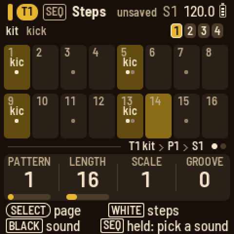
2. **A bass line.** Turn **ALGORITHM** to T2, the bass. Hold **SEQ** and play a low note. While you hold **SEQ**,
   the keys play like a keyboard, and LOOM-8 remembers the note you played. Let go and press white keys 1, 4, 7
   and 11 to put it on those steps. Hold **SEQ** again, play another note, let go and press white key 14. Or tap
   **REC** and play the notes one after another, and each one lands on the next step. Press **EDIT** and turn
   **KNOB 1** while it plays to hear the shape change.

   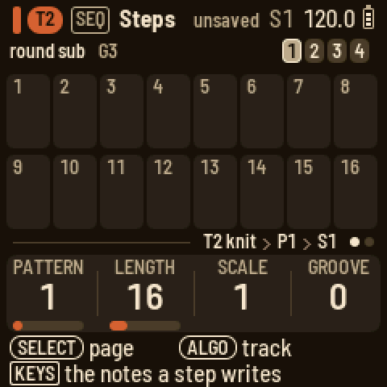 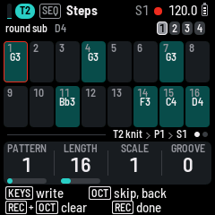
3. **Tricks.** Still on T2, hold white key 7 and press **ARP**. Turn **KNOB 1** to multiply and **KNOB 2** to 3,
   and step 7 plays three hits. Let go. Now hold white key 14, press **ARP**, turn **KNOB 1** to jump and **KNOB 2**
   to "either", and the pattern starts to wander. Last, hold white key 1, press **ARP** and turn **KNOB 1** to
   skip trig, so step 1 only plays every other time round.

   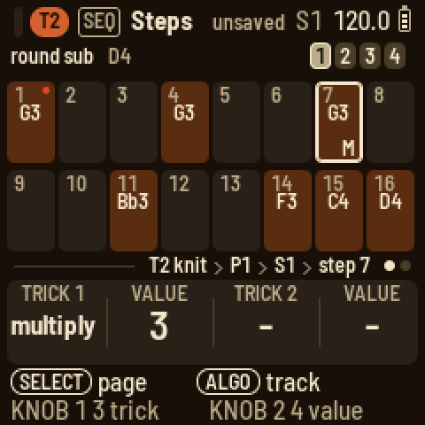
4. **A chord track.** Turn **ALGORITHM** to T3. Press **EDIT** and turn **PRESETS** until you find a pad you
   like. Press **SEQ**, then hold **SEQ** and three keys together. Let go and press white key 1 to put the chord
   there. To make it last half the bar, hold white key 1 and press white key 8; a line under the cells shows how
   far it reaches. Now hold **SEQ** and three keys a little higher, let go and press white key 9. Each cell shows
   the name of its chord.

   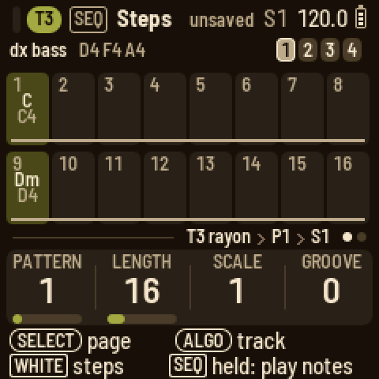
5. **The conductor.** Turn **ALGORITHM** to COND and press **EDIT**. This is the conductor. It sets the key for
   every melodic track, and it starts in C major. While the pattern plays, play an F, then a G, then a C, and the
   whole band follows you, in key.

   To write a progression, press **SEQ**, turn **SELECT** to the Bar page and press black key 4, so each step
   lasts a beat. Go back to Steps. Hold **SEQ** and play a chord, then let go and press a step. Do the same for
   each chord; four steps make one bar. Or let T3's chords lead instead: press **EDIT**, turn **SELECT** to
   Follow and press black key 3.

   You can also have a track play the notes of the chord. On that track, press **SEL** and set FOLLOWS CONDUCTOR
   to **harmony**, and each note moves to the nearest note in the chord. With **ch. deg**, each note's place in
   the scale picks a note of the chord instead.

   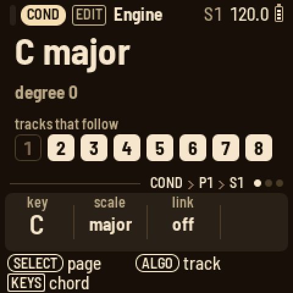 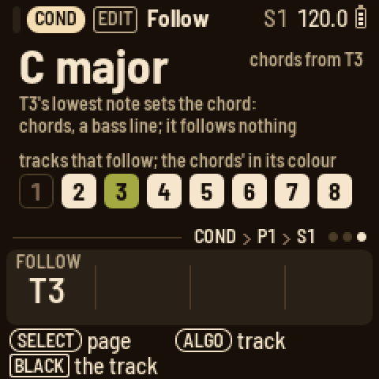
6. **Throws.** Press **FX** and turn **SELECT** to the last page, Throws. Hold a key in the lower octave to throw
   an effect on the drums: F3 mutes them, G3 stutters them, A3 repeats, B3 echoes, C4 builds, D4 plays four on
   the floor and E4 jumbles them. The upper octave does the same to the melodic tracks. Let go and the pattern
   comes back.

   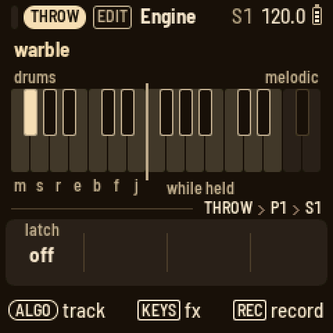
7. **A scene.** Press **HOME**. White key 1 is the scene you're playing; press white key 2 to copy it into a new
   scene. Now change something. Mute the drums with black key 1, or go to T2's Steps and turn **KNOB 1** to P2 for
   a new pattern. Press white keys 1 and 2 to switch between your scenes. While it plays, the new scene waits for
   the next bar; press its key again to switch right away.

   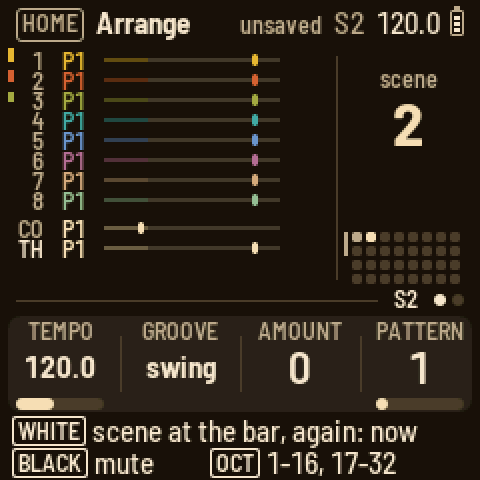
8. **Save.** Press **SAVE**.

Next, hold a step to see its velocity, length, chance and pitch. Hold a step and press
**EDIT** to lock a knob on it. Press **ARP** on T2 and turn **KNOB 1** to arp. Press **GLO**, turn **SELECT** to
Master out and turn **KNOB 4** to make the mix pump while it plays. To find out what a button does, hold it for a
second.

## Cheat sheet

### The words

- **Track** (T1 to T8): one sound and its patterns. After T8 come the aux tracks: COND (the conductor), THROW (the
  throws), FX I and FX II.
- **Pattern** (P1 to P8): a track's steps, up to 64 of them in four bars. Each track has eight patterns.
- **Step**: one cell of a pattern. It holds up to four notes (on a drum track, any of the eleven sounds), two
  tricks, a chance and parameter locks.
- **Trick**: something a step does as it plays, such as pulse, hold, multiply, flam or jump. There are fifteen,
  and a step can have two: hold it and press ARP.
- **Lock**: a knob value that a step sets as it plays.
- **Scene** (S1 to S32): which pattern each track plays, plus the mutes (a kit's individual sounds too) and the
  conductor's key.
- **Song**: a chain of scenes, each played for a number of bars.
- **Engine**: the way a track makes its sound. There are seven synths (knit, rayon, jacquard, bellows, cane, voile
  and acid), two sample engines (sample and slice) and the kit, a drum synth.
- **Preset**: a sound to load. 93 come with LOOM-8, from seven to eighteen for each engine, and 16 are your own.
- **Player**: what the keys do on a track: arp, strum, hold or random.
- **Conductor**: an aux track that sets the key, scale and chords for the other tracks. It plays its own chords,
  or takes them from a track's notes.
- **Throw**: a momentary effect on the drums or the melodic tracks. Hold a key on FX's Throws page to play one.
- **Weave**: crossing one pattern with another as they play. They take turns by bars or steps, or one plays its
  rhythm with the other's notes. Set it up on the track's ARP pages, and play it on the WEAVE track.
- **Groove**: a feel for timing and velocity. Pick the type for the project, and set how much each track gets.
- **Pump**: everything but the drums ducks on each kick and swells back. Set it on Master out. A track's pump LFO
  does the same to just that track.

### How do I…

Count the white keys 1 to 16 from the left, and the black keys 1 to 11. "Hold **HOME** and press…" means keep
**HOME** down while you press the next thing.

| How do I… | Do this |
| --- | --- |
| pick a track | Turn **ALGORITHM** on any page. |
| write a beat | Press **SEQ**. On a drum track, black key 1 is the kick: press it, then white keys 1, 5, 9 and 13. Black key 2 is the snare. <!-- hint: press SEQ; black 1; white 1,5,9,13 --> |
| write a note | On Steps, hold **SEQ** and play the note. Let go and press a white key: the note goes on that step. <!-- hint: hold SEQ; white 3 --> |
| write a chord | On Steps, hold **SEQ** and hold the notes together. Let go and press a step. <!-- hint: hold SEQ; white 3,5,7 --> |
| pick a drum sound | On a drum track's Steps page or its **EDIT** pages, press its black key, or hold **SEQ** and press any key. <!-- hint: press SEQ; black 1 --> |
| see a step | On Steps, hold its white key. The knobs show its velocity, length, chance and pitch. <!-- hint: white 5 --> |
| make a note longer | Hold its step and press a later white key. A bar under the cells shows how far a note reaches. <!-- hint: white 1,5 --> |
| nudge a step | Hold its step and press **OCT−** or **OCT+**. <!-- hint: press OCT−, OCT+; white 5 --> |
| copy and paste | On Steps, press **SEL** and pick COPY PATTERN or COPY BAR. Where you want it, pick PASTE PATTERN or PASTE BAR (PASTE LOCKS ONLY pastes just the locks). For one step, hold it, press **SEL** and pick COPY STEP; then hold another step, press **SEL** and pick PASTE STEP. |
| make a pattern twice as long | On Steps, press **SEL** and pick DOUBLE PATTERN. The pattern plays itself twice, so you can vary the second half. |
| change a step's note | Hold its step and turn **KNOB 4**. This works on a drum step too: its hits play higher or lower. <!-- hint: turn KNOB 4; white 5 --> |
| put a second sound on a drum step | Hold the step and press the sound's black key. <!-- hint: black 2; white 5 --> |
| take one note off a step | Hold the step, press **SEL**, pick the note and press **SEL**. <!-- hint: press SEL; white 5 --> |
| change a step's chord | Hold the step and tap **SEQ**, then play the chord (you can let go of the step). Tap **SEQ** again when you're done. <!-- hint: press SEQ; white 5 --> |
| add a trick | Hold the step and press **ARP**. **KNOB 1** picks the first trick (pulse, hold, multiply, velocity, ramp up, ramp down, random, glide, bend, tonality, jump, skip lock, skip trick, skip trigger, flam) and **KNOB 2** sets its value. **KNOB 3** and **KNOB 4** do the same for the second trick. Turn a trick back to "-" to remove it. <!-- hint: press ARP; turn KNOB 1, KNOB 2; white 5 --> |
| set a skip's pattern | Keep turning its value past "random". The same cycles come round again, first as "not on the last pass", then as "only the first". |
| give a step a chance | Hold the step and turn **KNOB 3**. Past 99 %, the A:B cycles come next. <!-- hint: turn KNOB 3; white 5 --> |
| give one drum sound a chance or a trick | On a drum track, each sound on a step has its own chance and tricks. Hold the step, turn **PRESETS** to the sound (the header names it), then turn **KNOB 3** or press **ARP**. The step's other sounds keep theirs. <!-- hint: turn PRESETS, KNOB 3; white 5 --> |
| lock a knob on a step | Hold the step, press **EDIT**, **ENV**, **FX** or **LFO**, and turn a knob. To clear a lock, hold **SEL** and turn that knob. The step's **SEL** list also has CLEAR LOCKS. <!-- hint: press EDIT; turn KNOB 1; white 5 --> |
| clear a knob's automation | Hold **SEL** and turn the knob. This clears its motion and locks in the pattern (or, with steps held, only theirs). <!-- hint: hold SEL; turn KNOB 1 --> |
| see the next bar | Press **OCT+** on Steps. (While **SEQ** is held, **PRESETS** sets the track's sound, so you can try notes before you write them; the keys play at the octave **OCT** set on the sound pages.) <!-- hint: press OCT+ --> |
| move a whole pattern an octave | On Steps, hold **SEQ** and press **OCT−** or **OCT+**. Hold **HOME** and press **REC** to undo it. <!-- hint: hold SEQ; press OCT+ --> |
| transpose a pattern, or rotate it | On Steps, press **SEL** and pick SHIFT NOTES (semitones) or ROTATE (steps). Turn **ALGORITHM** for how far, such as +4 or L2, and press **SEL**. |
| play one bar of a long pattern, or jump about in it | Press **SEQ** and turn **SELECT** to the Bar page. Hold **SEQ** and press black key 1 to 4 to jump to that bar. Hold two of them to loop those bars, or tap one twice to loop that bar. <!-- hint: hold SEQ; black 1,2,3,4 --> |
| set the track scale | On Steps, turn **KNOB 3**. Or, on the Bar page of a synth track, press a black key: 1, 2, 3, 4, 5, 6, 8, 16 sixteenths a step, or black key 9 for half a sixteenth. <!-- hint: turn KNOB 3 --> |
| change the pattern | On Steps, turn **KNOB 1**. While it plays, the new pattern comes in at the next bar line. Until then, the knob reads NEXT 1>2 and the tag line says "next P2". |
| weave two patterns | On the track, press **ARP** and go to its last page, Weave. Press a black key for the track to weave in and a white key for its pattern; **KNOB 3** sets the rule. From then on, it plays woven. To bring it in by hand instead, set **KNOB 4** to "on WEAVE", then pick the WEAVE track with **ALGORITHM** and hold that track's white key. <!-- hint: press ARP; black 2; white 1; turn KNOB 3 --> |
| change the sound | Press **EDIT** and turn **PRESETS** to step through the engine's own sounds. A name like "BASS 3/11" tells you what the sound is for and where you are in the list. **SEL** changes the engine. |
| edit a drum sound | On a drum track, press **EDIT** and press the sound's black key. The knobs are the model's own four. Turn **SELECT** for the model, random, pan and volume. Its **SEL** list has the play mode. <!-- hint: press EDIT; black 1 --> |
| shape one drum | On a drum track, press **ENV** and press the drum's black key to get its own attack, hold, decay and lag. Turn **SELECT** for its filter: **PRESETS** picks low-pass, high-pass or band-pass, and the knobs set cutoff, resonance, envelope and drive. <!-- hint: press ENV; black 1 --> |
| play a sample | On a drum track, set a key's model to sample. On a synth track, press **SEL** and set ENGINE to sample. The sample knob picks the sample. |
| load my own samples | Open <https://charlesvestal.github.io/fm1-loom/samples/> in Chrome or Edge with the FM-1 connected by USB. Add, replace, rename, reorder or remove samples, then press Send. They come after the factory samples, as user 1, user 2 ... |
| get the breaks back (0.7 on) | On the samples page, press Add the breaks, then Send. |
| chop a break | On a synth track, press **SEL** and set ENGINE to slice. Each key plays one slice of the break, with F3 playing the first. Write them on the steps in any order. To load your own break, run `tools/loom_samples.py load "amen.wav@2"` (here, a loop of 2 bars). |
| change the filter | Press **ENV** and turn **SELECT** to Filter. **PRESETS** changes the filter type. |
| give a sound some character | Press **FX** for the Character page. **PRESETS** changes the type (drive, fold, crush, ring, tilt, tape, sampler), and the knobs set its amount, tone and mix. |
| use the effects | Press **FX** and turn **SELECT** to Sends, the track's sends. Keep turning to reach FX I and FX II, where **PRESETS** picks the effect. |
| play | Press **PLAY**: every track starts from step 1. On Steps or Bar, hold **SEQ** and press **PLAY** to start from the bar on screen. |
| record live | Hold **REC** and press **PLAY**. Recording starts from step 1 straight away (after the count-in, if you set one). With COUNT on "on note", nothing moves until you play: your first note lands on step 1. |
| record while playing | While it plays, hold **REC** and play: it records for as long as you hold **REC**. Hold **REC** and press **PLAY** to keep recording on. |
| record a knob's motion | While it plays, on a sound page, hold **REC** and turn the knob. The motion is recorded for as long as you hold **REC**. |
| set the click, count-in, quantize | While stopped, hold **REC** and turn the knobs: CLICK, COUNT, QUANT and MODE (overdub or replace). |
| record step by step | While stopped, on Steps, tap **REC**. The red cursor starts after the last note. Each key (or chord) you play is written there, and the cursor moves on. **OCT+** leaves a rest and **OCT−** goes back. Tap **REC** again to finish. |
| undo | Hold **HOME** and press **REC**. Hold **HOME** and press **PLAY** to redo. |
| set the tempo | Press **HOME** and turn **KNOB 1**. Hold **HOME** while you turn it for tenths. On any page, you can also hold **HOME** and turn **SELECT**. |
| use a throw | Press **FX** and turn **SELECT** to Throws. Hold a key: the lower octave works on the drums and the upper octave on the melodic tracks. Hold **REC** while it plays to record throws into the THROW track. <!-- hint: press FX; turn SELECT; white 1-16 --> |
| make a new scene | Press **HOME** and press an empty white key. It becomes a copy of the scene that is playing. **OCT+** puts scenes 17 to 32 on the white keys. <!-- hint: press HOME; white 2 --> |
| switch scenes while playing | On Arrange, press the scene's white key, and it starts at the next bar. Press it again to switch at once. To wait for the end of T1's pattern instead, set SCENES SWITCH in the **SEL** list to "pattern end". <!-- hint: press HOME; white 2 --> |
| mute a track | On Arrange or Mix, press its black key. On Mix, hold it to solo the track for as long as you hold it. <!-- hint: black 1 --> |
| mute one drum sound in a scene | On Arrange, hold the kit track's black key and press white keys 1 to 11. <!-- hint: black 1; white 1-11 --> |
| make the whole mix pump with the kick | Press **GLO**, turn **SELECT** to Master out and turn **KNOB 4** (pump). **SEL** picks what drives it and how fast it swells back. <!-- hint: press GLO; turn SELECT, KNOB 4 --> |
| solo a track | On Mix, hold its black key (hold several to solo them together). Let go and the mutes come back. Tap it twice and the solo stays when you let go (also on other pages); tap any track's black key on Mix to end it. <!-- hint: black 1 --> |
| sweep a few tracks together | Press **GLO** and turn **SELECT** to LFO, the shared LFO. The black keys pick the tracks, and **KNOB 4** picks what it moves. <!-- hint: press GLO; turn SELECT, KNOB 4; black 1,2,3 --> |
| play a progression | Turn **ALGORITHM** to COND and press **EDIT**. Play a chord, and every track that follows the conductor moves to it. To write it down, press **SEQ** and press a step to put the chord there. On the Bar page, set the scale to 4 so each step lasts a beat. <!-- hint: turn ALGORITHM; press EDIT; white 1,3,5 --> |
| let a track lead the chords | On COND, press **EDIT** and turn **SELECT** to Follow. Press the track's black key, and its notes set the chord for the others. A chord part or a bass line works well. Press the same key again to turn it off. <!-- hint: press EDIT; turn SELECT; black 3 --> |
| harmonize a track to the chords | Give the conductor some chords: play them on COND's keys, or let a track lead from its Follow page. Then go to the track you want to harmonize, press **SEL** and set FOLLOWS CONDUCTOR to harmony. Each of its notes snaps to the nearest note of the conductor's chord. With **ch. deg**, each note's place in the scale picks a chord note instead. <!-- hint: press EDIT; press SEL; turn ALGORITHM --> |
| get new sounds for the band | Press **HOME**, press **SEL** and pick RANDOMIZE PRESETS: T2 to T8 each get a random preset for their part. Press **SEL** for yes. |
| save | LOOM-8 saves by itself when it is stopped and quiet. **SAVE** saves at once. Hold **SAVE** and press white key 1 to 3 to save to that slot. <!-- hint: press SAVE --> |
| keep a sound | On a sound page, hold **SAVE** and press a white key. The sound becomes that user preset. <!-- hint: hold SAVE; white 1 --> |
| load a project | Press **HOME** and press **SEL**. On LOAD PROJECT, turn **ALGORITHM** to pick the slot, then press **SEL**. NEW PROJECT starts an empty project in a free slot, with its sounds picked at random (new ones, as RANDOMIZE PRESETS gives). <!-- hint: press HOME, SEL; turn ALGORITHM --> |
| listen on Bluetooth headphones | Put them in pairing mode. Press **GLO**, turn **SELECT** to Setup and press **SEL**. Turn **SELECT** to AUDIO DEVICE and press **SEL**. Turn **SELECT** to the headphones and press **SEL**. |

### The buttons

| Control | What it does |
| --- | --- |
| **PLAY** | Starts and stops. Every track starts from step 1. To start from the bar on screen instead, hold **SEQ** on Steps or Bar and press **PLAY**. If you change a track's scale or length, it stays in time with the others. On the Song page, it plays the song from the selected slot. Hold **REC** and press **PLAY** to record live. |
| **REC** | While it plays, hold **REC** to record for as long as you hold it. On a sound page, the knobs you turn are recorded too. While stopped, tap it to start step recording. Hold it while stopped (or on Steps) to set up recording with the knobs: click, count-in, quantize and mode. |
| **SEL** | Opens a list of this page's settings and actions. Hold a step and press it to see the step's notes. When LOOM-8 asks a question, **SEL** means yes. |
| **HOME** | Opens Arrange. On Arrange, it opens the Song page. Hold it as a shift key for buttons and knobs: undo and redo, fine tempo, and the scenes on **PRESETS**. When LOOM-8 asks a question, **HOME** means no. |
| **SEQ** | Opens Steps; page 2 is Bar. Hold it on Steps and the keys play the track and set what a step writes (**PRESETS** sets the track's sound, and **OCT** moves the whole pattern an octave). Hold it on Bar and black keys 1 to 4 jump to a bar or loop bars. Hold it on Steps or Bar and press **PLAY** to start from the bar on screen. |
| **EDIT** | Opens Engine. Page 2 is Play and page 3 is Play 2 (the octave). The knit, rayon and acid engines have a page 4, Sub, with the engine's second set of knobs. A sample track in a loop mode has its Loop page second. On a drum track, page 2 holds the key's model, random, pan and volume, and page 3 its sends. On the conductor, the pages are its key, the routing and Follow. |
| **ENV** | Opens Envelope (on a drum track: lag, attack, random, length), then Filter, then the filter's envelope. |
| **FX** | Opens Character, the track's own effect. Next come Sends, the track's sends to FX I and FX II, and then FX I and FX II, the two effects. |
| **LFO** | Opens LFO. Page 2 has the type's fourth and fifth knobs. |
| **ARP** | Opens Players. With the arp, page 2 has its second set of knobs and page 3 is hold. |
| **GLO** | Opens Mix. Turn **SELECT** for Master EQ, Master color, Master out, LFO (the shared LFO) and Setup. |
| **SAVE** | Saves. Hold it and press a white key to save to a slot, or to keep a sound. |
| **OCT−** / **OCT+** | Move the keys an octave. On Steps, they show the bar before or after (with **SEQ** held, they move the pattern an octave), and with a step held, they nudge it. In step record, they move the cursor. On Arrange and Song, they put scenes 1 to 16 or 17 to 32 on the white keys. |
| **SELECT** | Turns to a button's next page. In a list, it moves up and down. |
| **ALGORITHM** | Picks the track. In a list, it changes the row's value. |
| **PRESETS** | Steps to the next item of whatever the page shows: a preset, a drum key, an effect, a pattern, a drum sound, a scene. |
| **KNOB 1–4** | Set the four values at the bottom of the screen. |

Hold any button for a second, and a card explains it. The two lines at the bottom of the screen always say
what each control does on the page you're on.

## Getting around

### The screen

From top to bottom, the screen has five parts.

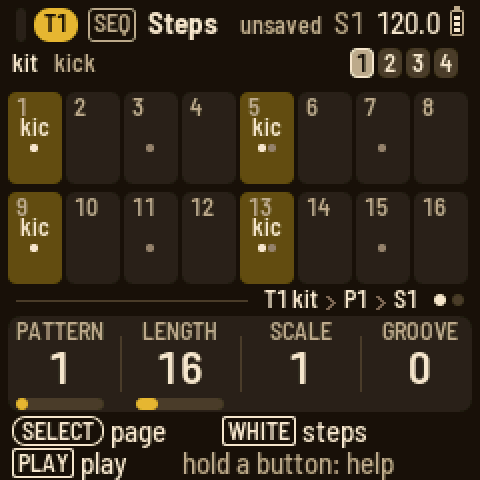

- **The header** shows the page's button and name, then the tempo with the battery beside it. The battery turns
  red when it is low, and it shows a bolt while a computer powers the FM-1. A red dot appears while you record,
  and "unsaved" appears when the project has changes you haven't saved. On a track's pages, the track's pill comes
  first. A small meter before it shows what the track is playing right now, so you can tell its notes from the
  other tracks'. Messages and questions cover the header for a moment.
- **The middle** is the page itself.
- **The tag line** tells you where you are. It names the track and its engine, the pattern and the scene, such as
  "T3 knit › P2 › S1". The dots on the right show which of the button's pages you're on.
- **The knob strip** shows the names and values of the four knobs, each with a bar in the track's color. The
  knob you just turned shows in the text color.
- **The two bottom lines** tell you what the encoders and the keys do here.

The screen comes in three themes. Pick one with Setup's THEME knob. **tape deck** is warm brown-black with cream
text, **blueprint** is deep blue with white lines, and **b/w** is black with white text and red. A new FM-1 starts
in b/w.

Each instrument track has its own color in every theme. In b/w, T1 is pink, T2 teal, T3 yellow, T4 blue, T5
orange, T6 green, T7 violet and T8 tan. In tape deck, T1 is mustard, T2 rust, T3 olive, T4 teal, T5 blue, T6 plum,
T7 tan and T8 sage. Steps with notes show in the track's color, dimmed. Whatever is sounding right now shows in the
track's color at full brightness, such as the step playing, the scene playing or a meter. On Arrange and Mix,
every track keeps its color, so you can tell them apart at a glance. Cream (or white) outlines show what you are
touching: the held step, the cursor, the knob you turned. Red is used only for recording and for locks.

### Messages

Short messages cover the header for a moment. An **i** is news, and a **✓** means something is done. An arrow
means an undo or a redo. A **?** on red is a question, waiting for you to press **SEL** or **HOME**. A **!** means
LOOM-8 couldn't do something, and the message tells you why.

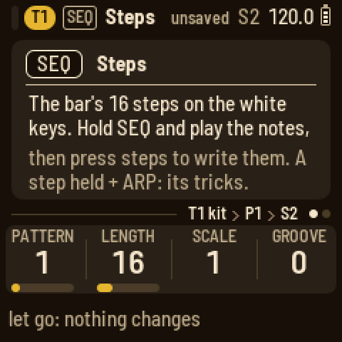

### The tracks

Turn **ALGORITHM** to pick a track. After T1 to T8 come COND (the conductor), THROW (the throws) and WEAVE. On Mix,
**ALGORITHM** steps through the mixer strips instead: T1 to T8, then the effect returns FX I and FX II. On the
Engine, Play, Envelope, Filter, LFO and Players pages, the keys play the track you picked. On a drum track, the
black keys are the eleven drum keys, and the white keys play them too. On FX I and FX II, the keys play the
instrument track you picked last, so you can hear the effect.

### The lights

**PLAY** is green while it plays and red while you record. **REC** lights while you record or while recording is
armed. **SAVE** lights when there is something to save, and the current page's button is lit. On Steps, the steps
with notes glow and the step playing is bright. On Arrange, the scenes in use glow and the one playing is bright.
On Arrange and Mix, a track's black key is lit while the track plays. It is bright for the selected track and dark
while the track is muted. Turn Setup's LIGHTS on to make the other buttons glow too.

## Steps

Press **SEQ**. The main band shows one bar of the pattern as 16 cells, and the 16 white keys are those cells. The
top line shows what a key press writes. On a drum track, that's the sound shown. On a synth track, it's the
remembered notes, which are the last keys you held together on a play page. On the THROW track, it's the last
effect you played. The four squares on the right are the bars. Press **OCT−** or **OCT+** to see the previous or
next bar.

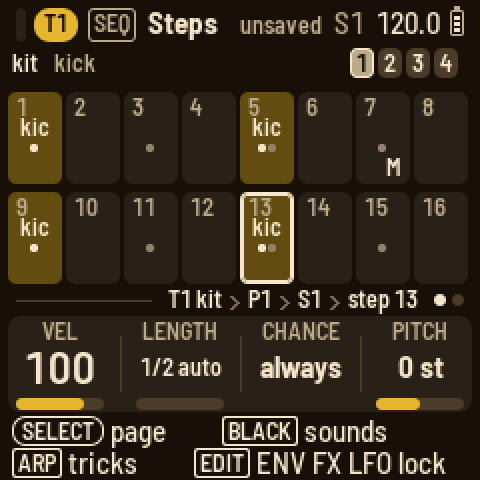

- **Hold SEQ and play keys** to choose what a step writes. The keys play the track, and the keys you hold
  together become the remembered notes, so you can write a chord. On a drum track, the key you play becomes the
  sound shown. While **SEQ** is down, **OCT−** and **OCT+** shift the keys' octave. On a synth track, **PRESETS**
  steps through the track's sounds, so you can try the notes before you write them. Letting go of **SEQ** changes
  nothing else.
- **Tap a white key** to put the remembered notes on that step, or to clear the step.
- **Hold a white key** to see the step. If you hold it longer than a tap, the step stays as it is. **KNOB 1** sets
  its velocity, and **KNOB 2** sets its length in steps. **KNOB 3** sets its chance. It goes from always, through
  a percentage, to the A:B cycles, which play on the A-th of every B times round. On a drum track, each sound on a
  step has its own velocity, chance and tricks, and the knobs show those of the sound named in the header. Pick
  the sound with its black key before you hold the step, or turn **PRESETS** while you hold it to go through the
  step's sounds. **KNOB 4** sets the step's pitch. On a synth track, its notes move by semitones, and a chord moves
  all together. On a drum track, the step's hits play up to 24 semitones from their key's pitch. This is the
  step's own note, separate from the key's pitch knob and its locks. **OCT−** and **OCT+** nudge the step earlier
  or later.
- **Hold a step and tap a later white key** to stretch its note to that step. The length is set when you let go
  of that key. Turn **KNOB 2** to take it further, up to the pattern's whole length. It moves in quarter steps up
  to 16 steps, then in whole steps. A note held past the end of the pattern wraps around to the start. The bar
  under the cells shows how far the note reaches. An arrow marks where it carries on into another bar or comes in
  from one.
- **Hold several steps** to edit them all at once. Hold one, then press the others. Turn a knob, press a black
  key, or open a lock page or the tricks, and every held step changes. Each knob moves each step from its own
  value, and the knob strip shows the first step's. If you hold two steps and let go without editing anything,
  you stretch the note as above, so to edit a pair, turn a knob before you let go. A step earlier than the first,
  or a third step, is always added to the steps held.
- **Hold a step and press a black key** on a drum track to put that sound on the step, or take it off. With
  several steps held, it goes on all of them or off all of them.
- **Hold a step and press SEL** for a list of its notes. Pick one and press **SEL** to remove it. The list also
  has COPY STEP. Then hold another step (or several), and its list has PASTE STEP and PASTE LOCKS ONLY. PASTE STEP
  pastes the notes and locks. PASTE LOCKS ONLY pastes just the locks onto the notes already there.
- **Hold a step and press ARP** for its tricks (below).
- **Hold a step and tap SEQ** to play its chord in on a melodic track. The screen shows the keys with the step's
  notes lit. The keys you play together become the step's notes and replace what it held. Its length, tricks and
  locks stay. You can let go of the step, and it stays in this mode until you tap **SEQ** again. Meanwhile,
  **OCT−** and **OCT+** move the keys' octave.

### Tricks

Hold a step and press **ARP**. The knob strip shows the step's two tricks. **KNOB 1** picks the first trick and
**KNOB 2** sets its value, and **KNOB 3** and **KNOB 4** do the same for the second. Turn a trick back to "-" to
remove it. If you hold several steps, each turn changes them all the same way. Let go of the steps when you are
done.

On a drum track, each sound on the step has its own tricks, as it has its own chance. The knobs show the tricks
of the sound on screen. If you flam the snare, the kick on the same step still hits once, and you can multiply the hat in
fours while the snare flams. On an empty drum step, the tricks belong to the step itself (a jump works there), and
a sound you add later plays them. When you take a sound off a step, it loses its own velocity, chance and tricks
there. If you put it back or record it again, it starts plain.

| # | Trick | Values: 1 to 9, then random |
| --- | --- | --- |
| 1 | pulse: plays the step again on the next steps | 1 to 9 times |
| 2 | hold: keeps the note going over the next steps | 1 to 9 steps |
| 3 | multiply: retriggers the step | 1 to 9 hits |
| 4 | velocity | 4, 8, 16, 32, 64, 100, 112, 127, 0 |
| 5 | ramp up: the note climbs the scale each time round | 2 to 6 steps over one octave, then over three |
| 6 | ramp down | the same |
| 7 | random: a different note of the scale each time round | the same |
| 8 | glide: slides into the note | 10 % to 80 %, then off |
| 9 | bend | down-up, up-down, bumps, springs, fades, random 1 and 2 |
| 10 | tonality: how the step follows the conductor | ignore, transpose only, octave up, fifth up, third up, chromatic up, chromatic down, quantize 33 %, 66 %, 100 % |
| 11 | jump: moves the playhead | to step 1, 5, 9, 13, forward, back, either, stay, align |
| 12 | skip lock: the locks play every Nth time round | a cycle of 1 to 9 |
| 13 | skip trick: the other trick plays every Nth time round | a cycle of 1 to 9 |
| 14 | skip trigger: the step plays every Nth time round | a cycle of 1 to 9 |
| 15 | flam: a soft grace hit, then the step's own a moment later | 1 to 9 32nds of a step apart |

A step whose tonality is **ignore** follows nothing. Its notes stay as they are, whatever the conductor's chord,
and harmony leaves them alone too. For the three skips, the value carries on past random. The same cycles come
round again, first playing every time but the last, then playing only the first time. A new trick starts at its
default: pulse and hold 4, multiply 2, velocity 64, the ramps and random 4, glide 40 %, bend down-up, tonality
fifth up, jump forward, the skips a cycle of 2, and flam 4 32nds.

Pulse and hold keep time. The playhead keeps moving, the steps they cover give way to them, and the track carries
on where it would have been. On a drum track, only the sound with the trick gives way. The other sounds play
their steps as written, so a pulsed kick does not stop the hats.

On a drum track, a sound's chance and skip trigger decide whether that sound plays. The other sounds on the step
play by their own. A few tricks move the whole track, so on a drum track they happen when their sound plays. A
jump moves the playhead, a bend bends the whole kit, and a skip lock skips the step's locks. Ramp up, ramp down,
random, glide and tonality change notes, so they do nothing on a drum track. In a project saved before each sound
had its own, a drum step's chance and tricks stay shared by all its sounds until you give one of them its own.

A step's chance and its skip trigger decide whether the step happens at all. When it doesn't, its tricks don't
happen either, and that includes a jump. A jump with a 25 % chance jumps about one time in four. A jump back, or
stay, starts the pattern round again, so the A:B cycles, the skips and the ramps keep counting inside the loop it
makes.

A cell shows its note, two notes one above the other, or the first note and how many more there are ("+2"). A
chord shows its name with its bass note underneath. If the name is too long for the cell, it is shortened: CM7
for maj7, C+ for aug, Co for dim, and Cs2 and Cs4 for the sus chords. If it is still too long (C#M7, Ebm7), the root
goes above its quality. An effect on the throw track shows three letters (PAN) above its group (drm or mel). On a
drum track, every sound on the step has a tick, and the tick of the sound shown is bright, so you can see the
whole beat while you edit one sound. A bar along the bottom of the cells shows how far a long note reaches, and an
arrow at its end means the note carries on. The tricks' letters sit at the bottom right. A percent sign marks a
chance, and a red dot marks locks. On a drum step, the percent sign means one of its sounds has a chance. The
letters show the tricks of the sound on screen, or of another sound when that one has none.

### Locks

Hold a step and press **EDIT**, **ENV**, **FX** or **LFO**. The knob strip becomes that module's four knobs for
the held step. Turn **SELECT** for the module's other pages. **ENV** has the envelope, the filter and the filter
envelope, and **FX** has the character and the sends. A knob shows "–" when the step has no lock on it, and locked
values show in red. Turn a knob to lock its value on the step, and let go of the step to go back. A lock lasts
until the next step that plays without one, and that step plays the knob's own value again.

To clear locks, hold **SEL** and turn a knob. This clears that knob's locks on the held steps. With no step held,
it clears the knob's motion and locks in the whole pattern. The held step's **SEL** list has CLEAR LOCKS, which
clears all of its locks (a drum step keeps its pitch). While you record, any knob you turn writes locks on the
steps as they play. Use the Bar page's SHAPE knob to turn a track's locks into a line, where each lock holds until
the next one and moves toward it.

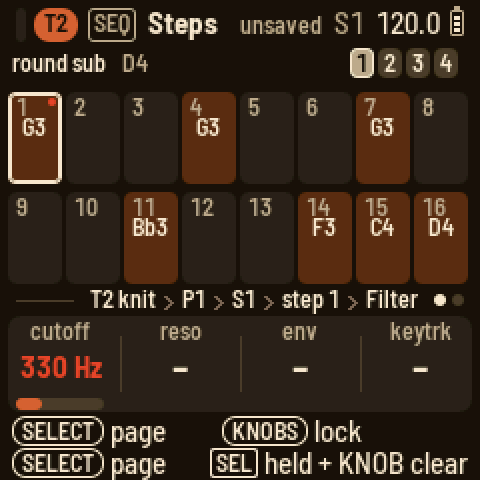

### The Steps knobs and the Bar page

With no step held, **KNOB 1** picks the pattern (P1 to P8) and **KNOB 2** sets the length in steps. **KNOB 3** sets
the track scale, which is how many sixteenths a step takes, from 1/2 to 16. **KNOB 4** sets the track's groove
amount.

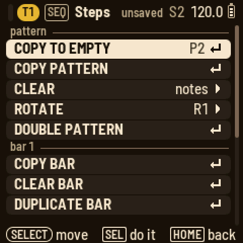

Turn **SELECT** for the Bar page. Its knobs set the quantize for live recording, the note length of new steps (as
a percentage of a step), the groove amount and the shape. The keys write steps just as on Steps. Hold a step for
its knobs, tricks and locks, and on a kit, use the black keys to pick and place its sounds. The box of the bar the
keys write to is outlined, and **OCT-** and **OCT+** move it. On a synth track, the black keys set the track scale.
Black keys 1 to 8 give 1, 2, 3, 4, 5, 6, 8 and 16 sixteenths a step, and black key 9 gives half a sixteenth.

Press **SEL** on either page for the actions. The pattern's actions come first, then the bar's, then the two pages'
knobs. A row with a ▸ is a choice. Turn **ALGORITHM** to pick it, and press **SEL** to do it.

- **COPY TO EMPTY** copies the pattern into the track's first empty pattern, with its locks, motion and loop. The
  row shows which pattern that is, such as P3. The track switches to the copy in the scene playing, and while it
  plays, the copy comes in at the next bar. Use this to make a variation. On **HOME**, press an empty scene key, and
  the new scene plays the same patterns. Then use COPY TO EMPTY on the tracks you want to change. The scene you
  started from keeps the original. Undo puts the scene back on the original.
- **COPY PATTERN** copies the pattern, and **PASTE** (pattern, or locks only) pastes it where you want it. The copy
  is read when you paste, and a kit's steps paste only onto a kit.
- **CLEAR** clears the notes, the locks, or both.
- **ROTATE** moves every step, with its notes and locks, along the pattern. Turn **ALGORITHM** to set how far, from
  L16 (16 steps to the left) to R16, and press **SEL** to do it. **SHIFT NOTES** moves every note up or down, from
  -24 to +24 semitones. It isn't there on a kit or THROW. Both keep the amount you set, and the list reopens on
  the row you used, so to do it again, press **SEL** twice.
- **DOUBLE PATTERN** makes the pattern twice as long, and it plays itself twice, locks included. A 16-step pattern
  becomes 32, so you can vary its second half.
- For the bar shown, there are **COPY BAR**, **PASTE** (the bar, or locks only), **CLEAR BAR**, which clears its
  notes and locks, and **DUPLICATE BAR**, which copies it into the next bar.

Every list opens on the row you used last, until you switch the FM-1 off.

On the Bar page, hold **SEQ** and press black keys 1 to 4, which stand for the pattern's bars. Press one key to
jump to that bar at the next bar line and play on from there. This releases any loop you had. Hold two keys to
loop that range of bars, or tap one key twice to loop that bar. The loop is saved with the pattern, for each track
and each pattern. Only the loop plays, so a bar you are editing comes round straight away. A bar under the boxes
marks the loop, and a small bracket marks a jump waiting for its bar line. Arrange draws the loop bright inside the
pattern's line, with the playhead repeating inside it. While stopped, the keys set the loop immediately. On the
other pages, holding SEQ still picks the notes a step writes.

### Weave

A weave crosses what a track plays with another pattern, live, while the song plays. Nothing is written. Set up a
weave on a track, and from then on that track plays woven. The other track plays as it was. Or keep the weave for
the WEAVE track and bring it in by hand.

**Set it up.** On a track, press **ARP** and turn **SELECT** to the last page, Weave. Press a black key to choose
the track to weave in. Keys 1 to 8 are the tracks, 9 is COND and 10 is THROW, and pressing the same key again sets
none. Then press a white key, 1 to 8, to choose its pattern. **KNOB 1** (WITH: the track), **KNOB 2** (PATTERN: its
pattern) and **KNOB 3** (RULE) set the same things. The page spells it out in words ("T2 weaves with T1", "by
rhythm: T2 P1's rhythm, T1 P1's pitch"). It draws a bar three ways: the track's own steps, the other pattern's
steps, and what plays, with each step in the color of the pattern it comes from. If a pattern is longer than a
bar, use **OCT+** and **OCT−** to go through its bars ("bar 2 of 4"). The last line tells you whether the weave
plays (on), or which WEAVE track key brings it in. The rules:

| Rule | What the track plays |
| --- | --- |
| bars | its own bars and the other pattern's in turn: its bar, the other's bar ... |
| steps | its own steps and the other's in turn |
| rhythm | its own rhythm, playing the other pattern's pitches in order, round and round |
| pitch | the other pattern's rhythm, playing this track's pitches |

Each pattern loops at its own length, and the turns count from the start, so a one-bar pattern woven by bars
plays its own bar, then the other's. A track can weave with any track. On a melodic track, a drum track's sounds
become notes on a ladder from C3: the kick is C3, the snare Eb3, the hat F3 and so on. A melody's notes become a
kit's sounds. The throw track weaves only with throws. The conductor weaves too, one progression with another.

**When it plays.** **KNOB 4** on the Weave page (PLAYS) sets when the weave plays. With **always**, the
default, it plays as soon as it is set up. With **on WEAVE**, it plays only while the WEAVE track's key for that
track is on, whether it's held, latched, or on its steps.

**Play it.** For a weave set to PLAYS on WEAVE, turn **ALGORITHM** to WEAVE. White keys 1 to 10 are T1 to T8, COND
and THROW. Hold one, and that track weaves for as long as you hold it. The key lights, and so does its box on the
screen. Use **KNOB 1** (latch) to make one tap start a weave and the next tap stop it. Hold **REC** while it
plays, and the weaves you play are written onto the WEAVE track. Each one starts at the step where it began and
lasts as long as it lasted. The song then plays them back.

**The WEAVE track's steps.** On **SEQ**, its steps show the tracks they weave and, underneath, for how long. Tap a
step to put the tracks you last wove on it, and tap it again to clear it. Hold a step and press black keys 1 to 10
to choose its tracks, and press a later white key to set its end. **KNOB 1** picks its pattern, and each scene
keeps its own. **KNOB 2** sets its length, from 16 to 64 sixteenths, or the step's length with a step held.
**SEL** clears the pattern.

**Keep it.** The **SEL** list on the Weave page has KEEP AS PATTERN. It writes the weave into the track's first
empty pattern, so you can edit it like any other. To make variations, weave a pattern with a shifted copy of
itself: copy it, use ROTATE FORWARD, then weave it by steps. To make a riff, weave a drum pattern's rhythm with a
melody's notes.

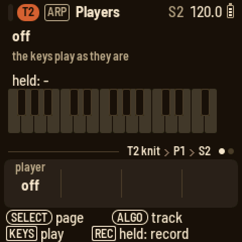 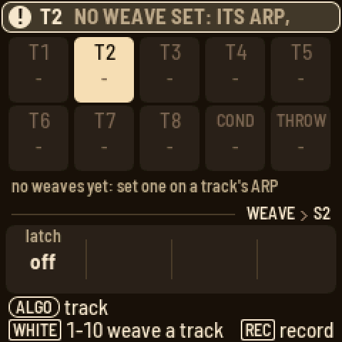

## Recording

- To record live, hold **REC** and press **PLAY**. Every track starts from step 1, and recording starts at once,
  after the count-in if you set one. The keys write steps as you play, quantized by QUANT, and a chord lands
  together on one step. Press **PLAY** to stop. With COUNT on "on note", the header shows "Play a note" and nothing
  moves until you play. That note lands on step 1, and everything runs from there.
- To record while it plays, hold **REC** and play. It records only while you hold **REC**. To keep recording on,
  hold **REC** and press **PLAY**. Press **REC** again to turn it off.
- While you record, any knob you turn on a sound page (Engine, Envelope, Filter, Character, Sends, LFO ...) writes
  its motion onto the steps as locks as they play. To punch it in, hold **REC** while it plays and turn the knob.
  It records while you hold **REC**, and the keys record too.
- To record chords on the conductor, turn **ALGORITHM** to COND and record the same way. Each chord lands on the
  nearest step and replaces the chord that was there. On the Bar page, set the conductor's scale to 4, so that a
  step is a beat.
- To change the record settings, hold **REC** while stopped (or on Steps and Bar) and turn the knobs. CLICK is off,
  while recording, or on. COUNT is a count-in of off, 1 or 2 bars, or "on note", which waits for your first note.
  QUANT sets how far notes are pulled onto the steps. MODE is overdub, which adds to the pattern, or replace,
  which clears the steps the playhead passes as you record over them. Holding **REC** to turn them changes nothing
  else.
- To record step by step, tap **REC** while stopped. On Steps, the keys become a keyboard, and a red cursor marks
  the step they write, starting after the pattern's last note. Play a key, or several keys together, to write the
  step, and the cursor moves on when you let go. **OCT+** leaves a rest and **OCT−** goes back a step. On a drum
  track, the sound is added to the step. Tap **REC** again to stop. Step recording works on the sound pages too,
  with a strip of the bar along the bottom of the screen.
- Throws you hold while you record are written into the THROW track's pattern.

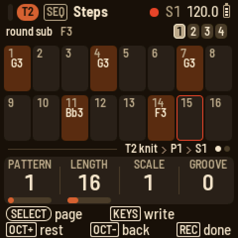

Hold **HOME** and press **REC** to undo the last change, and hold **HOME** and press **PLAY** to redo it. There is
one level of undo, and it covers whatever changed last. That can be a pattern with its locks (including CLEAR
LOCKS), a track's sound (or T2 to T8 after RANDOMIZE PRESETS), the master, or the song, scenes and weaves.

## Sounds

Press **EDIT**. The Engine page shows the track's engine and a picture of it. The picture moves as you turn the
knobs, and while the track plays it follows their motion and locks too. Below it are the four knobs, with values
from 00 to 99. Turn **PRESETS** to step to the engine's next sound. You get its factory presets first, then any
user presets you saved from it. The message tells you what the sound is for and where you are in the list, for
example "PAD 3/11". The roles are bass, lead, keys, pluck, bell, stab, brass, strings, pad, voice, chord, fx, drum
and loop, and a user preset shows "PRESET". Each engine's presets start from its plain sound and run through basses,
leads, keys, plucks and bells to pads. Most are dry. Pads, strings, voices and bells send to the reverb, and some
plucks and leads send to the delay. Press **SEL** for the list:

- PRESET picks a preset by name. ENGINE changes the engine and loads its first sound.
- SCRAMBLE gives you a random sound.
- The list also has SAVE AS PRESET and RESET SOUND.
- Use COPY SOUND, then PASTE SOUND on another track, to put the same sound there, just as loading a preset would.
  The track keeps its own level, pan, player and MIDI OUT. A synth's sound pastes onto a synth track, and a kit onto
  a kit track. Undo takes it back.
- FOLLOWS CONDUCTOR sets whether the track follows the conductor, and how: no, diatonic, transpose, harmony or
  ch. deg. [Following the conductor](#following-the-conductor) shows what each one does to the same notes.

### Following the conductor

The conductor holds a key, a scale and a chord. When a track follows it, the track's notes move to match. Set how
they move with FOLLOWS CONDUCTOR on the track's **SEL** list. In these examples the conductor is in C major and plays
a D minor chord (D F A), and the track plays C E G. The keyboard in each row shows the notes you hear.

| Mode | What it does | C E G sounds as |
| --- | --- | --- |
| no | The track plays its own notes. | C E G <!-- roll: 0,4,7 --> |
| diatonic | Moves each note by the chord's degree (here 1), counted in steps of the scale. The notes stay in the scale. | D F A <!-- roll: 2,5,9 --> |
| transpose | Moves each note by the same number of semitones (here 2), whatever the scale. | D F♯ A <!-- roll: 2,6,9 --> |
| harmony | Moves each note to the nearest note in the chord. If two are equally near, it goes down. | D F F <!-- roll: 2,5,5 --> |
| ch. deg | The note's place in the scale picks a note of the chord. The 1st degree gets the chord's 1st note, the 2nd gets its 2nd, and so on round the chord. You hear it in the octave nearest the note. | D A F <!-- roll: 2,9,5 --> |

You can hear the difference between the modes best with a note that is not in the scale. Take C♯ in C major, with
the same chord:

| Mode | What it does with C♯ | C♯ sounds as |
| --- | --- | --- |
| diatonic | Moves down to C (when it's halfway, it goes down), then up one step of the scale. | D <!-- roll: 2 --> |
| transpose | Simply moves it up two semitones, so it can land outside the scale. | D♯ <!-- roll: 3 --> |
| harmony | Moves it to the nearest note in the chord. | D <!-- roll: 2 --> |
| ch. deg | Moves it to C, the 1st degree, so it gets the chord's 1st note. | D <!-- roll: 2 --> |

Harmony and ch. deg need a chord. Until the conductor has played one, they behave like diatonic. A step whose
tonality is **ignore** follows nothing.

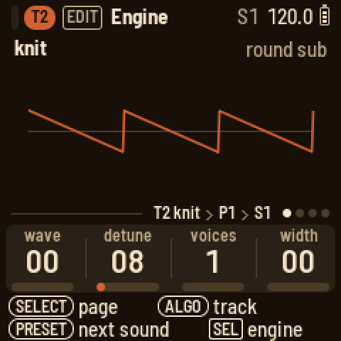 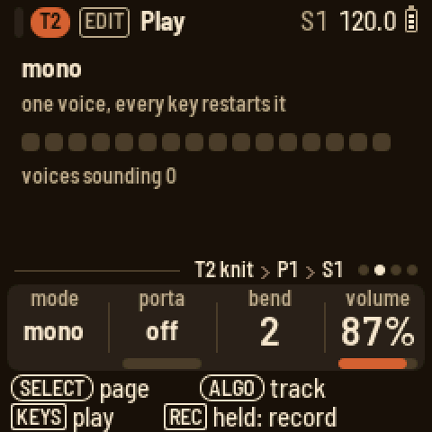

| Engine | Knobs | Presets |
| --- | --- | --- |
| knit | wave, detune, voices, width | 11 |
| rayon | bright, ratio, edge, tine | 10 |
| jacquard | table, scan, bend, ripple | 11 |
| bellows | stops, pedal, rotor, rate | 9 |
| cane | model, timbre, color, damp | 8 |
| voile | model, timbre, color, breath | 7 |
| sample | sample, start, length, mode | 18 |
| slice | sample, slices, pitch, gate | 11 |
| acid | wave, accent, slide, tune | 8 |
| kit | the model knobs of the key shown | |
| midi | eight knobs, each sending a CC | |

Knit and rayon have a second set of knobs. To reach them, press **EDIT** and turn **SELECT** to the Sub page.

### Knit

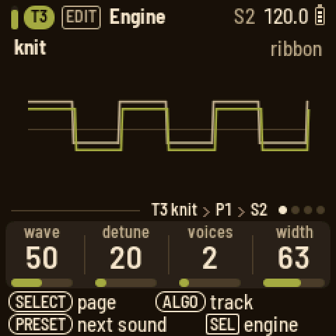

Knit is the everyday subtractive voice. Use it for basses, brass, strings, stabs and pads. **wave** sweeps from a
saw through a square to a narrow pulse. Put an LFO on it for PWM. **voices** stacks one to seven copies of that wave
in unison. **detune** spreads their pitches, finely at first and widely toward the end, and **width** spreads them
across the stereo field. With a single voice, **detune** gives a slow drift of the pitch instead.

On the Sub page, **osc 2** adds one more copy of the wave, up to 24 semitones above or below the note. **level**
sets how loud it is, and 0 turns it off. **sub** adds a sine an octave down, and **noise** adds noise. **detune**
also tunes osc 2 up to 20 cents above its interval, however many voices you have. For the classic sound of two
oscillators beating, set osc 2 to 0 semitones and add a little detune. To tune osc 2 finely, hold **HOME** and turn
**KNOB 1** ("osc 2 fine"). This goes 50 cents either way and tunes osc 2 alone, without the drift or spread that
detune brings.

A wide unison costs more than an ordinary voice, so knit plays at most six voices, or five when its unison is set
to seven. A new note beyond that takes over the oldest one.

### Rayon

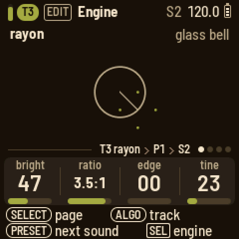

Rayon is two-operator FM in the DX style. Use it for e-pianos, bells, mallets and basses. **bright** sets how much
the modulator moves the carrier, and a soft note gets less. **ratio** sets the modulator's pitch relative to the
note. The left half of the knob gives a detuned 1:1 for slow beating. The right half gives ratios from 0.5:1 to 8:1,
including the inharmonic ones that make bells. **edge** feeds the modulator back into itself, which turns it from a
sine toward a saw. **tine** adds a high partial that you hear as the note is struck and that dies away within a
quarter of a second. The harder you play, the louder it is. This is an e-piano's bark.

On the Sub page, **fall** sets how fast the brightness falls from the start of the note, and 0 holds it. **floor**
sets how much brightness is left, and **keyscale** makes high notes less bright.

### Jacquard and bellows

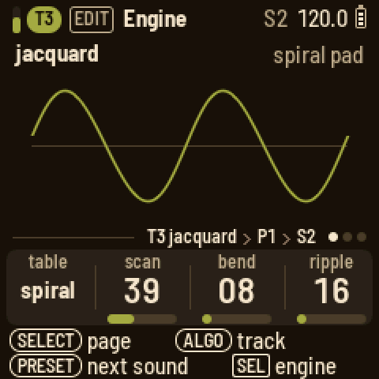 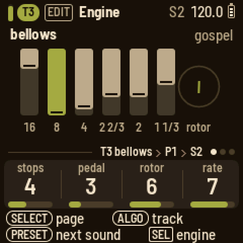

**Jacquard** plays wavetables. **table** picks one of nine: shapes, nasal, grit, vocal, spiral, fold, octaves,
glass and chirp. **scan** moves through the table's frames, and **bend** bends the shape of the wave. **ripple**
wobbles the wave with a second oscillator, slowly at first and then as fast as the note itself.

**Bellows** is the organ, with six drawbars. Its four knobs go from 1 to 8. **stops** picks the registration:
transistor, combo, jazz, gospel, rock, theater, pipe or church. **pedal** adds the low 16' bar, and 1 leaves it out.
**rotor** sets how deeply the rotating speaker swirls, with none at 1, and **rate** sets how fast it turns.

### Cane and voile

These two engines come from Mutable Instruments' Braids, Émilie Gillet's macro oscillator. Each one is a family of
Braids models, and **model** picks one. **timbre** and **color** are Braids' own two knobs, and what they do depends
on the model. The fourth knob is LOOM-8's own.

**Cane** plays the physical models. These are instruments built from their parts, such as a string, a tube or a bell.

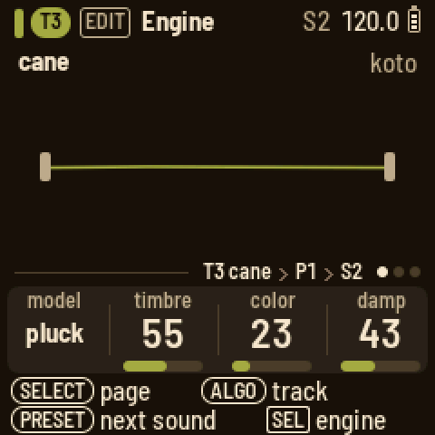

| Model | timbre | color |
| --- | --- | --- |
| pluck | how long the string rings | how wide the pluck is, from hollow to full |
| bow | how hard the bow presses | where it crosses the string |
| reed | how steady the breath is (less noise) | the tone of the body |
| flute | how breathy it is; high is clean | how hard it is blown |
| bell | how long it rings; at the top it never stops | how far apart the partials are pulled |
| drum | how long it rings | from tone to rattle |

**damp** darkens the sound. The pluck gets softer, the bridge or bore duller, and on the bell and the drum the
upper partials die first. The pluck and the strikes play once on each note. The bow and the breath start again on
each note, and when you play legato they carry on while the pitch moves. Cane plays at most four voices at once,
because each voice keeps its own strings and tubes in memory. A new note beyond that takes over the oldest one. If a
note is too low for the bow or the flute, you hear it an octave up.

**Voile** plays the voices.

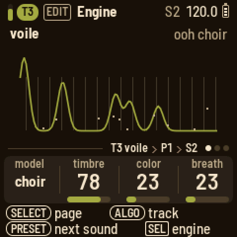

| Model | timbre | color |
| --- | --- | --- |
| vosim | the first formant | the second formant |
| vowel | the vowel, through nine of them | shifts the formants |
| choir | the vowel: a, e, i, o, u | the singer, from bass to soprano |
| whisper | how sharp the two peaks are | how far the second peak is from the note |

**breath** is the noise in the voice. On vosim and choir, it is the air passing through. On vowel, it is the
consonant at the start of each note, from none to long. On whisper, it sets the balance of noise against a buzz.
Turn it all the way up for a pure whisper.

Most of these models cost about as much as any other voice, or less. Cane's bell, with its eleven partials, costs
about a third more.

### Acid

**Acid** is a bass line machine after the TB-303. It is X0X's 303, which is Open303 with the Devilfish's extra
controls. It is the whole instrument, with its own filter, envelopes, accent and slide, so on an acid track the pages
hold the 303's knobs. Each Devilfish knob starts where the stock 303 has it.

| Page | Knobs |
| --- | --- |
| Engine | **wave** is saw or square. **accent** sets how hard an accented note hits. **slide** sets how long a slide takes, from 2 to 360 ms. **tune** is the 303's tuning, about a semitone and a half either way. |
| Envelope | **attack** sets how the filter opens on a plain note, from a snap to a swell (0.3 ms to 3 s). **decay** sets how long the filter takes to close (0.2 to 2 s). **acc dec** does the same for an accented note (30 ms to 3 s). **length** sets how long a held note takes to fade (30 ms to 3 s). |
| Filter | **cutoff** goes from 60 Hz to 2.4 kHz, before the envelope opens it. The top half is the stock 303's range, from 870 Hz. The bottom half goes darker than a 303 can, which stops at 314 Hz. **reso** is the resonance. **env mod** sets how far each note opens the filter. **low cut** sets how much bass stays in the resonance, from 350 down to 100 Hz. |
| Sub | **drive** and its **type**: off, soft or rat (a distortion pedal's clipping). **shaper** sets how square the square wave is. It works only with wave on square, and most of its change is in the bottom third of the knob. |

The picture on the Envelope page draws three seconds of the filter opening and closing. An accented note's curve is
drawn dimmer, and the held note's level is a line. An acid track has no filter envelope page, and its filter type is
the 303's own. It plays one note at a time, whatever the Play page's mode says.

Accents, slides and ties come from the steps:

- **Accent**: a step with a velocity of 112 or more. To set it, hold the step and turn **KNOB 1**. The "accent"
  groove adds velocity on the beats, which accents them.
- **Slide**: when a note is still held as the next one starts, it slides into it without a new attack. Make a step
  long enough to reach the next note (hold it and turn **KNOB 2**). Or give the next step the **glide** trick, which
  slides into it even after a short note. When you play live, keys held legato slide.
- **Tie**: a long step is one long note. A slide onto the same pitch also keeps the note going, so a held step
  followed by a step on the same note with **glide** sounds as one.

Two acid tracks can play at once. A third takes over the oldest one.

### Kit

A drum track has eleven keys, and you play them on the black keys. Each key has a drum model: kick, snare, hat,
clap, shaker, tambourine, string (a plucked string), conga, tom, fm or sample. It can also be one of the x models
(x kick, x snare, x hat, x clap, x tom, x rim, x fm, x noise), sophie, clang, or one of the 909 models (909 kick,
909 snare, 909 tom, 909 rim, 909 clap, 909 hat, 909 open, 909 ride, 909 crash). The kit is tuned to C: kick G1,
snare G3, low tom C3, high tom G3, conga C4, string C3, fm C5. To pick the key the knobs edit, press a black key or
turn **PRESETS**. The four knobs on the Engine page belong to that key's model:

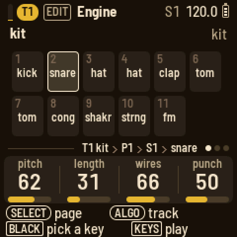 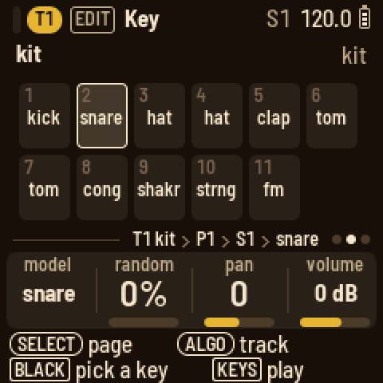 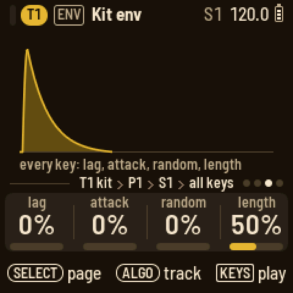

| Model | Knobs |
| --- | --- |
| kick | pitch, length, punch, tone |
| snare | pitch, length, wires, punch |
| hat | pitch, length, metal, focus |
| clap | tone, length, spread, tail |
| shaker | color, length, swell, return |
| tambourine | tone, length, jingle, hiss |
| string | pitch, length, bright, pluck |
| conga | pitch, length, slide, drive |
| tom | pitch, length, sweep, rate |
| fm | pitch, length, mod, feedback |
| sample | sample, pitch (24 semitones each way), start, reverse |
| x kick | pitch, length, tone, sweep · click, harm, drive |
| x snare | pitch, length, tone, snap · wire, body, drive |
| x hat | pitch, length, tone, res · noise, metal, drive |
| x clap | tone, length, drive |
| x tom | pitch, length, tone, sweep · noise, fm, drive |
| x rim | pitch, length, tone, sweep · noise, drive |
| x fm | pitch, length, ratio, mod decay · click, index, drive |
| x noise | tone, length, drive |
| sophie | pitch, length, color, metal · model, feedback, sweep, crush |
| clang | pitch, length, color, metal · model, sweep, feedback, fold |
| 909 kick | pitch, decay, attack, sweep · depth, drive, shape |
| 909 snare | pitch, decay, snappy, tone · drive, shape |
| 909 tom | pitch, decay, attack, size · drive, shape |
| 909 rim | pitch, drive, shape |
| 909 clap | tone, tail, drive, shape |
| 909 hat, 909 open | pitch, decay, drive, shape |
| 909 ride, 909 crash | pitch, decay, drive, shape |

The knobs after the dot are on a second Engine page. Turn **SELECT** to reach them.

- The **x models** are the eight drum engines of Omodaka9375's MACHINEDRUM, a drum machine in the browser. Their
  pitch is a note number, and 60 is middle C. Long lengths and high pitches turn the hat into cymbals. On x fm,
  mod decay sets how soon its brightness falls.
- **sophie** is Matt Estela's Sophie, metallic FM percussion. Its model knob picks the voice: fuse, stack, split,
  shard, pipe, boom, or its kick. color sets the inharmonic partials, metal sets how much FM, and feedback sets how
  much the operator feeds itself. Turn sweep right to drop the pitch, or left to raise it. crush lowers the bit
  depth.
- **clang** is digisophie, the version of Sophie made for the Digitakt. It has two operators and is coarser and
  cheaper, with a wavefolder (fold).
- The **909 models** are athousanddetails' 9W9. They are circuit models of the TR-909's kick, snare, toms, rim shot
  and clap, with its knobs. On the kick, attack is the beater's click, sweep sets how long the pitch takes to fall,
  and depth sets how far. On the snare, snappy is the wires and tone sets how long they ring. On the tom, size picks
  the low, mid or high tom, and attack is the stick. shape is 9W9's distortion (diode, clip, sat, fuzz, pdist, fold,
  crush), and drive pushes it. Eight 909 hits can sound at once across every drum track, and a ninth takes over the
  oldest.
- The **909 hat, open hat, ride and crash** are 9W9's cymbals. They play the samples the TR-909 plays its cymbals
  from (ER-99's, as 9W9 has them), with 9W9's knobs. pitch plays the sample slower or faster, up to two octaves each
  way, and decay sets how long it rings. As on the 909, both hats play the same sample. Give the hat and the open hat
  the same choke group so that each cuts the other off. The samples live beside the firmware, not in it. The
  installer writes them after an update, which takes a few seconds for about 70 KB. Until it has, these four models
  are silent, and picking one says NO SAMPLES. Installing again from the site writes them.

The x models and clang cost up to twice as much as a voice of a built-in model, and sophie and the 909 models up to
three times as much. Even with a kit made of them, the busiest demo stays well within what the FM-1 can do.

On every sound page of a drum track, a black key picks the key the knobs edit. On **EDIT**'s pages, the white keys
then put that key on the bar's steps, just as on Steps. Tap to add it and tap again to take it off, and the keys
light where it plays. That way you can shape a sound and write it without leaving the page. To lock a knob on a
step, hold its white key and turn the knob. The key goes on the step if it was not there. To clear the lock, hold
**SEL** and turn the knob. Hold **EDIT**, or record, and the white keys play the kit as before.
Turn **SELECT** for the Key page.
It has the model, random (a variation on every hit), pan, and volume in dB. Its **SEL** list sets the play mode:
one-shot, gated, loop, or choke group 1 to 3. When you change a key's model, the new model starts from its own knob
settings. COPY DRUM copies the drum on the key shown, and PASTE DRUM puts it on another key, in this kit or another.
It copies the model, knobs, envelope, filter and sends. This is a quick way to start two snares tuned apart. On
**ENV**, the list has the key's filter type (KEY FILTER) and the kit's bus filter (KIT FILTER, on or off) on all
four pages.

**Kits.** On a kit track, **EDIT**'s **SEL** list has **KIT** and **SAVE KIT**. Use KIT to load a whole kit onto the
track. You get its eleven keys with all their settings, plus the kit's envelope, filter, LFO and character. The
track's level, pan, player and MIDI OUT stay as they are. LOOM-8 comes with eleven kits, named for fibers and cloth:

- **Loom**: the kit a new project starts with.
- **Nylon**: the x models throughout.
- **Elastane**: sophie throughout, rubbery, with a bouncing kick, crushed ticks, a latex snap and toms that boing.
- **Wire**: clang throughout, hard and metallic, short, bright and folded.
- **Burlap**: rough and quick, with a tight kick, a cracking snare, a ghost snare on the clap's key and a ride.
- **Sequin**: shiny, with a long boom, a full-bodied snare and clap, FM toms and a driven shaker.
- **Frayed**: crushed and folded, with Sophie's crusher and digisophie's fold.
- **Denim**: the factory 909 samples, with sophie's toms and the x models' conga and shaker.
- **Linen**: short and dry, with a tight kick, ticking hats, clicks and a small clap.
- **Velvet**: deep, with a round, long kick, the 909 clap, dusty hats and a round conga.
- **Twill**: the 909's own circuits and cymbals (9W9's kick, snare, toms, clap, rim shot and hats).

The new kits keep the default kit's layout: kick, snare, closed hat, open hat (these two share choke group 1),
clap, low and high tom, conga, shaker, string, and fm (a short FM blip). That way a pattern plays the same parts on
every kit.

SAVE KIT stores the track's kit in one of eight user kits, K1 to K8, named after the track's sound. LOOM-8 asks
before it replaces one. After that, KIT loads your kits just like the others, in any project. User kits are kept
with the user presets, and a backup includes them too.

**ENV** on a drum track has four pages. The first two belong to the key shown, and follow its model:

- **Envelope**: attack, hold, decay and lag. Attack rises from silence, up to a second. Hold keeps it at full level,
  up to a second. Decay falls to silence, and at "off" the model's own length decides. Lag starts the key up to
  60 ms late, for a lazy snare or a flam. The picture draws the shape, and the line above the knobs shows the key's
  name.
- **Filter**: cutoff (50 Hz to 20 kHz), resonance, env and drive. Env sets how far the key's envelope moves the
  cutoff, up or down, so with a decay set you get a sweep on every hit. Drive squares off the key while keeping its
  level. **PRESETS** picks the type: off, low-pass, high-pass or band-pass. The picture draws the curve, and shows
  faintly where the envelope takes it.

A key left at its defaults sounds like its model alone and costs nothing extra. The defaults are attack, hold and
lag at 0, decay off, no filter and no drive. The next two pages are for the whole kit:

- **Kit env**: lag (a delay before every hit), attack, random and length. Random varies every key's knobs on each
  hit, and length scales the length of every model.
- **Kit filter**: the kit's bus, after the keys are mixed together, with low cut, compression, drive and hi cut.
  **PRESETS** turns it on or off.

Each key has its own sends. Press **FX** and turn **SELECT** to Sends to see the shown key's sends to FX I and
FX II. A black key or **PRESETS** picks the key. This lets you send the clap into the reverb and keep the kick and
the hats dry. A kit has no sends of its own besides those of its keys. In a new kit, the clap and the fm key send a
little to the reverb, and the rest are dry.

You can lock a key's own settings too. Hold a step and press **ENV**, and the knobs now edit the envelope of the
step's key. Turn **SELECT** for its filter. If the step plays the key shown, that is the one you edit. Otherwise it
is the first key the step plays. The line above the knobs names it.

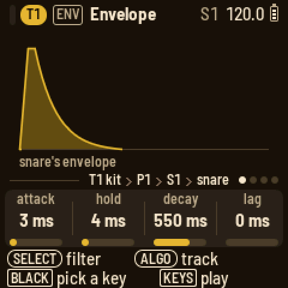 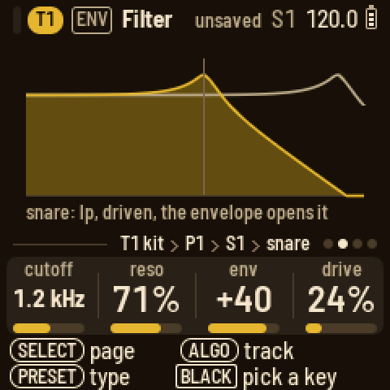

The **sample** model plays a sample from the bank on the key. The bank is described below. sample picks the sample,
pitch tunes it up to 24 semitones either way from its own rate, start makes it begin later, and reverse plays it
from the end back to the start. It plays to the end of the sample, or for as long as the key's decay allows. Four
sample keys can sound at once, and a fifth takes over from the oldest.
### Samples

LOOM-8 carries a bank of samples. Sixteen of them are its own. There's a 909 kick, snare, hat and clap, a noise
sweep, and piano, upright bass, strings, brass, flute and an orchestra hit. There's a vinyl loop, and four breaks
for the slice engine (classic, heat, choke and ecstasy). After those come thirty-two slots for your own samples,
user 1 to user 32. The sample model on a drum key and the sample engine on a synth track both play them, and the
knob shows each one's name.

LOOM-8's own sounds live in the sample bank, in the FM-1's flash, beside yours. The bank holds 214 KB of sound,
about 19 seconds at 22 kHz. The twelve sounds other than the breaks take 86 KB of it. The installer puts them
there after your samples. (Before 0.8, they were built into the firmware.) They don't use up user slots, so user 1
to user 32 are all still yours. The sounds keep their own places on the sample knob, so kits, presets and your
projects can find them.

If your samples leave no room for LOOM-8's sounds, the installer asks you first. You can make room by storing the
samples it names at a lower rate, install without the sounds, or stop. A lower rate loses everything above half
that rate, and you can't undo it on the FM-1, so keep the original files. Without the sounds, the kits and presets
that use them are silent, and the picture says "install the sounds: samples page". To add them later, open
[the samples page](https://charlesvestal.github.io/fm1-loom/samples/), press **Add LOOM-8's sounds**, then Send.
You can also run `tools/loom_samples.py factory`, and add `--make-room` to make room the same way.

Since 0.7, the four breaks aren't in the firmware either. To add them, press **Add the breaks** on the samples
page, then Send, or run `tools/loom_samples.py load breaks`. They take 92 KB. They keep their own places on the
sample knob, so the slice presets and your projects find them by name. Until you add them, the breaks are silent
and the picture says "install the breaks: samples page".

The **sample** engine plays a sample at the pitch of the note. The sample's root note plays it at its own rate,
and an octave up plays it twice as fast. Its knobs:

| Knob | What it does |
| --- | --- |
| sample | Picks the sample. An empty user slot plays nothing. |
| start | Sets where it begins, 0 to 99 % of the way in. |
| length | Sets how much of the rest plays. At 100 % it plays to the end. |
| mode | one-shot plays once, then the note ends. loop plays round and round, and a sample with its own loop loops that part. reverse plays once, backwards. ping-pong plays forward, then back. |

The picture shows the sample's waveform. The part that plays is drawn bright, a dot marks where it starts, and
the loop's ends are marked. In loop and ping-pong modes, **SELECT** has one more page, Loop, right after Engine.
Use **loop start** to set where the loop begins within the part that plays, and **loop len** to set how much of
the rest it loops. At 0, loop len reads "auto", and it uses the sample's own loop or loops to the end. The loop
point is crossfaded over 8 ms, so you won't hear a click wherever you set it. After that, the track's envelopes,
filter, character and LFO shape the sound as they do for any engine. There are eighteen presets:

- piano is looped, with a little tape. dusty keys is darker, with the tape wobbling. piano stab is short and
  bright, and rev piano is the piano backwards.
- upright and dusty bass are the upright bass, plucked. dusty bass is short and deep in the tape.
- strings, str stab and swell. str stab is the section's attack, cut short, and swell is the strings backwards.
- brass and horn stab.
- flute and air flute. air flute is an octave down, played as a pad.
- orch hit and dark hit, which is an octave down.
- vinyl is the run-out groove, riser is the noise sweep, and boom is the kick, low and long.

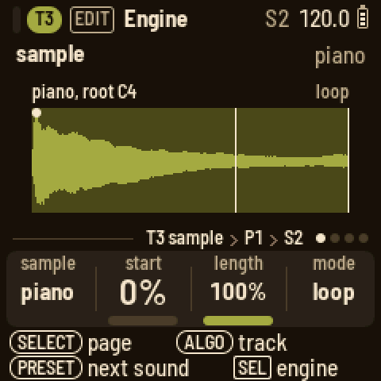

### Slice

The **slice** engine cuts a loop, such as a break, into even slices and plays one slice per note. The sample's
root note plays slice 1, the next note up plays slice 2, and so on. After the last slice, it wraps round to the
first. With eight slices, F3 to C4 play slices 1 to 8, and C#4 plays slice 1 again. Below the root, the notes
count back from the last slice. With the keys at their own octave, F3 (the lowest key) plays slice 1 of a factory
break. Write slices on the steps to replay the break, with slice k on every other step for eight slices over a
bar. Or build a new beat from its pieces, in any order, with repeats and gaps. Its knobs:

| Knob | What it does |
| --- | --- |
| sample | Picks the loop: the factory break, or one of yours. |
| slices | Cuts it into 4, 8, 16 or 32 even slices. |
| pitch | Moves it up to 24 semitones either way. Down, a slice plays slower and runs longer than its place. Up, it plays faster and shorter. |
| gate | Sets how much of each slice plays, all of it at 100 %. Both ends get a short fade, so a cut never clicks. |

A loop that knows how many bars it lasts follows the tempo, so its bars last as many bars of the song. A factory
break plays slower at a slower tempo, with each slice still on its steps, and the pitch knob works on top of
that. A sample without a bar count plays at its own speed, and the picture says "own speed".

How notes overlap depends on the play mode:

- In poly mode, each note plays its slice up to its gate and overlaps the next one.
- In mono mode, a new note cuts off the playing slice with a quick fade and starts the new slice from its
  beginning.
- In legato mode, a new note moves to the same position in the new slice, so the time keeps running.

After that, the envelopes, filter, character and LFO shape the sound as they do for any engine. The presets keep
the filter's key tracking at 0, so every slice sounds alike. A slice always plays to its gate, however short the
note. The gate sets the length, not the step, so slices on the steps play through just as the break did.

When you choose the slice engine from **SEL**, the track comes off the conductor. Its notes pick slices, and a
chord change would move them. Turn FOLLOWS CONDUCTOR back on if you want it.

The picture shows the loop's waveform cut at the slices. Each slice's gated part is drawn, and what the gate
leaves out is faint. The playing slice is lit, with a line at the play position, and slice 1 has a dot. Above
the waveform are the loop's name and bars, and the slice count or the slice playing. There are eleven presets:

- breaks, heat, choke and ecstasy play each break in eight slices, as it was played.
- jungle plays classic in sixteenths, driven, with each slice cutting off the last.
- roller plays choke in sixteenths, tight.
- two step plays choke in sixteenths, short, with a touch of delay.
- dusty loop plays ecstasy three semitones down, in the tape.
- half time plays classic an octave down, dark.
- hits plays classic's eighths one at a time, short, so you can play them as a kit.
- ghosts plays classic's sixteenths, soft and short, to sit under another beat.

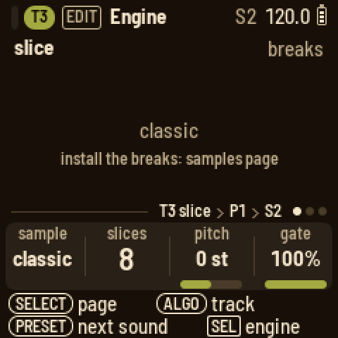

**Your own samples.** Connect the FM-1, running LOOM-8, to a computer by USB. Open the Samples page,
<https://charlesvestal.github.io/fm1-loom/samples/>, in Chrome or Edge, and press Connect to read the samples on
the FM-1. From there you can:

- add files (WAV, AIFF, MP3 or FLAC) by dropping them on the page
- replace a sample by dropping a file on it
- rename, move up or down, or remove samples
- set each sample's root note and, for a loop, its bars

Then press Send. The samples already on the FM-1 are kept exactly as they were. Use Quality to pick the rate new
samples are stored at. On auto, it picks the best rate at which everything fits.

You can do the same from the command line, in the firmware's folder:

```sh
pip install mido python-rtmidi numpy
python3 tools/loom_samples.py load kick.wav snare.wav "vox=ah_A3.wav" "pad=pad.wav:57" "amen=amen.wav@1%32k"
python3 tools/loom_samples.py info
python3 tools/loom_samples.py erase
```

`load` replaces the user samples with the files you give, in that order: user 1, user 2, and so on, up to 32.
Each WAV can be any rate, mono or stereo, 8 to 32 bit. The tool converts it to mono at its own sample rate and
evens out its peak level.

- `NAME=` sets the name shown on the screen (11 characters). Without it, the tool uses the file's name.
- `:ROOT` sets the note that plays the sample at its own pitch on a synth track. Without it, the tool uses a note
  in the file's name (such as "ah_A3"), or C4.
- A loop stored in the WAV is kept.
- `@BARS` marks the file as a loop of that many bars (1 to 16), for the slice engine. The loop then follows the
  tempo, and its root (slice 1) is F3 unless `:ROOT` says otherwise. The tool prints the tempo the loop has at its
  own speed. Trim the loop to exactly its bars first, because the slices are even cuts of the whole file.

**How much fits.** The bank holds 214 KB of sound. Each sample keeps its own rate, and a lower rate fits more:

| rate | keeps sound up to | fits in all |
|---|---|---|
| 32000 Hz (`%32k`) | 16 kHz: bright drums and loops | 12 seconds |
| 22050 Hz (`%22k`) | 11 kHz: most sounds | 17.7 seconds |
| 16000 Hz (`%16k`) | 8 kHz: bass, pads, voices | 24 seconds |
| 11025 Hz (`%11k`) | 5.5 kHz: lo-fi, sub bass | 35 seconds |

Put `%RATE` after a file to set its rate, or put `--rate RATE` right after `load` to set the rate for the rest.
Otherwise the tool picks the highest of 22050, 16000 and 11025 Hz at which everything fits. It prints each
sample's rate, length and size, and the seconds left at each rate. A bar at 120 BPM is two seconds, so eight
one-bar breaks fit at 22050 Hz. A sample plays at its own pitch whatever its rate, and a loop with `@BARS` keeps
the tempo. A higher rate only costs room, plus a little more of the FM-1's time while it plays. One sample can be
up to about 16 seconds long at 22050 Hz.

The sound stops while the FM-1 writes the samples, and a fuller bank takes longer. When the screen says LOADED,
the FM-1 has checked every byte. A track that was playing a sample keeps pointing at the same slot, so user 2 is
still user 2, whatever is in it now.

### MIDI

Use the **midi** engine to play an outside synth instead of one of LOOM-8's own sounds. The track makes no sound
on the FM-1. Its notes from the keys, the steps, the arp and strums go out over USB and Bluetooth on the track's
own channel: T1 on channel 1, up to T8 on channel 8. They go out whether or not the track's MIDI OUT is on.

It has eight knobs, four on the Engine page and four more on Engine 2. To reach Engine 2, press **EDIT** and turn
**SELECT**. Each knob sends a CC on the track's channel whenever it moves, whether you turn it, a step's lock
moves it, or recorded motion plays it back. The picture shows all eight as bars, with the page's four bright and
each one's CC number under it. To change which CC a knob sends, press **SEL** and turn KNOB 1 CC to KNOB 8 CC (0
to 119). They start as 74, 71, 73 and 72, which are cutoff, resonance, attack and release on most synths. The
next four are 1, 75, 91 and 93: mod wheel, decay, reverb and chorus.

A MIDI track has no envelope, filter, LFO, character or sends, so **ENV** and **LFO** take you to its knobs.
**FX** shows only FX I, FX II and Throws. Play keeps its glide, voice mode and octave. SCRAMBLE sets the eight
knobs at random and leaves their CC numbers alone. CC 9 on the track's channel still mutes it, but other CCs
coming in on its channel do nothing. That way, a synth that echoes CCs back can't change the CC numbers.

### The synth pages

On the Engine page, turn **SELECT** for the Play page. It sets poly, mono or legato, portamento, the bend range
(off, 1 to 7 semitones, or an octave) and the track's volume. Turn it again for Play 2, which sets the sound's
octave, from two down to two up. Bass presets come an octave or two down. This moves every note the track plays,
including the steps. On knit and rayon, turn once more for Sub.

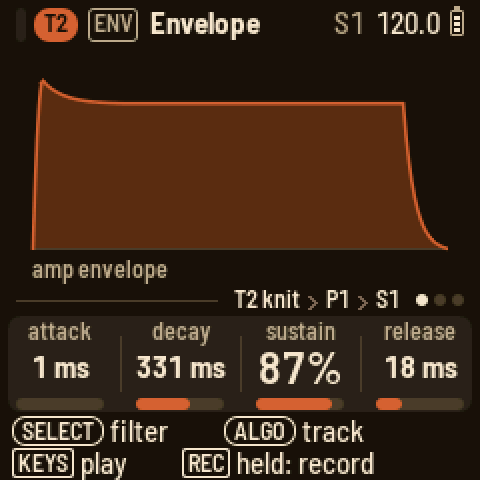 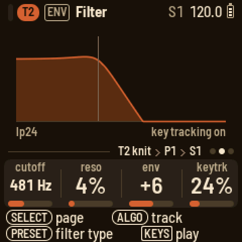 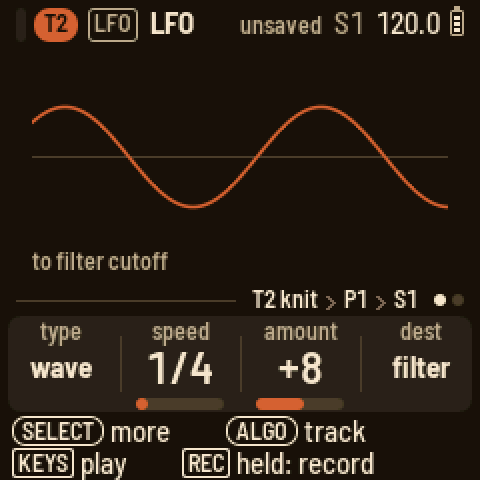

**ENV** opens on the amp envelope. Next comes the filter, with cutoff in Hz, resonance, envelope amount and key
tracking. Turn **PRESETS** to change its type (lp24, ladder, lp12, hp12, bp12, off). Last is the filter's
envelope. **FX** has the track's character (below), then its sends to FX I and FX II, its pan and its level, and
then the two effects. **LFO** has the type and its first three knobs on page 1, and its fourth and fifth on page
2. When you pick a new type, it starts from its own defaults:

| Type | Page 1 | Page 2 |
| --- | --- | --- |
| wave | speed, amount, destination | parameter, shape |
| drift | speed, amount, destination | parameter, envelope |
| wobble | speed, vibrato, volume | envelope, shape |
| pump | source, amount, hold | release |

Turn the speed knob left for synced speeds, from 2/1 to 1/64, or right to run it free in Hz. The destination is
a module, and the parameter is one of that module's four:

- synth: the engine's four knobs
- envelope: attack, decay, sustain, release
- filter: cutoff, resonance, envelope, key tracking
- voice: volume, pitch, pan, character

A destination marked "free" keeps running instead of restarting on each note.

### Character

Each voice of a synth track has its own effect after the filter and before the sends. This is its character.
Every voice is shaped on its own, so a chord driven hard still sounds like a chord. Press **FX** to open the
Character page. It shows the type and what it does, with a picture of either the curve a sample goes through or
what it does to a wave. The faint line is the sound without it. Turn **PRESETS** to change the type. The knobs
are type, amount, tone and mix, from dry to wet, and at mix 0 the character is off. Each factory preset has its
own character, so a preset is a whole sound.

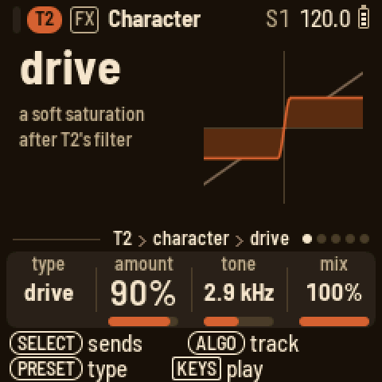

| Type | Amount | Tone |
| --- | --- | --- |
| off | | |
| drive | How hard it saturates. The level stays the same. | A low-pass after it, 400 Hz to 20 kHz. |
| fold | How far the wave folds over. The level stays the same. | The bias. Away from the center, it folds one side more. |
| crush | How far it drops. | What drops: the sample rate to the left, the bits to the right, both in the middle. |
| ring | How deep the ring modulation goes. | The ratio of the ring's sine to the note, 0.25:1 to 7:1. |
| tilt | The pivot, 150 Hz to 6 kHz. | The tilt: darker to the left, brighter to the right, 6 dB each way at the ends. |
| tape | Worn tape: saturation, plus a pitch wow that deepens with it. | The top-end roll-off, 1.5 to 18 kHz. |
| sampler | An old sampler's grain, with a lower rate and fewer bits. | Its output filter, 2 to 20 kHz. |

You can lock the amount, tone or mix on a step like any knob: hold the step and press **FX**. The LFO can reach
the amount through the voice module's fourth knob, "character". On a kit, the character belongs to the whole kit
and comes after its bus filter. The keys' sends are taken before it. A kit's ring uses a ratio of C4, and its
tape has no wow.

## Players

Press **ARP** and turn **KNOB 1** to pick the player: off, arp, strum, hold or random.

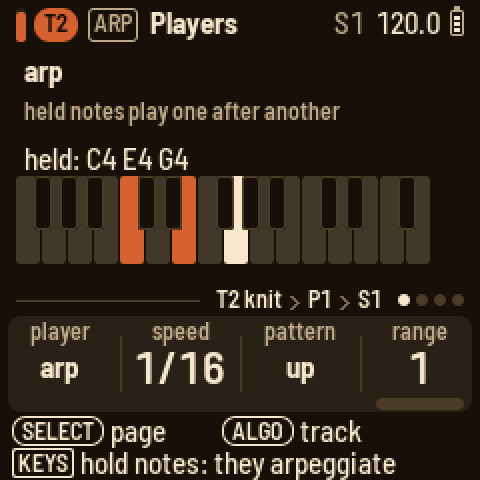

- **arp** plays the held notes one after another. Page 1 has the speed (1/4 to 1/64, with triplets), the pattern
  (up, down, up down 1, up down 2, as played, random) and the range. Page 2 has the note length, a style, glide
  and stereo. Page 3 is hold.
- **strum** plays a chord from one key, built on that key in the conductor's key and scale. At first it plays a
  triad, so the white keys in C major give the chords of the key: C, Dm, Em, F, G, Am and Bdim. Hold up to eight
  keys together, and they become the chord. You hear them as you hold them. From then on, one key plays that chord
  moved along the scale. A C7 gives Dm7 on D and G7 on G, and a note outside the scale stays where it is. A key
  outside the scale plays the chord exactly as you held it, moved to that key. Use Roll to strum the chord, up to
  one note per step.
- **hold** keeps the notes you play until you play the next ones.
- **random** makes up each step's note from a pool of notes. The steps are its active slots. Tap a step to switch
  it on. With no step set, every step plays, and the slots show dim. A step's note only sets the register, and a
  plain tap gives C4. The pool gives the pitches, and the pattern's length and scale give the grid. To pick the
  pool, go to Steps, hold a step and press **SEQ** as you would for a chord. The keys then switch the current
  pattern's notes on and off. With no pool picked, it uses all twelve notes. Each pattern has its own pool. A dot
  under a key marks a note your follow mode allows: the conductor's scale, or the notes of the chord for
  **harmony** and **chord deg**. A track that follows the conductor still harmonizes the notes it makes up. A
  step's own options apply to them as they do to a written note: ignore the progression, transpose only, or a move
  by the scale. The player's settings are spread over three pages:
  - **note %** is the chance a step sounds.
  - **pitch %** is the chance the notes change when a cycle ends. At 0 % the phrase repeats exactly, and at 100 %
    it changes every cycle.
  - **rhythm %** does the same for the rhythm: which steps sound, and their timing, velocity and length.
  - **time %** is the chance a step comes late, by a random amount up to half a step. At 0 % every step is on the
    grid. At 100 % every step is late, by anything from nothing to half a step.
  - **length** is the length of a cycle, in steps (1 to 64). It counts the track's steps, so it doesn't have to
    match the pattern. With pitch % and rhythm % at 0 %, a 16-step pattern with a length of 32 makes a phrase
    that takes two times round the pattern before it repeats. A 32-step pattern with a length of 16 plays the same
    phrase twice each time round.
  - **vel %** is the chance a step's velocity changes, to anything from half to one and a half times its own.
  - **gate %** is the chance a step's note length changes, to anything from a tenth to twice its own.
  - **oct down** and **oct up** (Players 3) set how far a note may stray from the step's own octave. They count
    the octaves below it and above it, 0 to 3 each. At 0 and 0, every note stays in the step's octave. At 1 and 1,
    it spreads over three octaves around it. A step's own octave is its note's, shown under its **on**. Hold
    **SEQ** and press **OCT-** or **OCT+** to move a pattern's notes. A step with no note set uses C4.

The arp and the strum play the track's steps too. A step's notes are arpeggiated for as long as the step lasts,
together with any keys you hold. Give the step a longer **LENGTH** for more notes. A step with a chord is strummed
in the strum's direction and roll, and every note ends with the step. A step with one note strums the strum's
chord from that note, just as a key does. When you change the player, or turn its hold off with no key down, it
lets go of whatever it was holding.
## Arrange, scenes and the song

Press **HOME** to see the whole arrangement. Each row is a track, with its pattern and a playhead. A small meter at
the left of each row shows what the track plays. For COND and THROW, the meter lights while one of their steps
plays. Muted tracks are dimmed. The scene number is at the right. When you cue a scene, its number appears beside
the current one with the beats left until it starts, and its key blinks.

The 16 white keys are scenes 1 to 16. Press **OCT+** to put scenes 17 to 32 on them, and **OCT−** to go back. The
dots at the right show all 32 scenes, with a mark beside the rows the keys hold now. The keys follow the scene
that is playing.

- When stopped, press a scene's key and it switches at once.
- While playing, the scene starts at the next bar line. Press its key again to switch at once, or press the
  playing scene's key to cancel the cue.
- To make a key wait for the end of T1's pattern instead, set SCENES SWITCH in the **SEL** list to "pattern end".
  The tracks can have different lengths and drift apart, so T1's pattern sets the scene's length. On a 64-step T1,
  that's up to four bars.
- COPY SCENE in the **SEL** list copies the scene that is playing. Switch to another scene and pick PASTE SCENE to
  make it the same again: its patterns, its mutes, the conductor's key and the weave. While playing, you hear the
  change at the next bar.
- Turn **PRESETS** to cue the next scene for the next bar in the same way.
- Press an empty scene's key to turn it into a copy of the scene that is playing.
- Hold a white key for a second to clear that scene. The playing scene keeps going while LOOM-8 asks you to
  confirm. Holding an empty scene's key does nothing.

The black keys mute. Keys 1 to 8 mute the tracks, 9 mutes the conductor and 10 mutes the throws. A kit track's
black key mutes it when you let go. To mute the kit's sounds one by one in this scene, hold its black key instead
and press white keys 1 to 11. A lit key means that sound is playing. The first four kit tracks each have their own
sound mutes, and the row shows how many are off. A muted sound still drives the pump, and its key still plays when
you press it. To change scenes from any page, hold **HOME** and turn **PRESETS**.

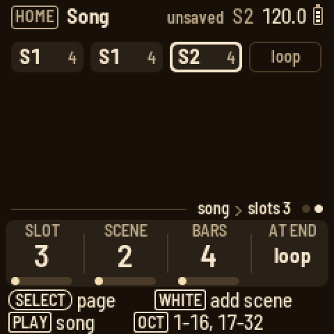

The knobs on Arrange:

- **KNOB 1** sets the tempo. Hold **HOME** while you turn it for tenths.
- **KNOB 2** sets the groove type: swing, lilt, weave, stretch, drunk, jitter, accent, lazy, push pull, sway or
  swell.
- **KNOB 3** sets the selected track's groove amount, from −99 to 99.
- **KNOB 4** sets the selected track's pattern in this scene ("T2 PAT"). **ALGORITHM** picks the track. While it
  plays, the new pattern comes in at the track's next bar line. Use it to set a scene's patterns track by track
  without leaving Arrange.

You'll find the click on **REC**'s knobs.

Turn **SELECT** for the Song page. Press a white key to add that scene after the selected slot. Press **OCT+** for
scenes 17 to 32. The knobs move to the new slot, which plays as many bars as the one before it. The first slot
plays four.

- **KNOB 1** picks the slot.
- **KNOB 2** changes its scene.
- **KNOB 3** sets how many bars it plays, from 1 to 64. A bar is always 16 sixteenths, whatever the patterns'
  lengths, so a 64-step pattern takes four bars.
- **KNOB 4** sets whether the song loops or stops at the end.

Press **PLAY** on the Song page to play the song from the selected slot. To play it from the top, pick PLAY SONG in
the **SEL** list. As the song plays, a bar along the bottom of the playing slot fills up over its bars. The **SEL**
list can also insert the scene that is playing (INSERT SLOT), repeat the selected slot right after itself
(DUPLICATE SLOT), delete a slot or clear the song.

## The aux tracks

Turn **ALGORITHM** past T8 to reach the aux tracks. Each one has its own page under **EDIT** and its own steps
under **SEQ**.

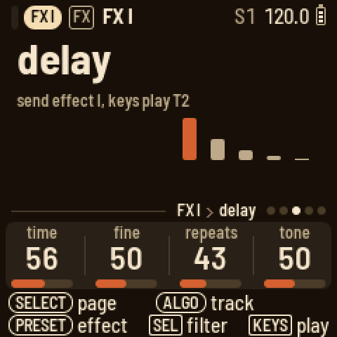 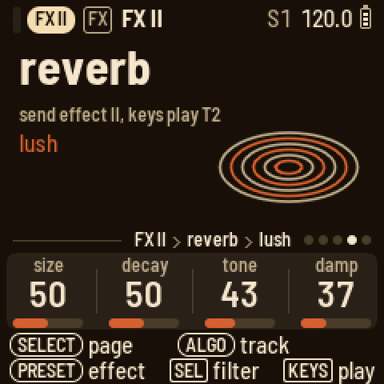

- **COND** is the conductor. Its knobs are key, scale and link. Link picks an instrument track that also plays
  the conductor's keys. Play a chord on its keys and the tracks that follow move to it. Its steps hold the chords
  you played: press **SEQ** and a white key. Set the track scale to 4 so each step lasts a beat, or to 16 for a
  bar. Page 2 is the routing, where black keys 1 to 8 turn each track on or off. Its **SEL** list sets how each
  track follows:
  - **no** doesn't follow.
  - **diatonic** moves by the chord's scale degree.
  - **transpose** moves the same distance in semitones.
  - **harmony** moves each note to the nearest note of the chord itself.
  - **ch. deg** uses each note's place in the scale to pick a note of the chord: root, third, fifth and so on,
    round and round, kept in the note's octave.

  The last two are the harmony modes. The conductor's Engine page shows the chord it hears beside the degree. Drum
  tracks never follow.

  Page 3, **Follow**, takes the chords from a track instead. Press that track's black key, or turn **KNOB 1**.
  Press the key again to turn it off. Each time the track plays, its notes set the chord. That's all the notes on
  a step, or the keys held, so a chord part sets the whole chord and a single note sets its triad. This way a chord
  part or a bass line can lead the others. The degree comes from the note's place in the scale, not its octave, and
  the other tracks move the nearer way. In C major, a G takes them down a fourth and an F takes them up a fourth.
  A single leading note is taken as the root of its diatonic triad. In C major, C gives C E G and G gives G B D.
  The leading track plays as written and follows nothing, and it still leads when muted. While a track leads, the
  conductor's own steps rest. Its keys still change the chord, until the leading track's next note. A kit has no
  notes, so it can't lead.
- **WEAVE** holds the weaves. Hold its white keys 1 to 10 to weave T1 to T8, COND and THROW. With latch on, one
  tap turns a weave on and another turns it off. Each track weaves the way its ARP's Weave page sets it, and REC
  records the weaves onto the WEAVE steps. For more, see Weave, above.
- **THROW** holds the throws. The keys fire them, on the drum tracks from the lower octave and on the melodic
  tracks from the upper one. Slice tracks count as drums. Their fills play the pattern's own slices: the slice on
  the downbeat acts as the kick, the one on the backbeat as the snare, and an off-beat one as the hat. The octave
  throw takes them up. A step writes the last throw you played. **KNOB 1** is latch. With it on, a key turns its
  effect on and off.

| Key of the octave | Effect |
| --- | --- |
| white 1 | mute: silences the group |
| white 2 | stutter: a fast loop from where the throw starts |
| white 3 | repeat: a slow loop |
| white 4 | echo: the loop repeats and fades |
| white 5 | build: a fill that builds |
| white 6 | floor: four on the floor |
| white 7 | jumble: a random fill |
| black 1 | warble: high-passed drums, vibrato on melodic notes |
| black 2 | pan: the sounds move across the field |
| black 3 | octave: drums an octave up, melodic tracks an octave down |
| black 4 | chop: short notes |
| black 5 | ring: long notes |

  When you let go of a loop throw (stutter, repeat or echo), the track comes back in time, at the step it would
  have reached if it had never looped. To have it stay where the loop left it instead, press **GLO**, open Setup's
  **SEL** list and set LOOP THROWS to "drift". The track then stays out of step with the others until a scene or
  the transport sets it straight.

  You can also throw from any track. The last page of **FX**, Throws, has the same keys and the latch.

- **FX I** and **FX II** are a send effect each: chorus, delay, lofi, phaser or reverb, each with four knobs. To
  reach them from any track, press **FX** and turn **SELECT**. **PRESETS** picks the effect. The **SEL** list has
  its high-pass and low-pass and, on FX I, the send into FX II. On a delay, it also has **PING WIDTH**, which sets
  how far apart the echoes bounce. At 127, as in a new project, they go hard left and right. At 0, they sit in the
  center. In a new project, the high-passes keep the lows dry: the echoes start at about 130 Hz and the reverb at
  about 230 Hz. The keys play the track you were on. If you turn to FX I or FX II with **ALGORITHM**, **EDIT** has
  the same knobs.

| Effect | Knobs |
| --- | --- |
| chorus | rate, depth, feedback, width |
| delay | time, fine, repeats, tone (how bright the repeats are); in **SEL**'s list, ping width |
| lofi | rate, bits, smooth, width |
| phaser | freq, depth, rate, feedback |
| reverb, plate | size, motion, tone, damp (how fast the tail darkens) |
| reverb, the other modes (lush too) | size, decay, tone, damp |

  The effects return only the sound they make. The track's own sound stays on the track.

  The reverb has eleven modes, and **PRESETS** steps through them after the phaser. **plate** is LOOM-8's own.
  Nine come from the PlayStation's sound chip, the reverbs its games used: **room**, **studio S**, **studio M** and
  **studio L** (small, medium and large), **hall**, **half echo**, **space echo**, **chaos echo** and **one echo**.
  Chaos echo almost never stops, and one echo is a single repeat. **lush** is a smooth, wide plate based on Jon
  Dattorro's, and a new project starts with it.

  The console modes keep their grain, because they run at half the sample rate, as lush does. On these, **size**
  stretches their delays, from small and metallic at 0 to the console's own at the top. A mode you've just picked
  starts at the top. **decay** sets how long the tail lasts, with the console's own in the middle. **tone** darkens
  the tail below the middle and thins it above. **damp** softens the reflections. When you change the mode, the
  reverb goes empty for a moment. On **lush**, **size** also lengthens the gap before the tail, and **damp** darkens
  the tail as it fades. Only FX II has the reverb. FX I has the delay's memory in its place.

## Mix and master

Press **GLO** for the Mix page, with a meter for each track. Each black key belongs to its track. Tap it to mute or
unmute the track, or hold it to solo the track until you let go. Hold several to solo them together. Each one you
let go leaves the solo, and when you let go of the last one, the mutes come back as they were. Tap a black key
twice and its track stays soloed after you let go, on every page, and **SOLO** shows at the right of the meters. It
stays until you tap a track's black key on Mix again or mute a track elsewhere. Then the mutes come back. A muted
track's meter still moves, in gray, while its steps go by, so you can tell it from an empty track. The knobs are the
sends to FX I and FX II, the pan and the level. On a drum track, you set the sends for each key, on the Sends page
of **FX**.

Turn **SELECT** for more pages:

- Master EQ has low, mid and high. 64 is flat.
- Master color is described below.
- Master out has the drums' level, the melodic tracks' level, the compressor and the pump. The **SEL** list on
  these pages lists their knobs, page by page, along with what the pump follows, its release and accent, and the
  master level.

On Setup, the knobs set the lights, the MIDI clock, sending MIDI notes and the theme. The clock is internal, receive
or send (see MIDI, below). Sending notes is on to start with. The theme is b/w to start with, or tape deck or
blueprint. The page also shows where the tempo comes from (LOOM-8, or a MIDI clock coming in), the USB audio level,
the autosave, Bluetooth audio and the Bluetooth MIDI device (see Bluetooth, below). The version is on the next page,
Debug. The **SEL** list on Setup has the FM-1's own settings, in three groups:

- Bluetooth: BT MIDI, MIDI DEVICE, BT AUDIO and AUDIO DEVICE.
- USB and MIDI: the USB audio level, USB PORT, CLOCK, NOTES, CC IN, CC OUT and SCENES OUT.
- LOOM-8: LIGHTS, THEME, AUTOSAVE and LOOP THROWS.

All of Setup's settings, the theme too, belong to the FM-1, not the project. Every project you load or start keeps
them as you left them. On every page, the header shows the scene playing ("S3") before the tempo. You'll find the
projects in **HOME**'s **SEL** list and the count-in on **REC**'s knobs.

**LFO** comes after Master out. It's the shared LFO. The project has one, and it moves the tracks you give it. Use
it to open the filters of a few tracks together in a single sweep, or to breathe across a 16-bar section of a
one-bar loop.

- **KNOB 1** sets the shape: off, sine, triangle, saw up, saw down, square or random.
- **KNOB 2** sets the rate, from 16 bars to a sixteenth in time with the tempo, or 0.02 to 10 Hz free.
- **KNOB 3** sets how much, in either direction.
- **KNOB 4** sets what it moves: cutoff, resonance, pitch (up to 12 semitones), pan, volume, the FX I or FX II
  send, or the character's amount.

Black keys 1 to 8 pick the tracks it moves, and they light up. The LFO starts again from the beginning when PLAY
starts, so a long sweep lines up with the bars. On a kit, it moves every sound, or just one. White keys 1 to 11
pick the sound, such as a hat's pitch or the snare's send, and white key 12 goes back to every sound. The
character's amount is the whole kit's.

**Master color** gives the whole mix a color after the EQ. **color** picks it, and **amount**, **tone** and
**mix** shape it.

- **tape** sounds like worn tape. You get a slow wow and a quick flutter on the pitch, more as you raise the
  amount, with soft saturation and a gentle roll-off of the top. Tone sets where the roll-off starts, from 1.5 to
  18 kHz.
- **sampler** gives the grain of an old sampler. The mix is held at a lower rate and fewer bits, then goes through
  its filter (tone). Amount goes from 26 kHz and 14 bits down to 11 kHz and 11 bits.
- **off** leaves the mix as it is. A new project starts here.

Each synth track's Character page has the same two, for one sound.

**Pump** is Master out's fourth knob. It lowers the mix each time the kick plays, by up to 24 dB, and lets it swell
back up, for the big-beat breathing of house and French touch. When a kit drives it, through its kick or as a kit
track, it lowers the melodic tracks and leaves the drums alone, so the kick keeps its punch. When a melodic track or
the metronome drives it, it lowers everything. Accented kicks pump harder. The pump works even with comp at 0, and
even when the kick is muted. So a silent kick can drive it: write a kick on a track, mute it, and the mix breathes
to a beat nobody hears. At 0 it is off, and a new project starts there. Its **SEL** list has these rows:

- **pump by** sets what drives it. **kick** is any kick of a kit: black key 1, or any key with the kick model.
  **T1** to **T8** is that track. On a kit, that means its kicks, so one kit's kick drives it and another's
  doesn't. On a melodic track, it means any note, whether a bass, a chord or a muted ghost track. **metronome** is
  the click, on every beat while it sounds.
- **release** sets how fast the mix swells back, from 10 ms to 1.5 s. It starts at 107 ms. Long releases breathe
  across the beat, and short ones only nick the kick's tail.
- **accent**, when on, makes each hit pump by its velocity, so a soft hit pumps about half as deep as a full one.
  When it's off, every hit pumps fully.
- **master level** sets the output level, which is the drive into the limiter. 100 is unity.

This pump works on the whole mix. A track's own pump LFO (above) still ducks just that track. Use it for a bass that
gets out of the kick's way while the rest plays on.

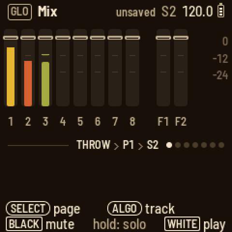 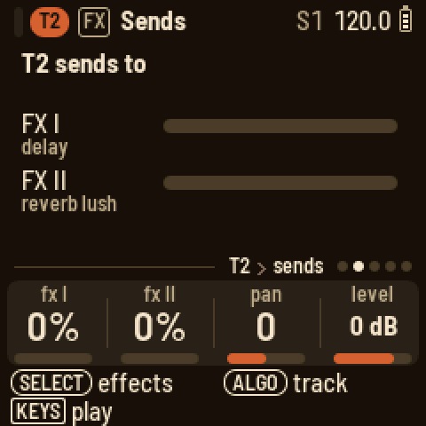 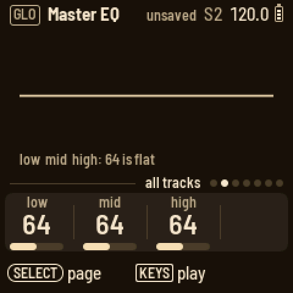 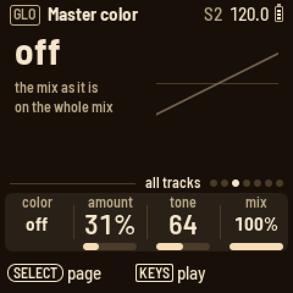

### Bluetooth

LOOM-8 can play through Bluetooth headphones or a Bluetooth speaker, and it can connect to a Bluetooth MIDI keyboard
or controller. Setup shows both. **BT audio** says off, the device playing, or what it is doing. **BT MIDI** says
off, on, or the MIDI device connected. Press **SEL** on Setup and the list opens on BT MIDI. Its Bluetooth rows
come in two pairs:

- **BT MIDI** turns Bluetooth MIDI on or off. Turn **ALGORITHM**, or press **SEL**. When it's off, the FM-1 stops
  showing up as a Bluetooth MIDI device and lets go of any computer, phone or MIDI device connected. Bluetooth audio
  keeps working. It is on to start with.
- **MIDI DEVICE** shows the MIDI device connected, "choose", or "BT MIDI off". Press **SEL** to choose one. If BT
  MIDI is off, turn it on first.
- **BT AUDIO** turns Bluetooth audio on or off. Turn **ALGORITHM**, or press **SEL**. Turning it on connects the
  device you used last.
- **AUDIO DEVICE** shows the headphones or speaker playing, or "choose". Press **SEL** to choose one.

**Headphones and speakers.** Put the headphones or speaker in pairing mode, then press **SEL** on AUDIO DEVICE. The
list's first line tells you what to do. It says "looking for devices..." while LOOM-8 looks, "pick a device. SEL
connects" once it has found some, or "none found. In pairing mode?". The devices you've used before come first,
marked "remembered". The one in use says "playing" or "connecting". After them come the ones it found, marked
"new". Turn **SELECT** to one and press **SEL** to connect. A new one is paired and remembered, and LOOM-8 remembers
four. While Bluetooth audio plays, the FM-1's own speaker and headphone jack are silent. The sound reaches your ears
150 to 300 ms after you play, so use it for listening, not for playing in time.

- **LOOK AGAIN** looks for devices again. The sound stops for a moment while it looks, because the radio can't look
  and play at once.
- **FORGET** forgets a remembered device. Pick it with **ALGORITHM** and press **SEL**. LOOM-8 asks first.

LOOM-8 keeps both settings over a restart. BT MIDI stays off if you switched it off, and when BT AUDIO is on,
LOOM-8 connects the device you used last again. A new project, and every project you load, keeps them as they are.

**MIDI devices.** Switch the keyboard or controller on, then press **SEL** on MIDI DEVICE. LOOM-8 looks for
Bluetooth MIDI devices while the list is open, and its first line says so. The ones it finds are marked "found".
Turn **SELECT** to one and press **SEL** to connect. Its notes and CCs play LOOM-8 as a computer's would, and what
LOOM-8 sends goes to it too. To let it go, press **SEL** on MIDI DEVICE again, then on DISCONNECT. LOOM-8 has one
Bluetooth MIDI link at a time, so while a computer or a phone is connected to the FM-1, it can't connect to a
device.

In both lists, **SAVE** connects the device picked, as **SEL** does, and **HOME** goes back.

**Pairing codes.** When a phone or an app asks for a code to pair with the FM-1, the header shows it on every page
("PIN 042613"), and the screen reader says it. Type it on the phone.

### MIDI

LOOM-8 speaks MIDI over USB and over Bluetooth, and it works the same on both. What comes in from either one plays,
and what LOOM-8 sends goes out on both.

**Bluetooth.** While LOOM-8 runs, the FM-1 shows up as a Bluetooth MIDI device, unless BT MIDI is off. It's named
"FM-1" and four letters and digits of its own ("FM-1 5132"). The name is the same every time, so you can tell two
FM-1s apart. On a Mac, open Audio MIDI Setup, choose Window, Show MIDI Studio, click the Bluetooth button, and press
Connect next to your FM-1. On an iPhone or iPad, connect from the app you play with. Most have a Bluetooth MIDI
button in their MIDI settings. Bluetooth bunches messages together, so LOOM-8 plays a clock that comes over
Bluetooth by the times the sender stamped on it. The tempo is as steady as over USB, but about 75 ms late. To line
LOOM-8 up with your DAW, set the DAW's clock delay (or MIDI sync offset) to send the clock about 75 ms early. Notes
and CCs play as they arrive.

**Clock.** Setup's **CLOCK** knob decides who keeps time:

- **receive** is the setting to start with. LOOM-8 follows a MIDI clock coming in, with its Start, Continue and
  Stop, and sends no clock. With no clock coming in, it plays at its own tempo. Half a second after a clock stops,
  it goes back to its own tempo.
- **send** has LOOM-8 keep time and send its clock, with Start, Continue and Stop, over USB and Bluetooth. It
  ignores any clock or Start and Stop coming in.
- **internal** has LOOM-8 keep time without following or sending a clock.

A project from 0.7 or older that sent the clock opens on send, and one that didn't opens on internal.

Each track has its own channel. T1 to T8 are on channels 1 to 8, FX I on 9, FX II on 10, and the master and the
scenes on 11. Notes on channels 12 to 16 play whichever instrument track is selected. If the conductor or the throws
track is selected, they play the last instrument track you had. LOOM-8 never sends on 12 to 16. Notes on 9 and 10
do nothing.

**USB keyboards and synths.** LOOM-8 can host a USB MIDI keyboard, controller or synth itself, with no computer
around. Press **GLO**, open Setup's **SEL** list and set USB PORT to **MIDI host**. Then plug the device in through
a powered USB hub or a powered USB-C adapter, because the FM-1 gives its USB port no power. It takes one device at
a time, plugged in directly or behind one hub. The device's notes and CCs play LOOM-8 as a computer's would, by
channel as above. What LOOM-8 sends goes to it: the tracks' MIDI OUT, the midi engine, and the clock on send. That
means LOOM-8 can play a hardware synth. The header tells you when a device connects, has no MIDI, or is lost. If
it's lost, the notes it held are let go. The screen freezes for a moment while a device connects, longer behind a
hub, but the sound plays on. While USB PORT is MIDI host, there's no computer link, so no USB audio, backup, mirror
or samples page. Bluetooth MIDI works as before. USB PORT goes back to **computer** at every start, so updating
always works.

You can also record LOOM-8 on a computer over USB, as an audio input with ten channels at 44.1 kHz. Channels 1
and 2 carry the master, as you hear it. Channels 3 to 10 carry tracks 1 to 8, one track each, so you can record
every track on its own. Each track's channel has the track at its level, before its pan, with its own filter and
character. The sends' effects and the master's EQ, color, compressor and pump are only on channels 1 and 2. A
muted track's channel is silent. To set the level of all ten, use USB audio on Setup's **SEL** list. With
**follows knob**, MASTER sets it. With **full**, the speaker follows MASTER and the recording stays at full level.

The TRS jack is MIDI in. Everything that comes in over USB works from it too, except SysEx: notes, CCs, Program
Change, and MIDI clock with start and stop. The FM-1 has no MIDI out jack, so LOOM-8 sends only over USB and
Bluetooth.

Each track's **SEL** list on **EDIT** has MIDI OUT. With it on, the track's notes go out on its own channel, as
long as Setup's NOTES is on too. MIDI OUT is on in a new project. A project from an older version that had a MIDI
channel number set opens with MIDI OUT on.

Notes that come in play the track, and record, but LOOM-8 doesn't send them back out. It doesn't send the arp or
strum they start either, so a DAW that sends them back doesn't cause a loop. The keys you play on LOOM-8 and the
sequencer's notes do go out. A track's arp, strum or hold follows the last key that played it. So if a note from
your DAW joins an arp you're holding on LOOM-8, the arp stays off MIDI out until you play a key on LOOM-8 again.

A CC moves the matching knob or switch, scaled to its range. On channels 12 to 16, it moves the knob or switch of
the selected instrument track.

| CC | Synth track | Kit track |
| --- | --- | --- |
| 7 | level | level |
| 10 | pan | pan |
| 91 / 93 | send I / send II | every sound's send I / II, moved by the same amount |
| 9 | mute (64 and up: muted) | mute |
| 74 | cutoff | the bus's hi cut |
| 71 | resonance | the bus's low cut |
| 73 | attack | kit attack |
| 72 | release | kit length |
| 75 | decay | - |
| 5 | glide | - |
| 1 | LFO amount | - |
| 16-26 | - | mute sound 1-11 (64 and up: muted) |
| 80-90 | - | pan of sound 1-11 |
| 102-112 | - | level of sound 1-11 |

| CC | FX I / FX II | Master |
| --- | --- | --- |
| 7 | return level | level |
| 16-19 | the effect's four knobs | EQ low / mid / high |
| 20-23 | - | color type / amount / tone / mix |
| 24-27 | - | drums level / melodic level / comp / pump |
| 28 | - | pump release |
| 74 / 75 | low-pass / high-pass | - |
| 93 | feed into FX II (channel 9 only) | - |

A mute (CC 9, or 16 to 26 on a kit) works like the mute on the Mix page and is saved into the scene that is
playing. The mutes for a kit's sounds work on the first four kit tracks, as on Arrange. While you record, a CC on
a track's parameter records into that track's own automation. That's while you hold **REC** during playback, or
after you keep recording on with **REC** and **PLAY**.

To pick scenes 1 to 32 over MIDI, send Program Change 0 to 31 on channel 11, or notes 36 to 67 (C1 up) on that
channel. This works like Arrange's white keys, and SCENES SWITCH decides when the change happens.

CC IN, in Setup's **SEL** list (**GLO**), tells LOOM-8 what a controller's knobs send. **absolute** is the setting
to start with, for pots and faders: a CC's value is where the parameter goes. **endless** is for endless encoders
that send relative values. On a Launchkey, set its encoders to relative. Each message turns the parameter by its
amount, in the knob's own steps, so nothing jumps when the FM-1's value and the encoder's disagree. Both of the
usual relative codes work: values around 64 (65 is +1, 63 is -1) and signed values (1 is +1, 127 is -1). A mute's
CC mutes when you turn up and unmutes when you turn down. Like CC OUT, CC IN belongs to the FM-1 and is kept across
projects.

CC OUT is in Setup's **SEL** list (**GLO**) and is on to start with. With it on, when you turn a mapped knob or
**SEL** row by hand, LOOM-8 sends its CC on its channel, if the track's MIDI OUT is on. FX and the master always
send. LOOM-8 never sends back what comes in. It never sends locks, automation, presets or a kit's 91 / 93 either,
because each sound's own send is a separate parameter, and it isn't mapped.

SCENES OUT comes after CC OUT in Setup's **SEL** list and is off to start with. With it on, when the scene changes
on LOOM-8 or when you load a project, LOOM-8 sends that scene's Program Change on channel 11. A scene change that
came in over MIDI isn't sent back.
## Saving

When you turn the FM-1 on, LOOM-8 opens the project you saved or loaded last. It saves by itself three seconds
after your last change, but only once it is stopped and silent, because writing to the flash would cut the sound.
Until it saves, the header says "unsaved" and **SAVE** lights. Press **SAVE** to save at once.

To save to another slot, hold **SAVE** and press white key 1 to 3. You can also pick SAVE TO on **HOME**'s **SEL**
list and turn **ALGORITHM** to the slot. If the slot holds another project, LOOM-8 asks first. NEW PROJECT starts
in the first empty slot. If all three slots are taken, the new project has none, and it waits for you to use
SAVE TO before it saves. To save only when you press **SAVE**, press **GLO**, go to Setup and set AUTOSAVE to off
in its **SEL** list. Every project keeps that choice.

A new project starts with a band picked at random from the factory presets. T1 gets the kit. T2 to T8 get a mono
bass, a polyphonic synth, a pad, a mono lead, keys, an effect, and a pluck or bell, and every track follows the
conductor. To pick another band for T2 to T8, use RANDOMIZE PRESETS on **HOME**'s **SEL** list. It asks first,
and it keeps your patterns, the kit and the mix. A project saves every knob as you left it, not the preset it
came from.

**Projects have no names.** Each project is its slot. LOAD PROJECT and SAVE TO show them as Proj 1, Proj 2 and
Proj 3, and mark which slots are empty and which one is open.

**Older projects.** Projects saved by 0.5-beta to 0.5.4-beta load and are converted. Their scenes go into the
thirty-two, MIDI notes are switched on, and T1 to T8 go on channels 1 to 8. Projects saved by this version don't
open in older ones.

**Backup.** You can keep the three projects, the user presets and kits, and your samples on a computer, and put
them back later. Open <https://charlesvestal.github.io/fm1-loom/backup/> in Chrome or Edge with the FM-1 connected
by USB. A backup holds the projects as they were last saved, so save anything you want in it first. Putting a
backup back replaces all three projects and the presets. LOOM-8 asks first on its screen (**SEL** yes, **HOME**
no), and only while stopped. Once you say yes, the page sends the samples too. This takes about 20 seconds, and
the sound stops while they are written. If the backup was made before the page kept samples, your samples stay as
they are. To do the same from a terminal, run these in the firmware's folder:

- projects and presets: `python3 base/tools/fm1_backup.py backup FILE --magic LM8B` and `restore FILE`
- samples: `python3 tools/loom_samples.py backup FILE` and `restore FILE` (its `restore` also takes the backup
  page's file)

**Mirror.** To see LOOM-8's screen live on a computer, open <https://charlesvestal.github.io/fm1-loom/mirror/> in
Chrome or Edge with the FM-1 connected by USB. Use it for a video, a lesson, or a bigger view. The page
shows the buttons, keys and knobs too, and you can play them from there. The music always comes first, so on a
busy screen the picture may skip a frame, but the sound never does. From a terminal,
`python3 base/tools/fm1_mirror.py screen.png` saves the screen as a PNG.

To keep a track's sound, go to a sound page, hold **SAVE** and press white key 1 to 16. The sound becomes that
user preset.

## Page by page

| Button | Page | KNOB 1 | KNOB 2 | KNOB 3 | KNOB 4 | Keys |
| --- | --- | --- | --- | --- | --- | --- |
| HOME | Arrange | tempo | groove | amount | the track's pattern | white: scenes (OCT: 17 to 32), black: mutes (hold a kit's: white 1-11 are its sounds); SEL: load, save to, new project, randomize presets, the song, when scenes switch |
| HOME, SELECT | Song | slot | scene | bars | at end | white: add a scene (OCT: 17 to 32) |
| SEQ | Steps | pattern | length | scale | groove | white: steps, black: sound (drums); SEQ held: a keyboard |
| SEQ, a step held | Steps | velocity | length | chance | pitch | white: length or more steps, black: sounds; PRESETS: the step's sound shown (drums: velocity, chance and tricks are its) |
| SEQ, a step held + ARP | Steps | trick 1 | its value | trick 2 | its value | PRESETS: the step's sound shown (drums) |
| SEQ, SELECT | Bar | quant | note | groove | shape | black: scale; SEQ held, black 1-4: jump or loop bars |
| EDIT | Engine | the engine's four | | | | play |
| EDIT, SELECT | Play | mode | porta | bend | volume | play |
| EDIT, SELECT twice | Play 2 | octave | | | | play |
| EDIT, SELECT 3 times (knit) | Sub | osc 2 | level | sub | noise | play |
| EDIT, SELECT 3 times (rayon) | Sub | fall | floor | keyscale | | play |
| EDIT, SELECT (sample, loop modes) | Loop | loop start | loop len | | | play |
| EDIT, drum track | Engine, Key, Sends | the key's knobs; model, random, pan, volume; its fx I, fx II | | | | black: the key |
| ENV | Envelope | attack | decay | sustain | release | play |
| ENV, SELECT | Filter | cutoff | reso | env | keytrack | play; PRESETS: the type |
| ENV, SELECT twice | Filter env | attack | decay | sustain | release | play |
| ENV, drum track | Envelope | the key's attack | hold | decay | lag | black: the key |
| ENV, drum track, SELECT | Filter | the key's cutoff | reso | env | drive | black: the key; PRESETS: the type |
| ENV, drum track, SELECT twice | Kit env | lag | attack | random | length | play |
| ENV, drum track, SELECT 3 times | Kit filter | low cut | comp | drive | hi cut | play; PRESETS: on or off |
| FX | Character | type | amount | tone | mix | play; PRESETS: the type |
| FX, SELECT | Sends | fx I | fx II | pan | level | play |
| FX, SELECT twice | FX I, FX II | the effect's four | | | | play; PRESETS: the effect (and the reverb's mode) |
| FX, SELECT four times | Throws | latch | | | | low: drum throws, high: melodic throws |
| LFO | LFO | type | the type's three | | | play |
| LFO, SELECT | LFO 2 | the type's fourth and fifth | | | | play |
| ARP | Players | player | its first | its second | its third | play, through the player (random: Players 2 has its randomization, Players 3 the octaves down and up) |
| ARP, SELECT | Players 2, Hold | the arp's length, style, glide, stereo; hold | | | | play |
| ARP, SELECT (last) | Weave | with | pattern | rule | plays | black: the track woven in, white: its pattern; SEL: KEEP AS PATTERN |
| GLO | Mix | FX I | FX II | pan | level | black: tap to mute, hold to solo (several together) |
| GLO, SELECT | Master EQ | low | mid | high | | |
| GLO, SELECT | Master color | color | amount | tone | mix | |
| GLO, SELECT | Master out | drums | melodic | comp | pump | SEL: pump by, release, accent, level |
| GLO, SELECT | LFO | shape | rate | amount | dest | black: the tracks it moves; white 1-11: a kit's sound, 12 all |
| GLO, SELECT | Setup | lights | clock | notes | theme | SEL: Bluetooth MIDI and audio, their devices, USB audio, USB port, loop throws, autosave, CC out, scenes out |

The aux tracks have their own **EDIT** pages:

- On COND, the first page has key, scale and link. On page 2, the black keys switch each track's routing on or
  off. Page 3 is Follow, where **KNOB 1** or a black key picks the track the chords come from.
- THROW has latch.
- WEAVE has latch.
- FX I and FX II have the effect's four knobs. Page 2 has hp, lp and the send to FX II.

## Screen reader

Connect the FM-1 by USB and open https://charlesvestal.github.io/fm1-reader/ in Chrome or Edge. LOOM-8 then
speaks each page, knob value, step, scene and message as it changes, and reads the whole screen when you ask. The
words it uses are published with this site, so every version reads its own screen correctly.

## Credits

LOOM-8's way of working owes a great deal to teenage engineering's OP-XY. LOOM-8 is not affiliated with teenage
engineering. It is built on fm1-base and felucca-bsp, from Felucca by Leo Kuroshita (Hügelton Instruments), and it
borrows Polly's menus and X0X's sequencer discipline.

Cane and voile are Mutable Instruments Braids by Émilie Gillet (MIT). Acid is X0X's 303, from Open303 by Robin
Schmidt (MIT), with jc303's Devilfish ranges by midilab and dm-Rat's RAT drive by Dave Mollen (GPL-3.0). That
makes LOOM-8 GPL-3.0 as a whole. The plate reverb is after 9W9 by athousanddetails, and its PlayStation modes are
PSXVerb's.

The factory breaks are free loops by u/FCTRYBEATS. The 909 kick, snare and clap are renders of 9W9 by
athousanddetails, and the hat is ER-99's, by Matthew Cieplak. The recorded instruments come from the Versilian
Studios Chamber Orchestra 2 Community Edition (CC0).

Bluetooth runs on Optimist's own stack by Henri David (MPL-2.0), with Android's SBC encoder (Apache-2.0), micro-ecc
by Kenneth MacKay (BSD-2-Clause), and the radio's set-up after JieLi's AC79 SDK (Apache-2.0).
