# LOOM-8 manual

LOOM-8 turns the M-VAVE FM-1 into a pocket groovebox: eight threads of sound on a 64-step loom. Eight tracks
with nine engines (six synths, a sample player, a break slicer and a drum kit), a 64-step sequencer with fourteen step tricks and parameter locks,
players, twelve throws (momentary effects) per octave, a conductor that moves the song through a progression,
two send effects (the reverb with the PlayStation's own reverbs among its modes), a mixer and a master section,
thirty-two scenes and a song. Weave two patterns into a
third, bar by bar, step by step, or one's rhythm with the other's pitch.

The loop LOOM-8 is made for: write a short pattern, add a few tricks, weave it with another, let the conductor
play a progression, season it with throws while it plays, then put the scenes in order.

To see it played first, watch the [LOOM-8 video](https://www.youtube.com/watch?v=d84QXnfulRE).

- [Quick start](#quick-start)
- [Cheat sheet](#cheat-sheet)
- [Getting around](#getting-around)
- [Steps](#steps)
- [Recording](#recording)
- [Sounds](#sounds)
- [Players](#players)
- [Arrange, scenes and the song](#arrange-scenes-and-the-song)
- [The aux tracks](#the-aux-tracks)
- [Mix and master](#mix-and-master)
- [Saving](#saving)
- [Page by page](#page-by-page)
- [Screen reader](#screen-reader)

## Quick start

Ten minutes from a blank project to a jam. White keys are numbered 1
to 16 from the left, black keys 1 to 11.

1. **A beat.** Turn **ALGORITHM** until the tag line says T1 kit. Press **SEQ**. Black key 1 is the
   kick: press it, then white keys 1, 5, 9 and 13. Press black key 2 for the snare and press white keys 5 and
   13. Press black key 3 for the hat and press every other white key. Press **PLAY**.

   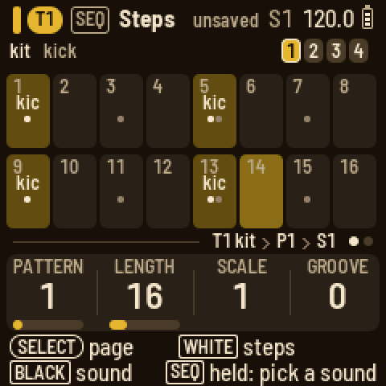
2. **A bass line.** Turn **ALGORITHM** to T2, the bass. On the Steps page, hold **SEQ** and play a low note:
   the keys are a keyboard while **SEQ** is down, and the note is remembered. Let go and press white keys 1, 4,
   7 and 11. Hold **SEQ**, play another note, let go and press white key 14. Or tap **REC** and play the
   notes one after another: each one goes on the next step. Press **EDIT** and turn **KNOB 1** while it plays
   to hear the shape change.

   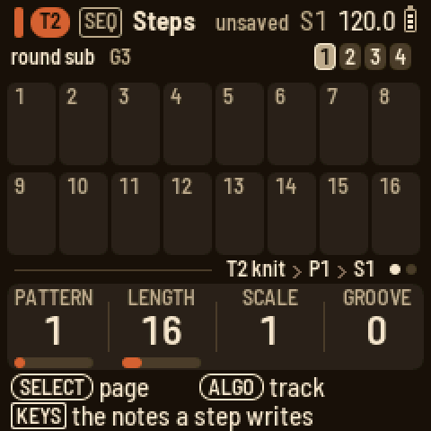 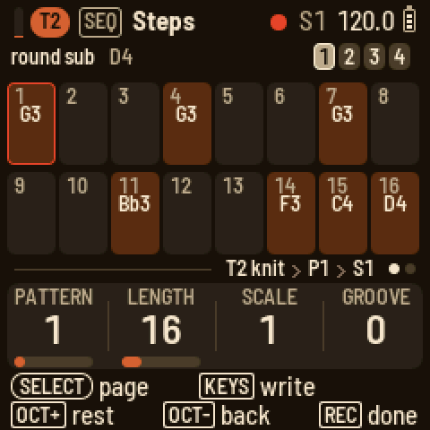
3. **Tricks.** Still on T2's Steps page, hold white key 7 and press **ARP**. Turn **KNOB 1** to multiply and
   **KNOB 2** to 3 for three hits. Let go. Hold white key 14, press **ARP**, turn **KNOB 1** to jump and
   **KNOB 2** to "either": the pattern starts to wander. Hold white key 1, press **ARP** and turn **KNOB 1** to
   skip trig, so step 1 plays every other pass.

   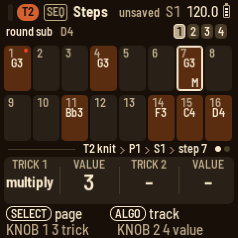
4. **A chord track.** Turn **ALGORITHM** to T3. Press **EDIT** and turn **PRESETS** until a pad you like
   comes up. Press **SEQ**, hold **SEQ** and hold three keys together, let go and press white key 1. Hold white
   key 1 and press white key 8 so the chord lasts half the bar: a bar under the cells shows how far it
   reaches. Hold **SEQ** and three keys a little higher, let go and press white key 9. The cells name the
   chords.

   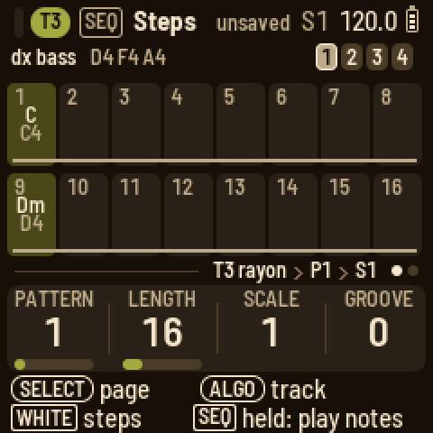
5. **The conductor.** Turn **ALGORITHM** to COND (the conductor). Press **EDIT**: the key is C major and every
   melodic track follows. Play an F, then a G, then a C while it plays: everything moves with you, in the scale.
   Press **SEQ**, turn **SELECT** for the Bar page and press black key 4 so a step is a beat. Back on Steps, hold
   **SEQ** and play a chord, let go and press a step, and so on: four steps are a bar of progression. Or let
   T3's chords lead: **EDIT**, turn **SELECT** to Follow and press black key 3.

   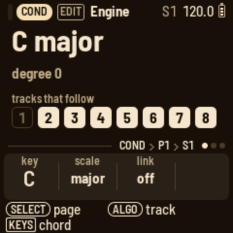 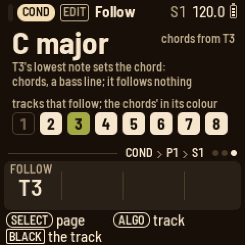
6. **Throws.** Press **FX** and turn **SELECT** to its last page, Throws. Hold a low key: F3 mutes the
   drums, G3 stutters them, A3 repeats, B3 echoes, C4 builds, D4 plays four on the floor, E4 jumbles them. A
   high key does the same on the melodic tracks. Let go and the pattern comes back.

   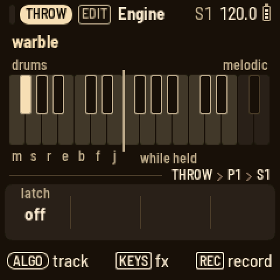
7. **A scene.** Press **HOME**. White key 1 is the scene playing. Press white key 2: a copy. Now change
   something: mute the drums with black key 1 on Arrange, or go to T2's Steps and turn **KNOB 1** to
   P2 for a new pattern. Press white key 1 and 2 in turn: while it plays, each waits for the next bar
   (press it again to switch at once).

   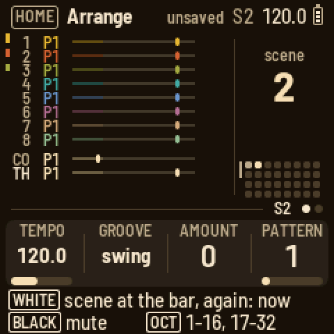
8. **Save.** Press **SAVE**.

From here: hold a step to see its velocity, length, chance and pitch; hold a step and press **EDIT** to lock a
knob on it; press **ARP** on T2 and turn **KNOB 1** to arp; press **GLO**, turn **SELECT** to Master out and turn
**KNOB 4** (the pump) while it plays. Hold any button for a second and a card explains it.

## Cheat sheet

### The words

- **Track** (T1 to T8): one sound and its patterns. After T8 come the aux tracks: COND (the conductor), THROW (the throws), FX I
  and FX II.
- **Pattern** (P1 to P8): a track's steps, up to 64 of them in four bars. Each track has eight.
- **Step**: one cell of a pattern. It holds up to four notes (on a drum track, any of the eleven sounds), two tricks, a
  chance and parameter locks.
- **Trick**: something a step does as it plays, such as pulse, hold, multiply or jump. There are fourteen; hold
  a step and press ARP to give it two.
- **Lock**: a knob value a step sets as it plays.
- **Scene** (S1 to S16): which pattern each track plays, plus the mutes and the conductor's key.
- **Song**: a chain of scenes, each played for a number of bars.
- **Engine**: the way a track makes its sound. Six synths (knit, rayon, jacquard, bellows, cane and voile), two
  for samples (sample and slice) and the kit, a drum synth.
- **Preset**: a sound to load. 85 come with LOOM-8, from seven to eighteen for each engine, and 16 are yours.
- **Player**: what the keys do on a track: arp, strum or hold.
- **Conductor**: the aux track that moves the other tracks through a key and scale, from its own chords or from
  a track's notes.
- **Throw**: a momentary effect on the drums or the melodic tracks, from a key on FX's Throws page.
- **Weave**: a track's pattern crossed with another, live: bars or steps in turn, or one's rhythm with the other's pitch.
  Set up on the track's ARP, played on the WEAVE track.
- **Groove**: a timing and velocity feel. The project picks the type, each track sets how much.
- **Pump**: the whole mix ducking on each kick and swelling back (Master out). A track's pump LFO does the same
  to one track.

### How do I…

White keys are numbered from the left, 1 to 16, and black keys the same way, 1 to 11. "Hold **HOME** and
press…" means keep **HOME** down while you press the next thing.

| How do I… | Do this |
| --- | --- |
| pick a track | Turn **ALGORITHM** on any page. |
| write a beat | Press **SEQ**. On a drum track, black key 1 is the kick: press it, then white keys 1, 5, 9 and 13. Black key 2 is the snare. |
| write a note | On Steps, hold **SEQ** and play the note, let go, and press a white key: the note goes on that step. |
| write a chord | On Steps, hold **SEQ** and hold the notes together, let go, and press a step. |
| pick a drum sound | On a drum track's Steps page, press its black key, or hold **SEQ** and press any key. |
| see a step | On Steps, hold its white key. The knobs show its velocity, length, chance and pitch. |
| make a note longer | Hold its step and press a later white key. A bar under the cells shows how far a note reaches. |
| nudge a step | Hold its step and press **OCT−** or **OCT+**. |
| change a step's note | Hold its step and turn **KNOB 4** (a drum step too: its hits play higher or lower). |
| put a second sound on a drum step | Hold the step and press the sound's black key. |
| take one note off a step | Hold the step, press **SEL**, pick the note and press **SEL**. |
| add a trick | Hold the step and press **ARP**. **KNOB 1** picks the first trick (pulse, hold, multiply, velocity, ramp up, ramp down, random, glide, bend, tonality, jump, skip lock, skip trick, skip trigger) and **KNOB 2** its value; **KNOB 3** and **KNOB 4** the second. Turn a trick back to "-" to take it off. |
| set a skip's pattern | Turn its value on past "random": the same cycles come again "not on the last pass", then "only the first". |
| give a step a chance | Hold the step and turn **KNOB 3**. Past 99 % come the A:B cycles. |
| lock a knob on a step | Hold the step and press **EDIT**, **ENV**, **FX** or **LFO**. Turn a knob. **SAVE** clears the step's locks. |
| see the next bar | Press **OCT+** on Steps. |
| play one bar of a long pattern, or jump about in it | **SEQ**, **SELECT** to the Bar page, hold **SEQ** and press black key 1 to 4: a bar to jump to; two held loop them; one tapped twice loops that bar. |
| set the track scale | On Steps, turn **KNOB 3**. Or on the Bar page of a synth track, press a black key: 1, 2, 3, 4, 5, 6, 8, 16 sixteenths a step, or black key 9 for half a sixteenth. |
| change the pattern | On Steps, turn **KNOB 1**. Playing, it comes at the next bar line: the knob reads NEXT 1>2 and the tag line "next P2" until it does. |
| weave two patterns | On the track, **ARP**, its last page Weave: a black key for the track woven in, a white key for its pattern, **KNOB 3** the rule. It plays woven from then on; to bring it in by hand instead, **KNOB 4** to "on WEAVE", then on the WEAVE track (**ALGORITHM**) hold that track's white key. |
| change the sound | Press **EDIT** and turn **PRESETS**: the engine's own sounds, "BASS 3/11": what the sound is for and where you are. **SEL** changes the engine. |
| edit a drum sound | On a drum track, press **EDIT** and press the sound's black key. The knobs are the model's own four. Turn **SELECT** for the model, random, pan and volume; its **SEL** list has the play mode. |
| shape one drum | On a drum track, press **ENV** and press the drum's black key: its own attack, hold, decay and lag. Turn **SELECT** for its filter: **PRESETS** picks low-pass, high-pass or band-pass, the knobs cutoff, resonance, envelope and drive. |
| play a sample | On a drum track, turn a key's model to sample. On a synth track, **SEL** and ENGINE: sample. The sample knob picks it. |
| load my own samples | Open <https://charlesvestal.github.io/fm1-loom/samples/> in Chrome or Edge with the FM-1 connected by USB: add, replace, rename, reorder or remove them, then Send. They come after the factory samples, as user 1, user 2 ... |
| chop a break | On a synth track, **SEL** and ENGINE: slice. Each key plays a slice of the break, F3 the first; write them on the steps in any order. Load your own with `tools/loom_samples.py load "amen.wav@2"` (a loop of 2 bars). |
| change the filter | Press **ENV** and turn **SELECT** to Filter. **PRESETS** turns the filter type. |
| give a sound some character | Press **FX**: the Character page. **PRESETS** turns the type (drive, fold, crush, ring, tilt, tape, sampler); the knobs are its amount, tone and mix. |
| use the effects | Press **FX** and turn **SELECT** to Sends: the track's sends. Turn on for FX I and FX II; **PRESETS** picks the effect. |
| play | Press **PLAY**: every track starts from step 1. |
| record live | Hold **REC** and press **PLAY**: it records from step 1 at once (after the count-in, if set). |
| record while playing | Hold **REC** and play: it records while you hold it. Hold **REC** and press **PLAY** to keep it on. |
| record a knob's motion | While it plays, on a sound page, hold **REC** and turn the knob: it is recorded while you hold **REC**. |
| set the click, count-in, quantise | Stopped, hold **REC** and turn the knobs: CLICK, COUNT, QUANT, MODE (overdub or replace). |
| record step by step | Stopped, on Steps, tap **REC**. The red cursor starts after the last note; each key (or chord) you play writes it and moves on. **OCT+** leaves a rest, **OCT−** goes back. **REC** again ends. |
| undo | Hold **HOME** and press **REC**. Hold **HOME** and press **PLAY** to redo. |
| set the tempo | Press **HOME** and turn **KNOB 1**. Hold **HOME** and turn it for tenths. On any page, hold **HOME** and turn **SELECT**. |
| use a throw | Press **FX** and turn **SELECT** to Throws. Hold a key: the lower octave works on the drums, the upper octave on the melodic tracks. Hold **REC** while it plays to record them into the THROW track. |
| make a new scene | Press **HOME** and press an empty white key. It becomes a copy of the scene playing. |
| switch scenes while playing | On Arrange, press the scene's white key: it starts at the next bar. Press it again to switch at once. To wait for the end of T1's pattern instead, set **SEL**'s SCENES SWITCH to "pattern end". |
| mute a track | On Arrange or Mix, press its black key. On Mix, hold it to solo the track while you hold. |
| make the whole mix pump with the kick | Press **GLO**, turn **SELECT** to Master out and turn **KNOB 4** (pump). **SEL** picks what drives it and how fast it swells back. |
| solo a track | On Mix, hold its black key. Let go, and the mutes come back. |
| play a progression | Turn **ALGORITHM** to COND (the conductor). Press **EDIT** and play a chord: it moves the tracks that follow. Press **SEQ** and press a step: the chord goes on it. Set the scale to 4 on the Bar page so a step is a beat. |
| let a track lead the chords | On COND, press **EDIT** and turn **SELECT** to Follow. Press the track's black key: its lowest note sets the chord for the others (a chord part or a bass line). The same key again: off. |
| get new sounds for the band | Press **HOME**, press **SEL** and pick RANDOMIZE PRESETS: T2 to T8 each get a random preset of their part. **SEL** says yes. |
| save | LOOM-8 saves by itself when stopped and quiet. **SAVE** saves at once; hold **SAVE** and press white key 1 to 3 to save to that slot. |
| keep a sound | On a sound page, hold **SAVE** and press a white key. The sound becomes that user preset. |
| load a project | Press **HOME**, press **SEL**, turn **ALGORITHM** on LOAD PROJECT to the slot, and press **SEL**. NEW PROJECT starts an empty one in a free slot, its sounds picked at random (RANDOMIZE PRESETS: new ones). |

### The buttons

| Control | What it does |
| --- | --- |
| **PLAY** | Starts (every track from step 1) and stops. A track whose scale or length you change stays in phase with the rest. On the Song page, it plays the song from the slot picked. With **REC** held, it starts live recording. |
| **REC** | Held while playing: records while held. Stopped: a tap arms step record. Held while playing on a sound page, the knobs you turn are recorded; held while stopped (or on Steps), the knobs are the record settings (click, count-in, quantise, mode). |
| **SEL** | Opens a list of this page's settings and actions. With a step held, its notes. When LOOM-8 asks a question, **SEL** means yes. |
| **HOME** | Opens Arrange. On Arrange, it opens the Song page. Held, it is the shift key for buttons and knobs: undo and redo, the fine tempo, the scenes on **PRESETS**. When LOOM-8 asks a question, **HOME** means no. |
| **SEQ** | Opens Steps. Its page 2 is Bar. Hold it on Steps and the keys play the track and set what a step writes. |
| **EDIT** | Opens Engine. Its page 2 is Play, page 3 Play 2 (the octave); knit and rayon have a page 4, Sub, the engine's second set of knobs. On a drum track, page 2 is the key's model, random, pan and volume, page 3 its sends. The conductor's pages are its key, the routing and Follow. |
| **ENV** | Opens Envelope (a drum track: lag, attack, random, length), then Filter, then the filter's envelope. |
| **FX** | Opens Character, the track's own effect. Then Sends, the track's sends to FX I and FX II. Then FX I and FX II, the two effects. |
| **LFO** | Opens LFO. Its page 2 has the type's fourth and fifth knobs. |
| **ARP** | Opens Players. With the arp, page 2 is its second set of knobs and page 3 is hold. |
| **GLO** | Opens Mix. Turn **SELECT** for Master EQ, Master color, Master out and Setup. |
| **SAVE** | Saves. Hold it and press a white key to save to a slot, or to keep a sound. With a step held, clears its locks. |
| **OCT−** / **OCT+** | Move the keys an octave. On Steps, show the bar before or after; with a step held, nudge it. In step record, move the cursor. |
| **SELECT** | Turns to a button's next page. In a list, it moves up and down. |
| **ALGORITHM** | Picks the track. In a list, it changes the row's value. |
| **PRESETS** | Steps to the next item of whatever the page shows: a preset, a drum key, an effect, a pattern, a drum sound, a scene. |
| **KNOB 1–4** | Set the four values at the bottom of the screen. |

Hold any button for a second, and a card explains it. The two lines at the bottom of the screen always say
what each control does on the page you're on.

## Getting around

### The screen

From top to bottom, the screen has five parts.

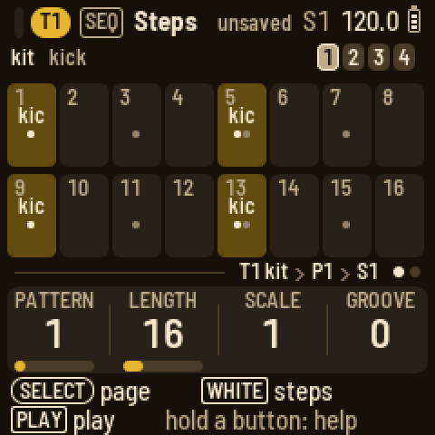

- **The header** shows the page's button and name, the tempo, a red dot while recording, and "unsaved". On a
  track's pages, the track's pill comes first, and before it a small meter: what that track is playing now, so
  you can tell its notes from the others'.
  Messages and questions cover it for a moment.
- **The middle** is the page itself.
- **The tag line** says where you are: the track and its engine, the pattern and the scene, such as
  "T3 knit › P2 › S1". The dots at the right say which of the button's pages you're on.
- **The knob strip** shows the four knobs' names and values, each with a bar in the track's colour. The
  knob you just turned shows in the text colour.
- **The two bottom lines** say what the encoders and the keys do here.

The screen comes in two themes (Setup's THEME knob): **tape deck**, warm brown-black with cream text, and
**blueprint**, deep blue with white lines. In both, every instrument track has its own colour; in tape deck
T1 mustard, T2 rust, T3 olive, T4 teal, T5 blue, T6 plum, T7 tan, T8 sage. A track's steps with notes are
its colour, dimmed; what sounds now is its colour, bright: the step playing, the scene playing, a meter. On
Arrange and Mix every track keeps its colour, so you can tell them apart at a glance. Cream (or white)
outlines are you: the held step, the cursor, the knob you turned. Red is only for recording and for locks.

### Messages

Short messages cover the header for a moment. **i** is news, **✓** is something done, an arrow is an undo
or redo, **?** on red is a question that waits for **SEL** or **HOME**, and **!** means LOOM-8 could not do it
and says why.

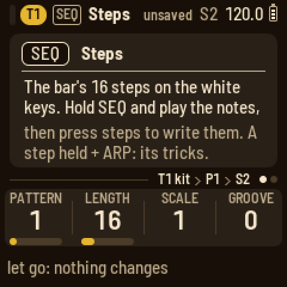

### The tracks

Turn **ALGORITHM** to pick a track: T1 to T8, then COND (the conductor), THROW (the throws) and WEAVE. On Mix it goes
through Mix's strips instead: T1 to T8, then FX I and FX II, the effects' returns. The keys play the
track you picked on the Engine, Play, Envelope, Filter, LFO and Players pages. On a drum track, the black
keys are the eleven drum keys, and the white keys play them too. On FX I and FX II, the keys play the
instrument track you picked last, so you hear the effect.

### The lights

**PLAY** is green while playing and red while recording. **REC** lights while recording or armed. **SAVE**
lights when there is something to save. The page's button is lit. On Steps, the steps with notes glow and the
step playing is bright. On Arrange,
the scenes in use glow and the one playing is bright. The muted tracks' black keys glow. With Setup's LIGHTS
on, the other buttons glow too.

## Steps

Press **SEQ**. The main band shows one bar of the pattern as 16 cells, and the 16 white keys are those
cells. The top line says what a press writes: on a drum track, the sound shown; on a synth track, the
remembered notes, which are the last keys you held together on a play page; on the THROW track, the last
effect you played. The four squares at the right are the bars.
**OCT−** and **OCT+** show the bar before or after.

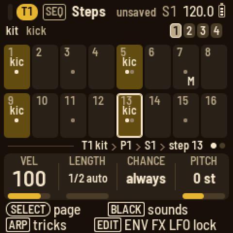

- **Hold SEQ and play keys** to choose what a step writes: the keys play the track, and the ones you hold
  together become the remembered notes (a chord). On a drum track, the key you play becomes the sound shown.
  Let go of **SEQ** and nothing else changes.
- **Tap a white key** to put the remembered notes on that step, or to clear the step.
- **Hold a white key** to see the step (held longer than a tap, it stays as it is). **KNOB 1** is its velocity
  (on a drum track, the velocity of the sound shown: each sound of a step has its own; the black keys pick the
  sound), **KNOB 2** its length in steps, **KNOB 3** its chance (always, a percentage, then the A:B cycles: on the A-th
  of every B passes) and **KNOB 4** its pitch: on a synth track its notes move by semitones, a chord together;
  on a drum track the step's hits play up to 24 semitones from their key's pitch, the step's own note, apart
  from the key's pitch knob and its locks. **OCT−** and **OCT+** nudge it, earlier or later.
- **Hold a step and press a later white key** to make its note reach that step. **KNOB 2** takes it further, up
  to the pattern's whole length (in quarter steps to 16 steps, then whole steps); a note held past the end of the
  pattern goes on round from its start. The bar under the cells shows how far it reaches, with an arrow where it
  goes on onto another bar or comes in from one.
- **Hold a step and press a black key** on a drum track to put that sound on the step, or take it off.
- **Hold a step and press SEL** for a list of its notes. Pick one and press **SEL** to take it off. The list
  also has COPY STEP; hold another step (or several) and its list has PASTE STEP (the notes and locks) and PASTE
  LOCKS ONLY (the locks onto the notes already there).
- **Hold a step and press ARP** for its tricks (below).

### Tricks

Hold a step and press **ARP**. The knob strip shows the step's two tricks: **KNOB 1** picks the first and
**KNOB 2** its value, **KNOB 3** and **KNOB 4** the second. Turn a trick back to "-" to take it off. Hold
several steps and they all take the same turn. Let go of the steps when you are done.

| # | Trick | Values: 1 to 9, then random |
| --- | --- | --- |
| 1 | pulse: play the step again on the next steps | 1 to 9 times |
| 2 | hold: keep the note over the next steps | 1 to 9 steps |
| 3 | multiply: retrigger the step | 1 to 9 hits |
| 4 | velocity | 4, 8, 16, 32, 64, 100, 112, 127, 0 |
| 5 | ramp up: the note climbs the scale each pass | 2 to 6 steps over one octave, then over three |
| 6 | ramp down | the same |
| 7 | random: another note of the scale each pass | the same |
| 8 | glide: slide into the note | 10 % to 80 %, then off |
| 9 | bend | down-up, up-down, bumps, springs, fades, random 1 and 2 |
| 10 | tonality: how the step takes the conductor | ignore, transpose only, octave up, fifth up, third up, chromatic up, chromatic down, quantize 33 %, 66 %, 100 % |
| 11 | jump: move the playhead | to step 1, 5, 9, 13, forward, back, either, stay, align |
| 12 | skip lock: the locks play every Nth pass | a cycle of 1 to 9 |
| 13 | skip trick: the other trick plays every Nth pass | a cycle of 1 to 9 |
| 14 | skip trigger: the step plays every Nth pass | a cycle of 1 to 9 |

For the three skips, the value goes on past random: the same cycles again, playing all but the last pass, then
again playing only the first. A new trick starts at its default: pulse and hold 4, multiply 2, velocity 64, the
ramps and random 4, glide 40 %, bend down-up, tonality fifth up, jump forward, the skips a cycle of 2.

Pulse and hold keep time: the playhead goes on, the steps they cover give way to them, and the track carries on
where it would have been. On a drum track only the sounds on the trick's step give way: the other sounds play
their steps as written, so a pulsed kick does not stop the hats.

A step's chance and its skip trigger decide whether the step happens at all. When it does not, its tricks do not
either, a jump included: a jump with a 25 % chance jumps about one time in four. A jump back, or stay, starts a new
pass, so the A:B cycles, the skips and the ramps keep counting inside the loop it makes.

A cell shows its note, two notes one over the other, or the first note and how many more ("+2"). A chord shows
its name with its bass note under it; a name too long for the cell is shortened (CM7 for maj7, C+ for aug, Co for
dim, Cs2 and Cs4 for the sus chords), and one still too long (C#M7, Ebm7) puts the root over its quality. An
effect on the throw track shows three letters (PAN) over its group (drm or mel). On a drum track, every sound on the
step has a tick, the shown sound's bright, so the whole beat is visible while you edit one sound. A bar along
the foot of the cells shows how far a long note reaches; an arrow at the bar's end means it goes on. The
tricks' letters sit at the bottom right, a percent sign marks a chance, and a red dot marks locks.

### Locks

Hold a step and press **EDIT**, **ENV**, **FX** or **LFO**. The knob strip becomes that module's four knobs
for the held step (turn **SELECT** for its other pages: **ENV** has the envelope, the filter and the filter's
envelope; **FX** the character and the sends), showing "–" where the step has no lock and the locked values in red. Turn a knob to lock
a value on the step. Let go of the step to go back. A lock lasts until the next step that plays without one,
which plays the knob's own value again. Hold a step and press **SAVE** to clear its locks (a drum step's pitch
stays). While recording, a knob you turn writes locks on the steps as they play. The Bar page's SHAPE knob turns
a track's locks into a line: each holds until the next lock and moves toward it.

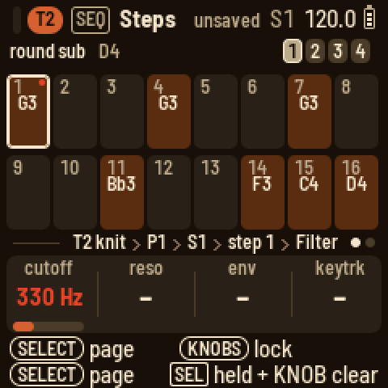

### The Steps knobs and the Bar page

With no step held, **KNOB 1** picks the pattern (P1 to P8), **KNOB 2** the length in steps, **KNOB 3** the
track scale (how many sixteenths a step takes, from 1/2 to 16) and **KNOB 4** the track's groove amount.

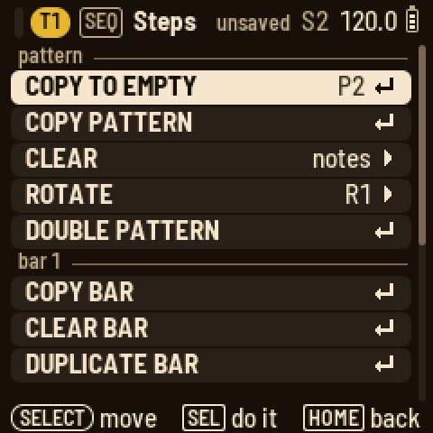

Turn **SELECT** for the Bar page: quantise for live recording, the note length of new steps as a percentage
of a step, the groove amount and the shape. The keys write steps as on Steps (a step held: its knobs, tricks and
locks; on a kit the black keys pick and place its sounds); the box of the bar they write is outlined, **OCT-**
and **OCT+** move it. On a synth track the black keys set the track scale: 1, 2, 3, 4, 5, 6, 8, 16
sixteenths a step on black keys 1 to 8, half a sixteenth on black key 9. Press **SEL** on either page for the
actions: clear notes, clear locks, clear both, copy the pattern or the bar shown, paste it (a bar onto the bar
shown; the copy is read when you paste, and a kit's steps go only onto a kit) or its locks alone, rotate it a step
forward or back, duplicate the bar into the next, or double the pattern (twice as long, playing itself twice, its
locks too: a 16-step pattern becomes 32, to vary its second half).

On the Bar page, hold **SEQ** and press black keys 1 to 4: they are the pattern's bars. One key jumps to that bar at
the next bar line and plays on from there (a loop you had is let go). Two held loop that range of bars; one tapped
twice loops that bar. The loop is saved with the pattern (it is per track and per pattern): only the loop plays, so a
bar you are editing comes round at once. A bar under the boxes marks the loop, a small bracket the jump waiting for
its bar line, and Arrange draws the loop bright inside the pattern's line with the playhead repeating in it. Stopped,
the keys set the loop at once. (SEQ held on the other pages still picks the notes a step writes.)

### Weave

A weave crosses what a track plays with another pattern, live, while the song plays: nothing is written. You set
a weave up on the track, and from then on that track plays woven (the other track plays as it was). Or you keep it
for the WEAVE track, to bring in by hand.

**Set it up.** On a track, press **ARP** and turn **SELECT** to its last page, Weave. Press a black key for the
track to weave in (1 to 8 the tracks, 9 COND, 10 THROW; the same key again: none) and a white key, 1 to 8, for
its pattern. **KNOB 1** (WITH: the track), **KNOB 2** (PATTERN: its pattern) and **KNOB 3** (RULE) say the same.
The page says it in words ("T2 weaves with T1", "by rhythm: T2 P1's rhythm, T1 P1's pitch") and draws a bar
three ways: the track's own steps, the other pattern's, and what plays, each step in the colour of the
pattern it comes from. A pattern longer than a bar: **OCT+** and **OCT−** go through its bars ("bar 2 of 4"). Its last line says whether it plays (on), or which WEAVE track key brings it in. The rules:

| Rule | What the track plays |
| --- | --- |
| bars | its bars and the other pattern's in turn: its bar, the other's bar ... |
| steps | its steps and the other's in turn |
| rhythm | its rhythm, playing the other pattern's pitches in their order, round and round |
| pitch | the other pattern's rhythm, playing this track's pitches |

Each pattern loops by its own length, and the turns count from the start, so a one-bar pattern woven by bars
plays its own bar, then the other's. A track can weave with any track: a drum track's sounds become notes on a
melodic track (a ladder from C3: the kick C3, the snare Eb3, the hat F3 ...), and a melody's notes become a kit's
sounds; the throw track weaves only with throws. The conductor weaves too: a progression with another.

**When it plays.** **KNOB 4** on the Weave page, PLAYS: **always** (as soon as it is set up: the default) or **on
WEAVE**, only while the WEAVE track's key for the track is on (held, latched, or on its steps).

**Play it.** For a weave set to PLAYS on WEAVE, turn **ALGORITHM** to WEAVE. Its white keys 1 to 10 are T1 to T8, COND and THROW: hold one and that
track weaves while you hold it; the key lights, and so does its box on the screen. **KNOB 1**, latch, makes a tap
start a weave and the next tap stop it. Hold **REC** while it plays and the weaves you play are written onto the
WEAVE track, each from the step it started for as long as it lasted, and the song plays them back.

**The WEAVE track's steps.** On **SEQ** its steps show the tracks they weave and, under them, how long. Tap a step
to put on it the tracks you last wove (again: clear it); hold a step and press black keys 1 to 10 for its tracks
and a later white key for its end. **KNOB 1** picks its pattern (each scene keeps its own), **KNOB 2** its length
(16 to 64 sixteenths; with a step held, the step's). **SEL** clears the pattern.

**Keep it.** SEL on the Weave page has KEEP AS PATTERN: the weave written into the track's first empty pattern, to
edit like any other. A pattern woven with a copy of itself, shifted (copy, ROTATE FORWARD, weave it by steps), makes
variations; a drum pattern's rhythm with a melody's notes makes a riff.

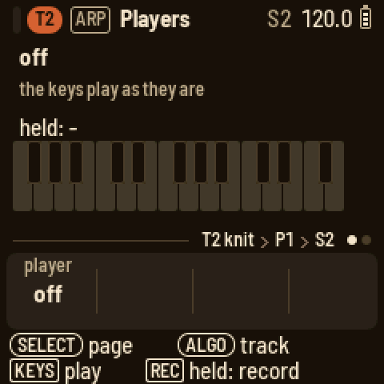 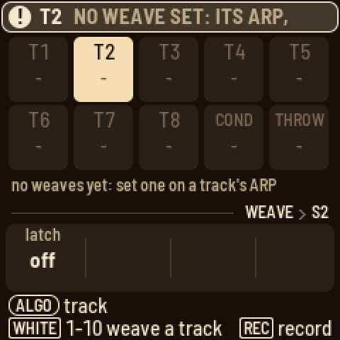

## Recording

- **Live recording**: hold **REC** and press **PLAY**. Every track starts from step 1 and recording starts at
  once (after the count-in, if one is set); the keys write steps as you play, quantised by QUANT, and chords
  land on one step together. Press **PLAY** to stop.
- **While playing**: hold **REC** and play. It records only while you hold **REC**. Hold **REC** and press
  **PLAY** to keep it on; press **REC** again to turn it off.
- **Motion**: while recording, a knob you turn on a sound page (Engine, Envelope, Filter, Character, Sends,
  LFO ...) is written onto the steps as they play, as locks. To punch it in, hold **REC** while it plays and turn
  the knob: it records while you hold **REC**, the keys too.
- **Chords on the conductor**: turn **ALGORITHM** to COND and record the same way. Each chord lands on the
  nearest step (set its scale to 4 on the Bar page, so a step is a beat), and a new chord replaces the one
  that was there.
- **Record settings**: stopped (or on Steps and Bar), hold **REC** and turn the knobs: CLICK (off, while recording, on), COUNT (a count-in of
  off, 1 or 2 bars), QUANT (how far notes are pulled onto the steps) and MODE (overdub adds to the pattern;
  replace clears the steps the playhead passes as you record over them). Holding **REC** to turn them
  changes nothing else.
- **Step by step**: stopped, tap **REC**. On Steps the keys become a keyboard and a red cursor marks the
  step they write, starting after the pattern's last note. A key, or keys held together, writes the step and
  the cursor moves on when you let go. **OCT+** leaves a rest, **OCT−** goes back a step. On a drum track the
  sound is added to the step. Tap **REC** again to stop. It works on the sound pages too, with a strip of the
  bar along the foot of the screen.
- **Throws** you hold while recording are written into the THROW track's pattern.

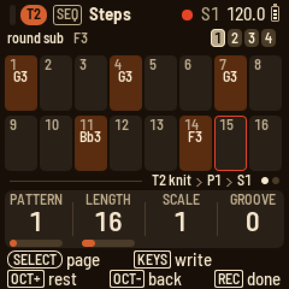

Hold **HOME** and press **REC** to undo the last change to the pattern. Hold **HOME** and press **PLAY** to
redo it. One stage, the selected track's pattern; locks stay as they are.

## Sounds

Press **EDIT**. The Engine page shows the track's engine, a picture of it that moves with the knobs, and its
four knobs with their values from 00 to 99. Turn **PRESETS** for the engine's next
sound: its factory presets, then the user presets saved from it. The message says what the sound is
for and where you are, as in "PAD 3/11". The roles are bass, lead, keys, pluck, bell, stab, brass, strings, pad,
voice, chord, fx, drum and loop; a user preset says "PRESET". Each engine's presets run from its own plain sound
through basses, leads, keys, plucks and bells to pads. Most are dry. Pads, strings, voices and
bells send to the reverb, and some plucks and leads to the delay. Press **SEL** for the list: ENGINE changes the engine and loads its first sound, then a preset,
SCRAMBLE for a random sound, SAVE AS PRESET, RESET SOUND, and whether the track FOLLOWS CONDUCTOR.

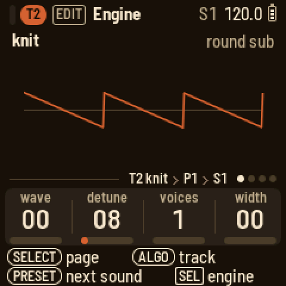 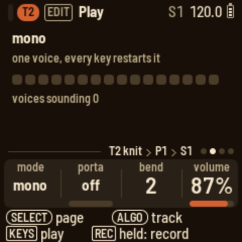

| Engine | Knobs | Presets |
| --- | --- | --- |
| knit | wave, detune, voices, width | 11 |
| rayon | bright, ratio, edge, tine | 10 |
| jacquard | table, scan, bend, ripple | 11 |
| bellows | stops, pedal, rotor, rate | 9 |
| cane | model, timbre, color, damp | 8 |
| voile | model, timbre, color, breath | 7 |
| sample | sample, start, length, mode | 18 |
| slice | sample, slices, pitch, gate | 11 |
| kit | the shown key's model knobs | |

Knit and rayon have a second set of knobs: **EDIT**, then **SELECT** to the Sub page.

### Knit

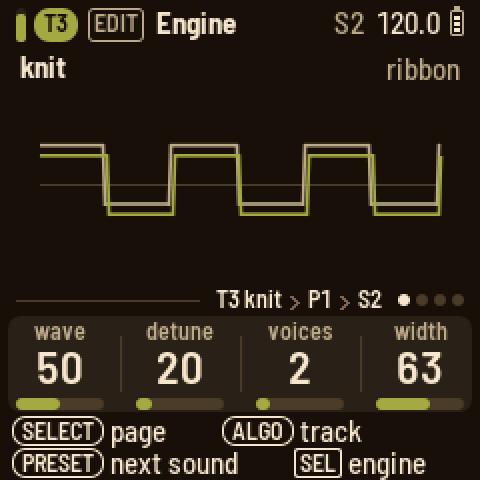

Knit is the everyday subtractive voice: basses, brass, strings, stabs, pads. **wave** goes from a saw through a
square to a narrow pulse (an LFO on it is PWM). **voices** stacks one to seven of that wave, the unison:
**detune** spreads their pitches, fine at first and wide at the end, and **width** opens them across the stereo
field. With one voice, **detune** is a slow drift of the pitch instead.

The Sub page: **osc 2** is one more of the wave, 24 semitones either way of the note, and **level** its level
(0 is off); **sub** is a sine an octave down; **noise** adds noise. **detune** tunes osc 2 too, up to 20 cents
above its interval, at any number of voices: osc 2 at 0 semitones with a little detune is the classic two
oscillators beating.

A wide unison costs more than an ordinary voice. So knit plays at most six voices, five with seven in its unison;
a new note past that takes its oldest.

### Rayon

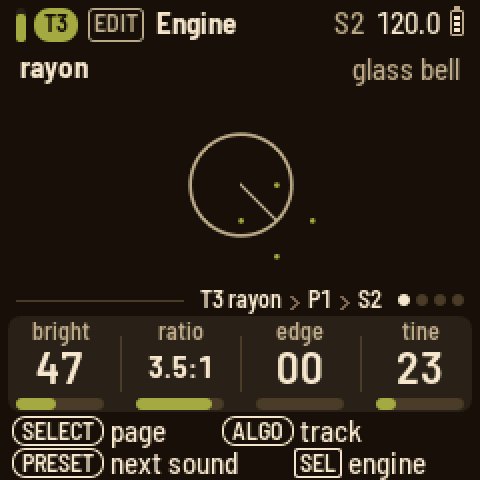

Rayon is two-operator FM, the DX way: e-pianos, bells, mallets and basses. **bright** is how much the modulator
moves the carrier (a soft note gets less of it). **ratio** is the modulator's pitch against the note: the left
half a 1:1 detuned for a slow beating, the right half the ratios from 0.5:1 to 8:1, the bells' inharmonic ones
among them. **edge** feeds the modulator back on itself, from a sine toward a saw. **tine** is a high partial
struck with the note and gone in a quarter of a second, by how hard you play: an e-piano's bark.

The Sub page: **fall** is how fast the brightness falls from the start of the note (0 holds it), **floor** how
much of it is left, and **keyscale** makes high notes less bright.

### Jacquard and bellows

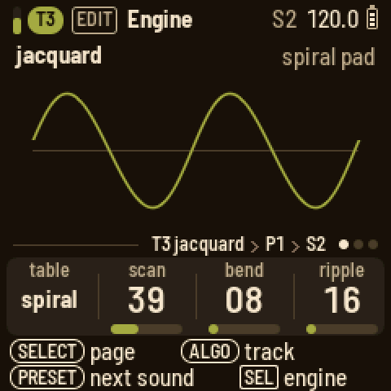 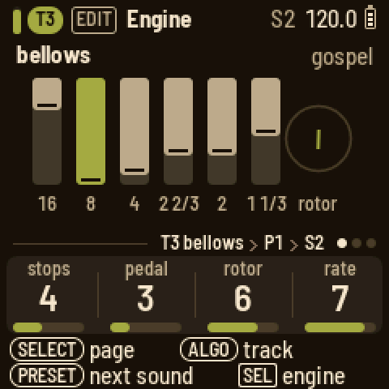

**Jacquard** plays wavetables. **table** picks one of nine: shapes, nasal, grit, vocal, spiral, fold, octaves,
glass and chirp. **scan** moves through its frames, **bend** bends the wave's shape, and **ripple** wobbles it
with a second oscillator, slow at first and up to the note's own rate.

**Bellows** is the organ: six drawbars. Its four knobs go from 1 to 8. **stops** picks the registration:
transistor, combo, jazz, gospel, rock, theatre, pipe or church. **pedal** adds the low 16' bar (1 is none),
**rotor** how deep the rotating speaker swirls (1 is none) and **rate** how fast.

### Cane and voile

Two engines from Mutable Instruments' Braids, Émilie Gillet's macro oscillator, each a family of its models.
**model** picks one; **timbre** and **color** are Braids' own two knobs, and what they do depends on the model;
the fourth knob is LOOM-8's.

**Cane** is the physical models: instruments built from their parts, a string, a tube, a bell.

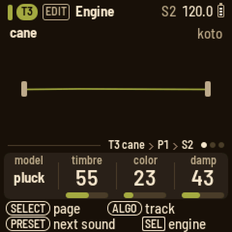

| Model | timbre | color |
| --- | --- | --- |
| pluck | how long the string rings | how wide the pluck: hollow to full |
| bow | how hard the bow presses | where it crosses the string |
| reed | how steady the breath (less noise) | the body's tone |
| flute | how breathy, high is clean | how hard it is blown |
| bell | how long it rings; at the top it never stops | the partials pulled apart |
| drum | how long it rings | from tone to rattle |

**damp** darkens it: a softer pluck, a duller bridge or bore, the bell's and the drum's upper partials dying
first. A pluck or a strike plays at each note; the bow and the breath start again on each note, and in legato
they carry on while the pitch moves. Cane plays at most four voices at once (each keeps its strings and tubes in
memory of its own); a new note past that takes its oldest. Very low notes the bow or the flute cannot reach
sound an octave up.

**Voile** is the voices.

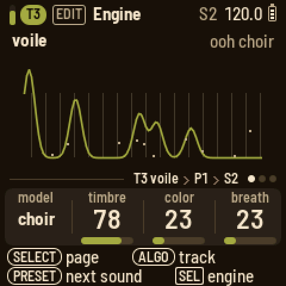

| Model | timbre | color |
| --- | --- | --- |
| vosim | the first formant | the second formant |
| vowel | the vowel, through nine | the formants' shift |
| choir | the vowel: a, e, i, o, u | the singer: bass to soprano |
| whisper | how sharp the two peaks | how far the second is from the note |

**breath** is the noise in the voice: on vosim and choir the air through it, on vowel the consonant at the
start of each note (none to long), on whisper the share of noise against a buzz (all the way up, a whisper).

Most of these models cost about as much as any voice or less; cane's bell, with its eleven partials, about a third more.

### Kit

A drum track has eleven keys on the black keys, each with a drum model: kick, snare, hat, clap, shaker,
tambourine, string (a plucked string), conga, tom, fm or sample. The kit is tuned to C: kick G1, snare G3, low tom C3,
high tom G3, conga C4, string C3, fm C5. Press a black key, or turn **PRESETS**, to pick the key the
knobs edit. The Engine page's four knobs are the model's own:

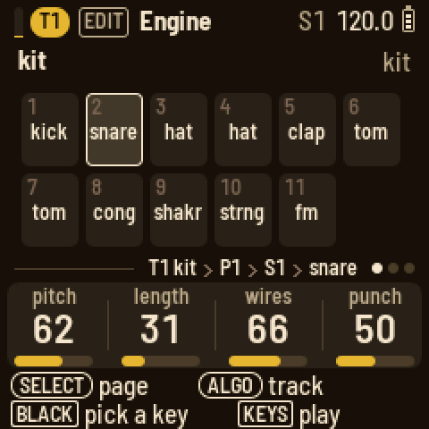 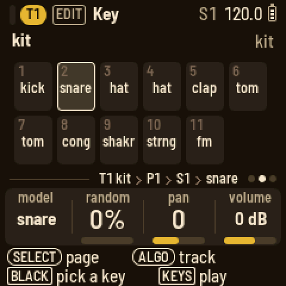 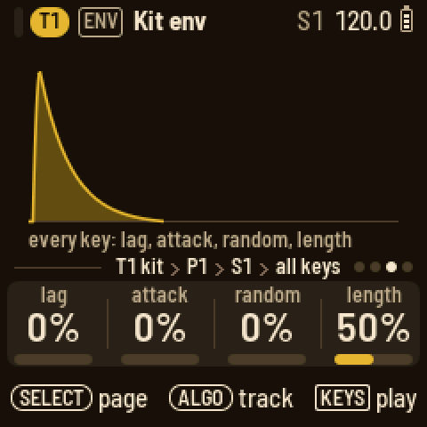

| Model | Knobs |
| --- | --- |
| kick | pitch, length, punch, tone |
| snare | pitch, length, wires, punch |
| hat | pitch, length, metal, focus |
| clap | tone, length, spread, tail |
| shaker | color, length, swell, return |
| tambourine | tone, length, jingle, hiss |
| string | pitch, length, bright, pluck |
| conga | pitch, length, slide, drive |
| tom | pitch, length, sweep, rate |
| fm | pitch, length, mod, feedback |
| sample | sample, pitch (24 semitones each way), start, reverse |

On every sound page of a drum track, a black key picks the key the knobs edit. Turn **SELECT** for the
key's page: the model, random (a variation on every hit), pan and volume in dB; its **SEL** list has the play
mode: one-shot, gated, loop, or choke groups 1 to 3. A new model starts from its own knobs.

**ENV** on a drum track has four pages. The first two are the shown key's own, after its model:

- **Envelope**: attack (a rise from silence, up to a second), hold (full level, up to a second), decay (a fall
  to silence; at "off" the model's own length decides) and lag (the key starts up to 60 ms late: a lazy snare,
  a flam). The picture draws the shape; the key's name is in the line above the knobs.
- **Filter**: cutoff (50 Hz to 20 kHz), resonance, env (how far the key's envelope moves the cutoff, up or
  down: with a decay set, a sweep on every hit) and drive (the key squared off, its level kept). **PRESETS**
  picks the type: off, low-pass, high-pass or band-pass. The picture draws the curve, and faintly where the
  envelope takes it.

A key left as it comes (attack, hold and lag at 0, decay off, no filter, no drive) sounds as its model alone
and costs nothing. Then two pages for the whole kit:

- **Kit env**: lag (a delay before every hit), attack, random (every key's knobs vary on each hit) and length
  (every model's length scaled).
- **Kit filter**: the kit's bus, after the keys are summed: low cut, compression, drive and hi cut.
  **PRESETS** turns it on or off.

Each key has its own sends: **FX**, then **SELECT** to Sends, shows the shown key's sends to FX I and FX II
(a black key or **PRESETS** picks the key). The clap into the reverb, the kick and the hats dry:
a kit has no sends of its own beside its keys', and a new kit's keys come with a little reverb on the clap and
the fm key, the rest dry.

Locks reach a key's own: hold a step and press **ENV**, and the knobs are the envelope (then, turning
**SELECT**, the filter) of the step's key: the one shown if the step plays it, else the step's first. The
line above the knobs names it.

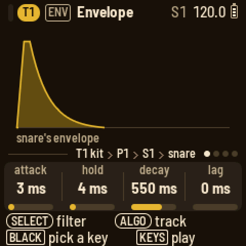 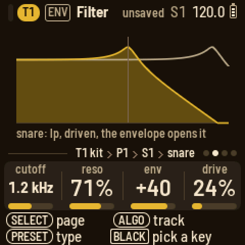

The **sample** model plays a sample of the bank (below) on the key: sample picks it, pitch tunes it 24
semitones either way of its own rate, start begins later in it, reverse plays it from its end back to the
start. It plays to the sample's end, or as long as the key's decay lets it. Four sample keys sound at once; a
fifth takes the oldest's place.

### Samples

LOOM-8 carries a bank of samples: sixteen of its own (a 909's kick, snare, hat and clap; a noise sweep; piano,
upright bass, strings, brass, flute and an orchestra hit; a vinyl loop; and four breaks for the slice engine:
classic, heat, choke and ecstasy), then thirty-two of yours, user 1 to user 32. The sample model on a drum key and the sample engine
on a synth track both play them, the knob naming each one.

The **sample** engine plays a sample at the pitch of the note: the sample's root note plays it at its own rate,
an octave up twice as fast. Its knobs:

| Knob | What it does |
| --- | --- |
| sample | which one (an empty user slot plays nothing) |
| start | where it begins, 0 to 99 % in |
| length | how much of the rest plays, to its end at 100 % |
| mode | one-shot (once, then the note ends), loop (round and round; a sample with its own loop loops that), reverse (once, backwards), ping-pong (forth and back) |

The picture shows the sample's waveform, the part that plays bright, a dot where it starts and the loop's ends
marked. Then the track's envelopes, filter, character and LFO shape it like any engine. Its eighteen presets:
piano (looped, a little tape), dusty keys (darker, the tape wobbling), piano stab (short and bright), rev piano (the
piano backwards), upright and dusty bass (the upright bass, plucked; the second short and deep in the tape),
strings, str stab (the section's attack, cut short) and swell (the strings backwards), brass and horn stab, flute
and air flute (an octave down, a pad), orch hit and dark hit (an octave down), vinyl (the run-out groove), riser
(the noise sweep) and boom (the kick, low and long).

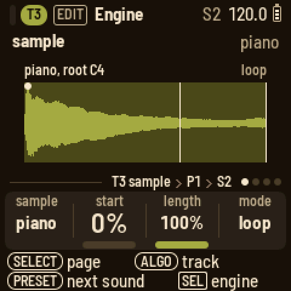

### Slice

The **slice** engine cuts a loop (a break) into even slices and plays one a note: the sample's root note plays
slice 1, the next note up slice 2, and so on, round again after the last (with eight slices, F3 to C4 are
slices 1 to 8 and C#4 is slice 1 again; below the root they count back from the last). On the keys at their own
octave, F3 (the lowest key) is slice 1 of a factory break. Written on the steps, the slices replay the break
(slice k on every other step, for eight slices of a bar) or make a new one from its pieces: any order, repeats,
gaps. Its knobs:

| Knob | What it does |
| --- | --- |
| sample | which loop (the factory break, or one of yours) |
| slices | 4, 8, 16 or 32 even slices |
| pitch | 24 semitones either way: down, a slice plays slower and longer than its place; up, faster and shorter |
| gate | how much of each slice plays, to all of it at 100 %; a short fade at both ends, so a cut never clicks |

A loop that says how many bars it is follows the tempo: its bars last as many bars of the song, so a factory break
plays slower at a slower tempo, each slice still on its steps; the pitch knob goes on top. A sample
that does not say plays at its own speed (the picture says "own speed"). In poly mode each note plays its slice
to its gate and overlaps the next; mono cuts the playing slice for the new one (a quick fade, then its start);
legato moves to the new slice at the same place in it, the time running on. Then the envelopes, filter,
character and LFO shape it like any engine (the presets keep the filter's keytrack at 0, so every slice sounds
alike). A slice plays to its gate however short the note: the gate decides the length, not the step, so slices on
the steps play through as the break did. Choosing the engine from **SEL**
takes the track off the conductor: its notes pick slices, and a chord change would move them (FOLLOWS CONDUCTOR
turns it back on).

The picture shows the loop's waveform cut at the slices, each slice's gated part drawn and what the gate leaves
out faint, the slice playing lit with a line where it is, a dot on slice 1. Above: the loop's name and bars,
the count or the slice playing. Its eleven presets: breaks, heat, choke and ecstasy (each break in eight slices, as
it was played), jungle (classic in sixteenths, driven, each slice cutting the last), roller (choke in sixteenths,
tight), two step (choke in sixteenths, short, a touch of delay), dusty loop (ecstasy three semitones down, in the
tape), half time (classic an octave down, dark), hits (classic's eighths one at a time, short, to play as a kit)
and ghosts (classic's sixteenths, soft and short, under another beat).

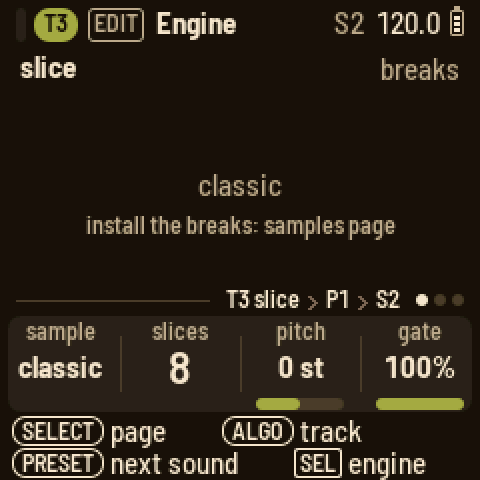

**Your own samples.** Connect the FM-1 (running LOOM-8) to a computer by USB and open the Samples page,
<https://charlesvestal.github.io/fm1-loom/samples/>, in Chrome or Edge. Connect reads the samples on the FM-1;
add files (WAV, AIFF, MP3 or FLAC: drop them on the page), replace one by dropping a file on it, rename, move up
or down, remove; set each one's root note and, for a loop, its bars; then Send. The samples already there are
kept exactly as they were. Quality picks the rate new samples are stored at: auto takes the best at which
everything fits.

The same from the command line, from the firmware's folder:

```sh
pip install mido python-rtmidi numpy
python3 tools/loom_samples.py load kick.wav snare.wav "vox=ah_A3.wav" "pad=pad.wav:57" "amen=amen.wav@1%32k"
python3 tools/loom_samples.py info
python3 tools/loom_samples.py erase
```

`load` replaces the user samples with the files given, in that order: user 1, user 2... (up to 32). Each WAV
(any rate, mono or stereo, 8 to 32 bit) is made mono at its sample rate and its peak evened out. `NAME=` names it
on the screen (11 characters; else the file's name); `:ROOT` is the note that plays it at its own pitch on a synth
track (else a note in the file's name, as "ah_A3", or C4). A loop in the WAV is kept. `@BARS` says the file is a
loop of that many bars (1 to 16), for the slice engine: it then follows the tempo, and its root (slice 1) is F3
unless `:ROOT` says otherwise; the tool prints the tempo the loop has at its own speed. Trim the loop to exactly
its bars first: the slices are even cuts of the whole file.

**How much fits.** The bank holds 214 KB of sound. Each sample keeps its own rate, and a lower rate fits more:

| rate | keeps sound up to | fits in all |
|---|---|---|
| 32000 Hz (`%32k`) | 16 kHz: bright drums and loops | 12 seconds |
| 22050 Hz (`%22k`) | 11 kHz: most sounds | 17.7 seconds |
| 16000 Hz (`%16k`) | 8 kHz: bass, pads, voices | 24 seconds |
| 11025 Hz (`%11k`) | 5.5 kHz: lo-fi, sub bass | 35 seconds |

`%RATE` after a file sets its rate; `--rate RATE` (right after `load`) sets the rest; else the tool picks the
highest of 22050, 16000 and 11025 Hz at which everything fits, and prints each sample's rate, length and size and
the seconds left at each rate. (A bar at 120 BPM is two seconds: eight one-bar breaks fit at 22050 Hz.) A sample
plays at its own pitch whatever its rate, and a loop with `@BARS` keeps the tempo; a higher rate only costs room,
and a little more of the FM-1's time while it plays. One sample may be up to about 16 seconds at 22050 Hz.
The sound stops while it writes (longer for a fuller bank); then the screen says LOADED: the FM-1 has checked
every byte. A sample a track was playing keeps its place: user 2 is still user 2, whatever is in it now.

### The synth pages

Turn **SELECT** on Engine for Play: poly, mono or legato, portamento, the bend range (off, 1 to 7
semitones, an octave) and the track's volume. Again for Play 2: the sound's octave, two down to two up (a bass preset
comes an octave or two down), which moves the notes it plays, the steps too. On knit and rayon, once more for Sub.

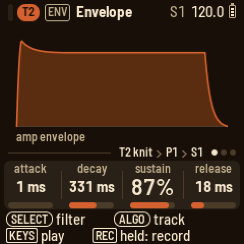 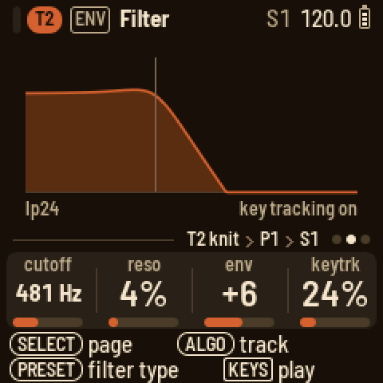 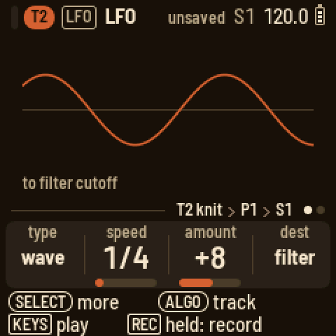

**ENV** has the amp envelope, then the filter: cutoff in Hz, resonance, envelope amount and key tracking,
with **PRESETS** turning the type (lp24, ladder, lp12, hp12, dynamic, bp12; on a synth track dynamic is no
filter); then the filter's envelope.
**FX** has the track's character (below), then its sends to FX I and FX II, its pan and its level, then the two
effects. **LFO** has the
type and its first three knobs; page 2 its fourth and fifth. A new type starts from its own defaults:

| Type | Page 1 | Page 2 |
| --- | --- | --- |
| wave | speed, amount, destination | parameter, shape |
| drift | speed, amount, destination | parameter, envelope |
| wobble | speed, vibrato, volume | envelope, shape |
| pump | source, amount, hold | release |

The speed knob is synced from 2/1 to 1/64 turned left, and free in Hz turned right. The destination is a
module, and the parameter one of its four: synth (the engine's four knobs), envelope (attack, decay, sustain,
release), filter (cutoff, resonance, envelope, key tracking) or voice (volume, pitch, pan, character). A
destination with "free" after it runs on without restarting on each note.

### Character

Every voice of a synth track has an effect of its own after the filter, before the sends: its character.
Each voice is shaped on its own, so a chord driven hard stays a chord. Press **FX**: the Character page shows
the type, what it does and a picture of it: the curve a sample goes through, or what it does to a wave. The
faint line is the sound without it. **PRESETS** turns the type. The knobs are type, amount, tone and mix (dry
to wet); at mix 0 it is off. The factory presets each have their own, so a preset is a whole sound.

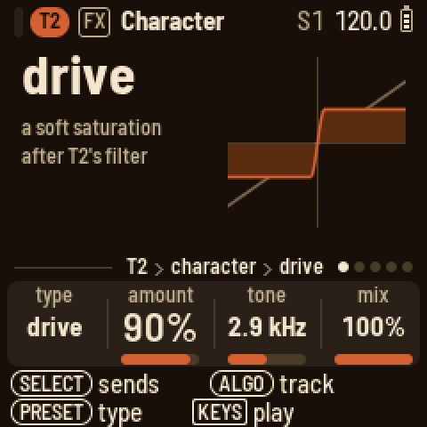

| Type | Amount | Tone |
| --- | --- | --- |
| off | | |
| drive | how hard it saturates (the level stays) | a low-pass after it, 400 Hz to 20 kHz |
| fold | how far the wave folds over (the level stays) | the bias: off the middle, it folds one side more |
| crush | how far it falls | which falls: left the sample rate, right the bits, the middle both |
| ring | how deep the ring modulation | the ratio of the ring's sine to the note, 0.25:1 to 7:1 |
| tilt | the pivot, 150 Hz to 6 kHz | the tilt: left darker, right brighter, 6 dB each side at the ends |
| tape | worn tape: saturation, and a wow on the pitch that deepens with it | the roll-off of the top, 1.5 to 18 kHz |
| sampler | an old sampler's grain: a lower rate and fewer bits | its output filter, 2 to 20 kHz |

Lock the amount, tone or mix on a step like any knob (hold the step, press **FX**). The LFO reaches the amount:
the voice module's fourth knob, "character". On a kit the character is the whole kit's, after its bus filter
(the keys' sends are taken before it); its ring is a ratio of C4, its tape has no wow.

## Players

Press **ARP**. **KNOB 1** picks the player: off, arp, strum or hold.

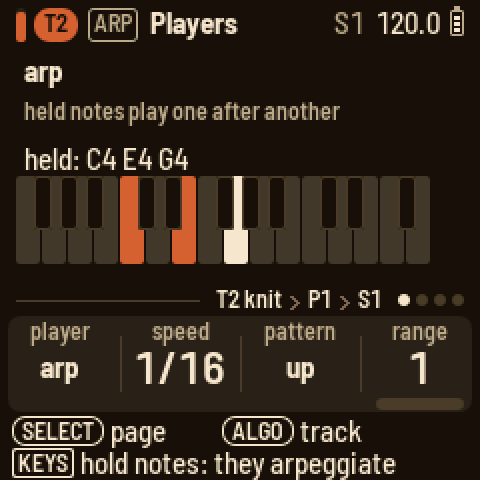

- **arp** plays the held notes one after another: speed (1/4 to 1/64, with triplets), pattern (up, down, up
  down 1, up down 2, as played, random) and range on page 1; page 2 has the note length, a style, glide and
  stereo; page 3 is hold.
- **strum** plays a chord from one key, built on that key in the conductor's key and scale: a triad at first,
  so the white keys in C major give C, Dm, Em, F, G, Am and Bdim (the harmonic field). Hold keys together, up to
  eight, and they become the chord (they sound as you hold them); from then on one key plays that chord moved
  along the scale (a C7 gives Dm7 on D, G7 on G: a note outside the scale keeps its place). A key outside the
  scale plays the chord as you held it, moved there as it is. Roll strums it, up to one note per step.
- **hold** keeps the notes you play until the next.

The arp and the strum play the track's steps too. A step's notes are arpeggiated for as long as the step lasts
(give it a longer **LENGTH** for more notes), together with any keys you hold. A step with a chord is strummed
in the strum's direction and roll, every note ending with the step; a step with one note strums the strum's
chord from that note, as a key does. Changing the player, or turning its hold off with no key down, lets go of
what it was holding.

## Arrange, scenes and the song

Press **HOME**. Each row is a track with its pattern and a playhead, and at its left a small meter of what it plays;
muted tracks are dimmed. The scene's
number is at the right, with the next one when a scene is cued, the beats until it starts and its key
blinking. The 16 white keys are scenes 1 to 16; **OCT+** puts 17 to 32 on them (**OCT−** back; the dots at the
right show all 32, a mark beside the rows the keys have now, and the keys follow the scene playing). Stopped, a
press switches at once. Playing, the scene
starts at the next bar line; press its key again to switch at once, or press the scene playing to take
the cue back. **SEL**'s SCENES SWITCH set to "pattern end" makes a key wait for the end of T1's pattern
instead: the tracks can have different lengths and drift apart, so T1's pattern is the scene's length (on a
64-step T1, up to four bars). Turning **PRESETS** cues the next scene for the bar the same way. An empty scene
becomes a copy of the scene playing. Hold a white key for a second to clear that scene. The black keys
mute: 1 to 8 the tracks, 9 and 10 the conductor and the throws. A kit track's black key mutes it when you let go;
hold it instead and press white keys 1 to 11 to mute that kit's sounds one by one (lit: playing), in this scene
(every kit track's sound alike; the row says how many are off). A muted sound still drives the pump; its key
still plays when you press it. Hold **HOME** and turn **PRESETS** to change scenes
from any page.

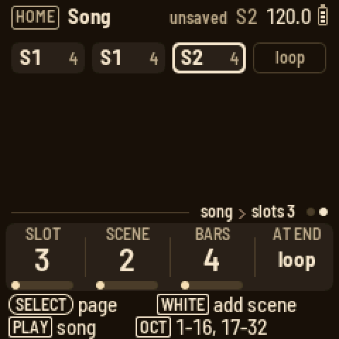

**KNOB 1** is the tempo (hold **HOME** for tenths), **KNOB 2** the groove type (swing, lilt, weave,
stretch, drunk, jitter, accent, lazy, push pull, sway, swell), **KNOB 3** the
selected track's groove amount from −99 to 99, and **KNOB 4** the selected track's pattern in this scene ("T2 PAT";
**ALGORITHM** picks the track; playing, it comes at the track's next bar line): a scene's patterns, track by
track, without leaving Arrange. The click is on **REC**'s knobs.

Turn **SELECT** for the Song page. Press a white key to add that scene after the slot picked (**OCT+**: scenes 17
to 32); the knobs move
to the new slot, which plays as many bars as the one before it (the first: four). **KNOB 1** picks the slot,
**KNOB 2** changes its scene, **KNOB 3** how many bars it plays (1 to 64; a bar is 16 sixteenths, whatever the
patterns' lengths, so a 64-step pattern takes four), and **KNOB 4** whether the song loops or stops at the end.
**PLAY** on the Song page plays the song from the slot picked; **SEL**'s PLAY SONG plays it from the top. As it
plays, a bar along the playing slot's foot fills over its bars. **SEL** also inserts the scene playing, deletes
a slot or clears the song.

## The aux tracks

Turn **ALGORITHM** past T8. Each aux track has its own page under **EDIT** and its own steps under **SEQ**.

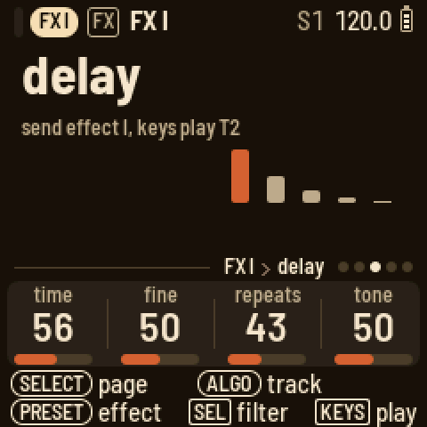 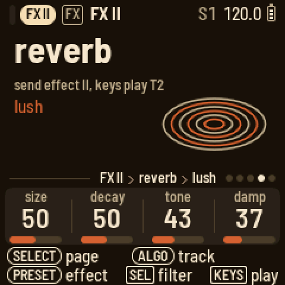

- **COND** (the conductor): key, scale and link, an instrument track that also plays the conductor's keys. Play a
  chord on its keys: the tracks that follow move to it. Its steps hold the chords you played: press **SEQ** and a
  white key. Set the track scale to 4 so a step is a beat, or 16 for a bar. Page 2 is the routing: black keys 1 to
  8 toggle a track. Its **SEL** list sets how each track follows, diatonic or transpose only. Drum tracks never
  follow.

  Page 3, **Follow**, takes the chords from a track instead: press its black key (again: off), or turn
  **KNOB 1**. Each note that track plays, its lowest on a step or among the keys held, sets the chord, so a chord
  part or a bass line leads the others. The note's place in the scale counts, not its octave, and the others move
  the nearer way (in C major, a G takes them down a fourth, an F up a fourth). The track itself plays as written
  and follows nothing; muted, it still leads. While a track leads, the conductor's own steps rest; its keys still
  change the chord until the track's next note. A kit has no notes to lead with.
- **WEAVE** (the weaves): its white keys 1 to 10 weave T1 to T8, COND and THROW while held (latch: a tap on, a tap
  off), each as its ARP's Weave page sets it; REC records them onto its steps. See Weave, above.
- **THROW** (the throws): the keys fire the throws on the drum tracks (lower octave) and the melodic tracks
  (upper octave). Slice tracks count as drums: their fills play the pattern's own slices (the one on the
  downbeat as the kick, the backbeat's as the snare, an off-beat's as the hat), and octave takes them up. The last one you played is the one a step writes. **KNOB 1** is latch: a key then
  toggles its effect.

| Key of the octave | Effect |
| --- | --- |
| white 1 | mute: silences the group |
| white 2 | stutter: a fast loop from where the throw starts |
| white 3 | repeat: a slow loop |
| white 4 | echo: the loop repeats and fades |
| white 5 | build: a fill that builds |
| white 6 | floor: four on the floor |
| white 7 | jumble: a random fill |
| black 1 | warble: high-passed drums, vibrato on melodic notes |
| black 2 | pan: the sounds move across the field |
| black 3 | octave: drums an octave up, melodic tracks an octave down |
| black 4 | chop: short notes |
| black 5 | ring: long notes |

  Let a loop throw (stutter, repeat, echo) go and the track comes back in time, at the step it would be at had it
  never looped. **GLO**'s **SEL** list, LOOP THROWS "drift", leaves it where the loop left it instead: out of step
  with the others, until a scene or the transport sets it straight.

  From any track, **FX**'s last page, Throws, has the same keys and the latch.

- **FX I** and **FX II**: a send effect each: chorus, delay, lofi, phaser or reverb, with its
  four knobs. Press **FX** and turn **SELECT** to reach them from any track: **PRESETS** picks the effect, and
  **SEL** has its high-pass, low-pass and, on FX I, the send into FX II (a new project's high-passes keep the
  lows dry: the echoes from about 130 Hz, the reverb from about 230 Hz). The keys play the track you were on.
  Turned to with **ALGORITHM**, they have the same knobs on **EDIT**.

| Effect | Knobs |
| --- | --- |
| chorus | rate, depth, feedback, width |
| delay | time, fine, repeats, tone (how bright the repeats are) |
| lofi | rate, bits, smooth, width |
| phaser | freq, depth, rate, feedback |
| reverb, plate | size, motion, tone, damp (how fast the tail darkens) |
| reverb, the other modes (lush too) | size, decay, tone, damp |

  The effects return only what they make: the track's own sound stays on the track.

  The reverb has eleven modes, and **PRESETS** walks through them after the phaser: **plate**, LOOM-8's own;
  nine from the PlayStation's sound chip, the reverbs its games used: **room**, **studio S**, **studio M**,
  **studio L** (small, medium, large), **hall**, **half echo**, **space echo**, **chaos echo** (it almost never
  stops) and **one echo** (a single repeat); and **lush**, a smooth, wide plate (based on Jon Dattorro's), the
  reverb of a new project. The console's keep its grain: they run at half the sample rate, as lush does.
  On these, **size** stretches their delays, from small and metallic at 0 to the console's own at the top (the
  new mode's starting point); **decay** sets how long the tail lasts, the console's own in the middle;
  **tone** darkens the tail below the middle and thins it above; **damp** softens the reflections. Changing
  the mode empties the reverb for a moment. On **lush**, **size** also lengthens the gap before the tail, and
  **damp** darkens the tail as it fades. Only FX II has the reverb: FX I has the delay's memory instead.

## Mix and master

Press **GLO**. The Mix page shows a meter for each track. A black key picks its track: a tap mutes or unmutes
it, and holding it solos the track until you let go. The knobs are the sends to FX I and FX II, the pan and the
level (a drum track's sends are its keys': **FX**, Sends). Turn **SELECT** for Master EQ (low, mid and high; 64 is flat), Master color (below) and
Master out (the drums' level, the melodic tracks' level, the compressor and the pump; its **SEL** list has
what the pump follows, its release and accent, and the output level). Setup's knobs are the lights, sending MIDI
clock, sending MIDI notes (over USB: each track on its own channel, T1 on 1 to T8 on 8 in a new project; a track's
**SEL** list on its sound pages has MIDI CHANNEL, off or 1 to 16, which also picks the track for notes coming in on
that channel) and the theme (tape deck or blueprint); the page also says where the tempo comes from
(LOOM-8, or a MIDI clock coming in), the USB audio level, the autosave and the version, and **GLO**'s **SEL** list
sets the USB audio level, LOOP THROWS and AUTOSAVE. The header shows the scene playing ("S3") before the tempo, on
every page. The projects are on **HOME**'s **SEL** list; the count-in is on **REC**'s knobs.

**Master color** gives the whole mix a colour after the EQ: **color** picks it, **amount**, **tone** and **mix**
shape it. **tape** is worn tape: a slow wow and a quick flutter on the pitch (more with the amount), a soft
saturation and a gentle roll-off of the top (tone: where it starts, 1.5 to 18 kHz). **sampler** is an old
sampler's grain: the mix held at a lower rate and fewer bits (amount: 26 kHz and 14 bits down to 11 kHz and 11
bits), then its filter (tone). **off** (a new project's) leaves the mix as it is. The same two are on each
synth track's Character page, for one sound.

**Pump** (Master out's fourth knob) lowers the whole mix each time the kick plays, by up to 24 dB, and lets it
swell back up: the big-beat breathing of house and French touch. Accented kicks pump harder. It works even with
comp at 0, and even when the kick is muted, so a silent kick can drive it: write a kick on a track, mute it, and
the mix breathes to a beat nobody hears. At 0 (a new project's) it is off. Its **SEL** list:

- **pump by**: what drives it. **kick** is any kick of a kit (black key 1, or any key with the kick model);
  **T1** to **T8** is any note on that track (a bass, a chord, a muted ghost track); **metronome** is the
  click, on every beat while it sounds.
- **release**: how fast the mix swells back, 10 ms to 1.5 s (107 ms to start with). Longer releases breathe
  across the beat; short ones only nick the kick's tail.
- **accent**: on, a hit pumps by its velocity (a soft one about half as deep as a full one); off, every hit
  pumps fully.
- **level**: the output level, the drive into the limiter (100 is unity).

The pump is the whole mix's; a track's own pump LFO (above) still ducks just that track, for a bass that gets
out of the kick's way while the rest plays on.

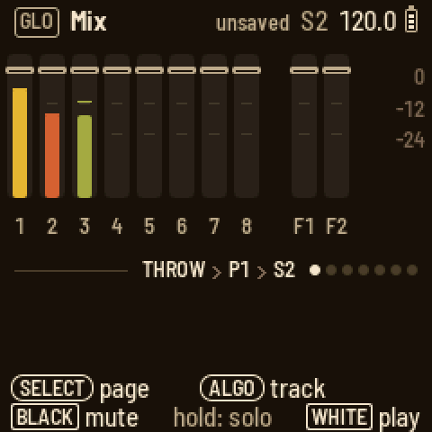 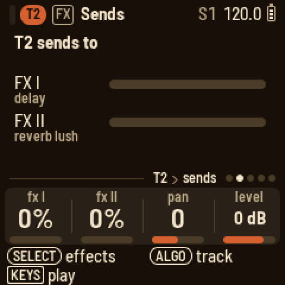 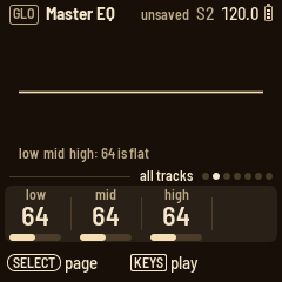 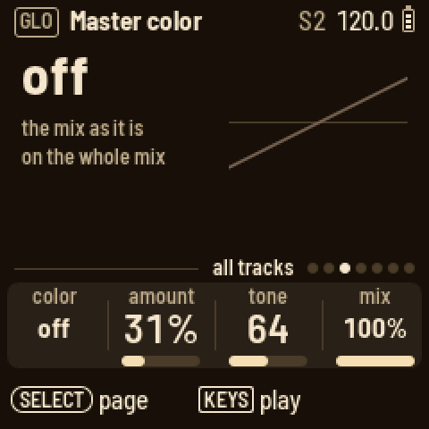

## Saving

At power-on LOOM-8 opens the project you saved or loaded last. It saves by itself: three seconds after your last change, once it is stopped and silent (writing to the
flash would cut the sound). The header says "unsaved" and **SAVE** lights until then. Press **SAVE** to save at
once. To save to another slot, hold **SAVE** and press white key 1 to 3, or use **HOME**'s **SEL** list: SAVE TO
(turn **ALGORITHM** to the slot); LOOM-8 asks first if the slot holds another project. NEW PROJECT starts in the
first empty slot; when all three are taken it has none, and waits for SAVE TO before it saves. To save only when you
press **SAVE**, set AUTOSAVE to off in **GLO**'s **SEL** list (Setup shows it); a new project keeps the choice.

A new project starts with a band picked at random from the factory presets: the kit on T1, then a bass (mono), a
polyphonic synth, a pad, a mono lead, keys, an effect and a pluck or bell on T2 to T8, every track following the
conductor. RANDOMIZE PRESETS on **HOME**'s **SEL** list picks another band for T2 to T8 (it asks first); the
patterns, the kit and the mix stay. A project saves every knob as you left it, not the preset it came from.

**Projects have no names.** A project is its slot: LOAD PROJECT and SAVE TO show Proj 1, Proj 2 and Proj 3
(and which are empty).

**Backup.** To keep the three projects and the user presets on a computer, and put them back later, open
<https://charlesvestal.github.io/fm1-loom/backup/> in Chrome or Edge with the FM-1 connected by USB (or run
`python3 base/tools/fm1_backup.py backup FILE --magic LM8B` from the firmware's folder; `restore FILE` puts it back). A backup holds them as saved: save first what you
want in it. Putting one back replaces all three projects and the presets; LOOM-8 asks first, on its screen
(**SEL** yes, **HOME** no), and only while stopped. Your own samples are not in a backup: keep their WAV files,
and load them again on the Samples page.

On a sound page, hold **SAVE** and press white key 1 to 16 to keep the track's sound as that user preset.

## Page by page

| Button | Page | KNOB 1 | KNOB 2 | KNOB 3 | KNOB 4 | Keys |
| --- | --- | --- | --- | --- | --- | --- |
| HOME | Arrange | tempo | groove | amount | the track's pattern | white: scenes, black: mutes; SEL: load, save to, new project, randomize presets, the song, when scenes switch |
| HOME, SELECT | Song | slot | scene | bars | at end | white: add a scene |
| SEQ | Steps | pattern | length | scale | groove | white: steps, black: sound (drums); SEQ held: a keyboard |
| SEQ, a step held | Steps | velocity | length | chance | pitch | white: length, black: sounds |
| SEQ, a step held + ARP | Steps | trick 1 | its value | trick 2 | its value | |
| SEQ, SELECT | Bar | quant | note | groove | shape | black: scale |
| EDIT | Engine | the engine's four | | | | play |
| EDIT, SELECT | Play | mode | porta | bend | volume | play |
| EDIT, SELECT twice | Play 2 | octave | | | | play |
| EDIT, SELECT 3 times (knit) | Sub | osc 2 | level | sub | noise | play |
| EDIT, SELECT 3 times (rayon) | Sub | fall | floor | keyscale | | play |
| EDIT, drum track | Engine, Key, Sends | the key's knobs; model, random, pan, volume; its fx I, fx II | | | | black: the key |
| ENV | Envelope | attack | decay | sustain | release | play |
| ENV, SELECT | Filter | cutoff | reso | env | keytrack | play; PRESETS: the type |
| ENV, SELECT twice | Filter env | attack | decay | sustain | release | play |
| ENV, drum track | Envelope | the key's attack | hold | decay | lag | black: the key |
| ENV, drum track, SELECT | Filter | the key's cutoff | reso | env | drive | black: the key; PRESETS: the type |
| ENV, drum track, SELECT twice | Kit env | lag | attack | random | length | play |
| ENV, drum track, SELECT 3 times | Kit filter | low cut | comp | drive | hi cut | play; PRESETS: on or off |
| FX | Character | type | amount | tone | mix | play; PRESETS: the type |
| FX, SELECT | Sends | fx I | fx II | pan | level | play |
| FX, SELECT twice | FX I, FX II | the effect's four | | | | play; PRESETS: the effect (and the reverb's mode) |
| FX, SELECT four times | Throws | latch | | | | low: drum throws, high: melodic throws |
| LFO | LFO | type | the type's three | | | play |
| LFO, SELECT | LFO 2 | the type's fourth and fifth | | | | play |
| ARP | Players | player | its first | its second | its third | play, through the player |
| ARP, SELECT | Players 2, Hold | the arp's length, style, glide, stereo; hold | | | | play |
| ARP, SELECT (last) | Weave | with | pattern | rule | plays | black: the track woven in, white: its pattern; SEL: KEEP AS PATTERN |
| GLO | Mix | FX I | FX II | pan | level | black: a tap mutes, held: solo |
| GLO, SELECT | Master EQ | low | mid | high | | |
| GLO, SELECT | Master color | color | amount | tone | mix | |
| GLO, SELECT | Master out | drums | melodic | comp | pump | SEL: pump by, release, accent, level |
| GLO, SELECT | Setup | lights | clock | notes | theme | SEL: USB audio |

The aux tracks' **EDIT** pages: COND has key, scale and link, page 2 the routing (black keys toggle a track) and
page 3 Follow (**KNOB 1**, or a black key: the track the chords come from); THROW has latch; WEAVE has latch; FX I
and FX II have the effect's four knobs, and on page 2 hp, lp and the send to FX II.

## Screen reader

Connect the FM-1 by USB and open https://charlesvestal.github.io/fm1-reader/ in Chrome or Edge. LOOM-8 says
each page, knob value, step, scene and message as it changes, and the whole screen when you ask. The words
it uses are published with this site, so every version reads its own screen correctly.

## Credits

LOOM-8's way of working owes a great deal to teenage engineering's OP-XY; LOOM-8 is not affiliated with
teenage engineering. Built on fm1-base and felucca-bsp, from Felucca by Leo Kuroshita (Hügelton Instruments),
with Polly's menus and X0X's sequencer discipline. Cane and voile
are Mutable Instruments Braids by Émilie Gillet (MIT); the reverb's PlayStation modes are PSXVerb's. The factory
breaks are free loops by u/FCTRYBEATS, the 909 drums renders of 9W9, and the recorded instruments from the
Versilian Studios Chamber Orchestra 2 Community Edition (CC0).
